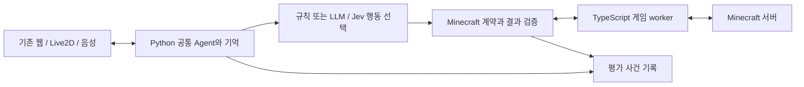

# AIRI 재사용 계획과 현재 저장소 점검

조사일: 2026-10-29. 이 문서는 소스 조사 결과와 구현 제안이다. AIRI 통합이나 Minecraft 플레이를 완료했다는 실행 보고가 아니다.

10월 30일 후속: 아래 P0 표는 조사 당시 상태다. 현재 로컬 변경에서는 연결별 Agent 분리와 credential redaction·설정 전체 로깅 축소를 수정하고 회귀 검사를 수행했다. 서강이 별도 화면의 후속 실행 결과와 남은 한계는 [작업 기록](sogangi-progress.md)을 참고한다. 이 변경은 아직 main 공유나 사용자 인증·디스크 기록 권한 분리 완료를 뜻하지 않는다.

## 확인한 작업 상태

- 작업 브랜치: `work/local-experiments`. 기준 커밋 `648f8bf016bbf22ae16c4eaec3750ac03d57bed2`이며 조사 시점의 `origin/main`과 커밋 차이는 없다.
- 로컬 실행 수정, 스크립트, 설계 문서는 아직 커밋 전이다. 브랜치가 main과 같은 커밋을 가리켜도 이 수정들이 main에 공유된 것은 아니다.
- AIRI는 팀 저장소 밖 `../reference-sources/airi`에 shallow/sparse clone했다. Minecraft와 관련 서버·코어 패키지를 중심으로 체크아웃했다. 팀 저장소에 AIRI 전체를 복사하거나 합치지 않았다.
- AIRI 원본: `https://github.com/moeru-ai/airi.git`, 고정 SHA `6399a0f158255254343f0e44cb9c51b3627e9be6`. 루트 package 버전 `0.13.1`, packageManager `pnpm@11.24.0`.
- AIRI 의존성 설치와 실행은 하지 않았다. 이번 셸에서는 Node/pnpm 실행 파일도 찾지 못했다. sparse checkout은 재현 실행 환경이 아니므로 전체 workspace 의존성을 포함한 설치 준비가 별도로 필요하다.

## 현재 Open-LLM-VTuber에 대한 피드백

음성 대화 시제품의 출발점으로는 적합하다. Python의 ASR→Agent→TTS와 웹/Live2D 출력을 유지하면서 게임을 붙일 수 있다. 기존 Windows 실행 결과는 [첫 실행 기록](local-first-run.md)에 있다. 실제 마이크·스피커·화면 확인과 AIRI 게임 실행은 그 기록으로 증명되지 않는다.

| 우선순위 | 소스에서 확인한 상태 | 다음 작업과 완료 기준 |
| --- | --- | --- |
| P0: 연결별 상태 | `websocket_handler.py:_init_service_context`는 설정을 deep copy하지만 동일한 `default_context_cache.agent_engine`을 전달한다. `service_context.py:load_cache`는 이를 그대로 대입한다. `BasicMemoryAgent`는 가변 `_memory`를 가진다. | 공유 가능한 모델 클라이언트와 연결별 Agent/대화 상태를 구분한다. 두 연결의 동시 대화·기록 전환·중단에서 기억이 섞이지 않는 통합 검증을 추가한다. 현재 판정은 소스의 참조 공유 확인이며 실제 교차 대화 재현은 하지 않았다. |
| P0: 설정 로그 | `ServiceContext.__str__`는 agent 설정의 `model_dump()`를 문자열로 만든다. `load_cache`와 설정 전환에서도 설정을 DEBUG로 기록한다. `run_server.py`는 파일 로그를 DEBUG로 저장한다. | 키·토큰을 구조적으로 가리고 설정 객체 전체 로깅을 없앤다. 가짜 식별용 키로 연결·전환·오류를 발생시켜 로그에 원문이 없는지 확인한다. 실제 키를 읽어 출력하는 방식으로 검사하지 않는다. |
| P1: 실행 수정 공유 | edge-tts 최소 버전 7.3.1, uvicorn 최소 버전 0.35.0, `websockets-sansio` 선택과 실행 스크립트가 로컬에 있다. | 이 변경을 검토 가능한 커밋으로 묶고 깨끗한 체크아웃에서 실행을 재현한다. 현재 main에 반영된 변경으로 소개하지 않는다. |
| P1: 기억과 평가 | 기본 Agent의 대화 목록과 `chat_history` JSON이 중심이다. 목표로 하는 선별 기억·페르소나 행동 평가·Jev 연결은 아직 구현되지 않았다. | 사용자/캐릭터/세션/월드별 소유 범위와 평가 사건 형식을 먼저 정한다. RAG나 DB 제품 선택만으로 이 문제가 해결되지는 않는다. |
| P1: 프론트엔드 | 현재 브랜치는 빌드된 frontend submodule을 사용한다. 편집 가능한 소스는 별도 `origin/feat/frontend-source`에 있다. | UI 작업 전에 그 브랜치의 빌드·타입 검사·라이선스를 별도로 검토하고 가져온다. 해당 브랜치의 기능을 현재 브랜치 기능으로 취급하지 않는다. |
| P1: AWS/Docker | Dockerfile은 있으나 이 Windows 실행이 컨테이너 배포 검증을 대신하지 않는다. 선언된 VOLUME은 conf/models이며 대화 기록은 별도 영속 경로가 필요하다. | 컨테이너 listen 주소, 인증과 원격 마이크를 위한 HTTPS, 키 주입, 기록 volume, 재시작 복구를 검증한다. `.dockerignore`는 현재 `conf.yaml`과 로그를 제외한다. |

P0 두 항목을 먼저 다루고, 한 봇에서 관측과 행동 결과를 연결한 다음 기억·페르소나 평가를 확장하는 순서를 제안한다. 이번 조사에서는 이 결함들을 수정하지 않았다.

## AIRI에서 가져올 경계

확인한 AIRI 경로는 아래와 같다. 모든 경로는 위 SHA 기준이다.

| AIRI 소스 | 재사용 제안 |
| --- | --- |
| `integrations/minecraft/src/skills/{base,blocks,inventory,movement,combat,crafting}.ts` | 이동·채집·식사부터 의존성을 추려 작은 TS 실행 worker에 이식한다. 스킬별 전제 조건·실패·중단 동작을 확인한다. Python으로 전부 번역하지 않는다. |
| `integrations/minecraft/src/cognitive/perception/` | 월드 사건을 관측으로 정규화하는 구조를 참고한다. 처음부터 전체 인지 파이프라인을 복사하지 않는다. |
| `integrations/minecraft/src/cognitive/reflex/` | 위험 대응의 우선순위와 일반 행동을 중단하는 개념을 참고한다. 생존 개입도 평가 로그에 남긴다. |
| `integrations/minecraft/src/cognitive/{index,container}.ts` | 현재 결합 지점 조사에 사용한다. AIRI client, brain, reflex manager, task executor가 함께 조립되므로 폴더만 복사해서 독립 실행할 수 없다. |
| `packages/server-{sdk,shared,runtime}` | AIRI 자체 연결 방식의 참고 자료다. 우리 worker 계약에 필요한 부분만 판단하고 AIRI 서버 전체를 필수 의존성으로 만들지 않는다. |

현재 Minecraft 패키지는 Mineflayer 플러그인뿐 아니라 `workspace:*`, `catalog:` 의존성, LLM 호출, DI, `isolated-vm`, `canvas` 등을 사용한다. 첫 단계에서 원래의 전체 planner를 실행하는 방식은 설치 범위와 제어 주체를 모두 늘린다. 스킬의 실제 import 연결을 확인한 뒤 필요한 의존성만 독립 package manifest에 고정해야 한다.

**현재 AIRI README는 Mineflayer 런타임을 Fabric 기반으로 교체할 예정이라고 명시한다.** 단기 시제품은 Mineflayer로 시작하되, 공통 Agent가 Mineflayer 객체나 좌표 라이브러리를 직접 알지 않게 한다. 장기 런타임 선택은 한 봇 검증 결과와 Fabric 구현 상태를 보고 결정한다.

## 제안하는 연결 구조

LLM은 대화와 목표 계획을 맡고, 규칙/LLM/Jev는 실행 가능한 후보 중 행동을 고른다. 후보 생성과 성공 판정은 게임 상태를 읽는 코드가 맡는다. 일반 행동의 결정 주체는 하나로 둔다. AIRI의 기존 planner와 우리 Agent를 동시에 켜서 서로 다른 명령을 내리게 하지 않는다. 위험 대응은 일반 행동을 중단하고 그 이유를 기록한다.

첫 구현의 제안 위치는 Python `src/open_llm_vtuber/integrations/minecraft/`와 별도 TS package `integrations/minecraft-worker/`다. 아직 생성한 구현 폴더는 아니며 기존 Agent/도구 호출 경계를 조사한 뒤 확정한다.

### 먼저 고정할 계약

아래는 우리의 설계안이며 AIRI에 이미 존재하는 API 명세가 아니다.

- 공통 식별자: `agent_id`, `world_id`, `request_id`, `state_version`.
- Observation: 관측 시각, 위치, 체력·허기, 인벤토리, 관측 범위 내 대상. 런타임 전용 객체 대신 JSON으로 전달한다.
- Candidate: 안정적인 행동 ID, 인자, 실행 전제 조건과 근거. 성격은 유효한 후보의 선호를 조절하고 필수 조건을 무시하지 않는다.
- ActionRequest: 선택한 후보 ID, 기대 상태 버전, 제한 시간. 재전송 시 중복 실행 여부를 명시한다.
- ActionResult: 성공/실패/취소, 이유, 전후 상태의 근거. 타임아웃·접속 종료·리스폰도 처리한다. 문장으로 “완료”라고 답한 것만으로 성공 처리하지 않는다.
- 인터럽트: `cancel(request_id)`의 확인 응답을 정의한다. 우선 이동·채집·식사는 동시에 하나만 실행하고 위험 대응이 선점한다.

Jev는 의사결정 후보를 선택하는 비교 구현으로 붙인다. 키·API 버전·비용·실제 지연은 아직 검증하지 않았다. 우선 규칙 또는 기존 LLM로 동일 계약을 통과시킨 뒤, 같은 관측과 후보를 쓰는 Jev 구현과 비교한다.

## 구현 순서와 종료 기준

| 단계 | 구현 범위 | 확인할 결과 |
| --- | --- | --- |
| 0. 기반 정리 | 연결별 Agent 상태, 로그 마스킹, 현재 실행 수정 정리 | 두 연결 격리, 가짜 키 로그 검사, 현재 음성 대화 회귀 확인 |
| 1. 한 봇 연결 | worker 실행 환경과 Minecraft 버전 고정, 로그인·관측·종료 | 실제 서버에 한 봇 접속, 상태 JSON 수신, 종료·재접속 결과 기록 |
| 2. 세 가지 행동 | 이동·나무 채집·음식 먹기, 제한 시간·취소·실패 | 실제 위치/아이템 수/허기 변화로 성공 판정. 음식 없음·갈 수 없음·중단도 확인 |
| 3. 공통 Agent 연결 | 기존 Agent 도구 경계에 목표→후보→선택→결과 연결 | 음성 또는 텍스트 명령이 게임 행동과 발화로 이어지고 같은 request_id로 추적 가능 |
| 4. 페르소나와 Jev 비교 | 두 페르소나, 고정된 관측·후보, 비교 정책, 평가 리포트 | 성격 차이와 과제 성공률을 별도로 측정. 정책·프롬프트·상태·시드·오류 기록 |
| 5. 운영과 확장 | 기억 지속, Docker/AWS, 2개 봇 이후 8개 | 재시작 후 기억 복원, 상태 격리, API 예산·게임 tick·자원 사용 확인 |

첫 행동 과제는 “나무와 음식을 확보하고 돌아오기”로 제안한다. MBTI 이름을 정답으로 삼기보다 계획 유지·새 사건에 반응·위험 감수·도움 행동 같은 축을 먼저 정의한다. 환경과 스킬 능력을 같게 두고 여러 시드에서 반복한다. 생존에 꼭 필요한 식사를 못 하는 버그를 P 성향의 증거로 세지 않는다. 대화는 고정 질문에 대한 블라인드 평가, 행동은 실제 사건·소요 시간·목표 누락·재계획·성공률로 평가한다.

처음에는 JSONL 사건으로 충분하다. 원문 대화나 API 키를 리포트에 싣지 않고, 정책 비교에 필요한 상태·행동·결과·버전만 남긴다. 지속 기억은 최근 대화/에피소드 요약/장기 사실을 구분하고 정정·삭제·소유 범위를 먼저 정한다.

## 공개 프로젝트 재사용 후보

개인 계정에서 시작했거나 개인 계정으로 공개한 관련 사례다. 전체 기능을 로컬에서 실행 검증한 목록은 아니며, 프로젝트 README/NOTICE/라이선스와 메타데이터를 확인했다. 모든 후보가 Open-LLM-VTuber 또는 AIRI의 파생작인 것은 아니다.

| 프로젝트와 조사 SHA | 관계와 참고할 부분 | 재사용 판단 |
| --- | --- | --- |
| [inni918/warashi](https://github.com/inni918/warashi), `8c71103978dbd34b8595af34eefd14c3028655f6` | README와 NOTICE가 Open-LLM-VTuber 기반임을 명시한다. GitHub fork 플래그는 false다. 캐릭터별 core memory 주입·턴 후 정리·먼저 말 걸기·quiet mode를 추가했다. | 가장 직접적인 참고 대상. `memory_core.py`, `MEMORY_SYSTEM_DESIGN.md`, 대화 훅부터 조사한다. 자체 추가 부분은 NOTICE에서 MIT로 안내하지만 번들 전체는 별도 구성요소 조건이 있다. |
| [mrubens/jevcraft](https://github.com/mrubens/jevcraft), `99d4066de3aa15cb343b59065430698b8aae59b3` | 독립 Minecraft/Jev 프로젝트. 행동 후보, 실행 조정, trial/replay 구조를 참고할 수 있다. | MIT. 의사결정과 평가 부분의 우선 조사 대상. 저자 발표 게임 성과·비용은 우리 환경 검증 결과로 인용하지 않는다. |
| [mindcraft-bots/mindcraft](https://github.com/mindcraft-bots/mindcraft), `e1c1fc3ffa481506c2445fc639e16dba504b5920` | 과거 `kolbytn/mindcraft` 주소에서 현재 조직으로 이동했다. 독립 LLM/Mineflayer 프로젝트로 봇 프로필과 여러 봇 운용을 참고한다. | MIT. 당장 두 번째 게임 프레임워크를 병합하기보다는 다중 봇 단계의 비교 자료로 둔다. |
| [nthclrd/jevcraft](https://github.com/nthclrd/jevcraft), `a7a1dd2b7d65e161df5871af6e2f526e2457b251` | 독립 프로젝트. LLM 전략가와 Jev 행동 선택, 실행 가능한 후보, 경험 기억을 결합한다. | GitHub 라이선스 메타데이터가 없고 루트 LICENSE도 확인되지 않았다. 공개 열람과 코드 재배포 허가는 다르므로 설계 참고로 두고 코드 복사는 보류한다. |

이번 조사에서 검증한 사례를 “Open-LLM-VTuber + AIRI + Jev가 이미 완성된 통합 프로젝트”로 소개할 수는 없다. 가장 짧은 경로는 Open-LLM-VTuber 대화부를 유지하면서 AIRI 스킬 실행을 붙이고, warashi의 기억 처리와 jevcraft의 의사결정·평가를 필요한 단위로 조사하는 것이다.

## 출처와 라이선스 기록

- [AIRI 고정 README](https://github.com/moeru-ai/airi/blob/6399a0f158255254343f0e44cb9c51b3627e9be6/integrations/minecraft/README.md), [package.json](https://github.com/moeru-ai/airi/blob/6399a0f158255254343f0e44cb9c51b3627e9be6/integrations/minecraft/package.json), [MIT LICENSE](https://github.com/moeru-ai/airi/blob/6399a0f158255254343f0e44cb9c51b3627e9be6/LICENSE).
- [warashi NOTICE](https://github.com/inni918/warashi/blob/8c71103978dbd34b8595af34eefd14c3028655f6/NOTICE), [mrubens/jevcraft LICENSE](https://github.com/mrubens/jevcraft/blob/99d4066de3aa15cb343b59065430698b8aae59b3/LICENSE), [Mindcraft LICENSE](https://github.com/mindcraft-bots/mindcraft/blob/e1c1fc3ffa481506c2445fc639e16dba504b5920/LICENSE).
- [Jev 공식 API 개념](https://docs.typesafe.ai/introduction). 실제 계정과 게임 통합은 미검증이다.
- 현재 백엔드 루트는 MIT이나 이를 모든 번들 자산의 조건으로 확대하지 않는다. `origin/feat/frontend-source:frontend/LICENSE`와 [현재 upstream 웹 LICENSE](https://github.com/Open-LLM-VTuber/Open-LLM-VTuber-Web/blob/main/LICENSE)는 Apache 2.0에 추가 조건이 있는 Open-LLM-VTuber License 1.0이다. 개인·교육 용도와 조건에 맞는 방송 수익화는 허용 항목이며, 유료 호스팅·상업 재브랜딩 등은 별도 조건이 명시된다. 현재 빌드 submodule의 정확한 버전별 조건과 Live2D Core·모델·음성 자산도 배포 전에 따로 기록한다.
- 실제 이식 시 원본 URL·고정 SHA·복사 파일·수정 내용·라이선스를 기록하고 필요한 저작권/고지를 보존한다. 설계만 참고한 부분과 복사한 코드를 구분한다.

## 이번 확인 범위

현재 브랜치에서 Ruff 전체 검사와 `uv lock --check --offline`은 통과했다. 소스의 상태 공유·로그 경로를 검토했다. 신규 코드 통합, AIRI 설치·테스트, Minecraft 서버 접속, Jev API 호출, Docker/AWS 실행은 이번에 수행하지 않았다. API를 쓰는 기존 음성 종단 검사는 불필요하게 재실행하지 않았다.
