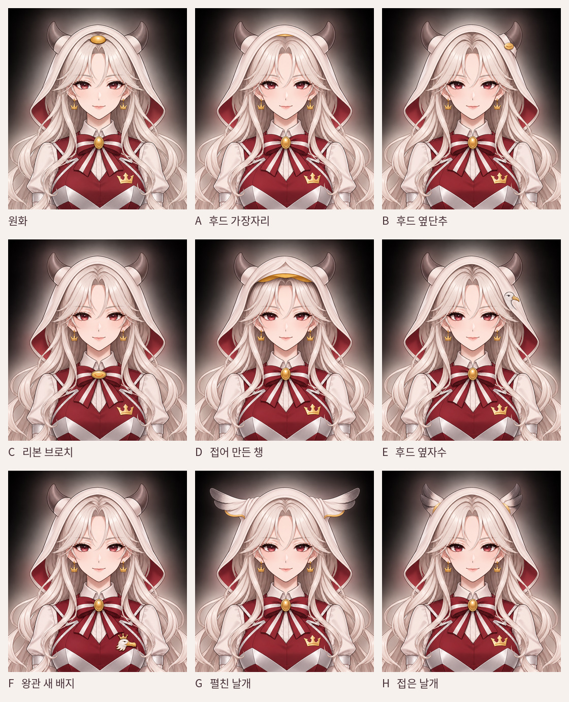

# 강이서 후드와 부리 디자인 리뷰

**방송 기본형으로는 H ‘접은 날개’를 추천한다.** 원화에서 위로 솟던 두 후드 끝을 비슷한 폭 안에서 깃털로 접었다. 이마가 비면서 와인색 눈과 목 리본이 먼저 보이고, 가까이 보면 깃 밑의 노란 안감에서 서강이의 색을 발견할 수 있다. **서강이 부리 특유의 노란 타원까지 알아볼 수 있게 할 때는 B ‘후드 옆단추’가 더 적합하다.**

원화는 강이서 Live2D 제작에 사용한 정면 일러스트다. 공식 서강이의 부리에서 가져온 노란 타원과 가운데가 살짝 내려가는 곡선을 강이서의 후드와 제복에 어떻게 담을지 검토했다. 표정, 은백색 머리, 와인색 눈과 왕관 귀걸이는 각 안의 인상을 비교하는 기준으로 삼았다. [강이서 정면 원화](../ivory-crown-front-base.png) · [전신 설정화](../ivory-crown-concept.png) · [서강대학교 공식 캐릭터](https://www.sogang.ac.kr/ko/symbol/character)

## 이번에 추가한 다섯 안

| 시안 | 디자인 피드백 |
| --- | --- |
| [D · 접어 만든 챙](D-folded-hood-peak.png) | 아이보리 천이 겹쳐지고 그 아래로 노란 안감이 보여서 챙의 구조가 이해된다. 작은 화면에서도 노란 면이 선명하다. 얼굴 쪽으로 시선을 내리려면 양끝을 안쪽으로 접어 보이는 노란 폭을 줄이는 편이 좋다. |
| [E · 후드 옆자수](E-embroidered-albatross.png) | 관자놀이 옆에서 흰 새 목선이 후드 곡선을 따라간다. 가까이서 볼 때 노란 부리까지 알아보기 쉽다. 작게 줄이면 새 목선이 흰 천에 묻히고 부리 끝만 점처럼 남는다. 상반신 일러스트에 어울린다. |
| [F · 왕관 새 배지](F-crown-and-bill-pin.png) | 왕관과 새를 가슴 배지 하나로 묶어 제복의 문장처럼 보인다. 굽은 부리와 날카로운 눈매가 서강이보다 독수리를 연상시킨다. 부리 끝과 눈매를 둥글게 다듬을 여지가 있다. 얼굴만 나오는 구도에서는 배지가 프레임 밖으로 나간다. |
| [G · 펼친 날개](G-swept-wing-hood.png) | 좌우로 뻗은 깃 덕분에 축소해도 날개임을 바로 알아볼 수 있다. 머리 위가 원화보다 넓어져 후드가 강한 인상을 준다. 의상 변화를 보여주는 특별 방송용 실루엣으로 어울린다. |
| [H · 접은 날개](H-folded-wingtips.png) | G의 옆으로 퍼지는 깃을 짧게 접고 원화처럼 위로 세웠다. 회색 끝이 어두운 배경에서 머리 윤곽을 잡고 목 리본의 금색이 중심에 남는다. 노란 안감은 작아져서 알바트로스와의 연결은 주로 날개 윤곽이 전달한다. |

## 앞선 세 안과의 비교

| 시안 | 디자인 피드백 |
| --- | --- |
| [A · 후드 가장자리](A-sewn-hood-edge.png) | 이마 중앙 금색을 가늘게 줄여 원화의 대칭을 살린다. 128px 폭에서는 노란색이 거의 사라져 마스코트의 흔적도 약해진다. |
| [B · 후드 옆단추](B-wing-clasp.png) | 가로 타원과 홈이 회색 후드 끝의 단추로 읽힌다. 원본 부리 형태를 살리면서 이마와 리본에서 금빛 타원이 반복되는 문제를 푼다. 작은 화면에서는 색과 단추 위치가 주로 보인다. |
| [C · 리본 브로치](C-ribbon-clasp.png) | 노란 타원과 주황 곡선이 리본 한가운데 모여 서강이 부리의 인상이 선명하다. 얼굴에 가까이 당겨 리본이 잘리면 이 특징도 사라진다. |

비교판은 아홉 정면 이미지의 같은 영역을 잘라 같은 배율로 배치했다. 각 안은 상반신 너비를 128px로 줄여서도 확인했다. H의 평가와 추천은 정면 정지화 기준이다. 실제 Live2D에서 고개를 돌릴 때 깃이 겹쳐 보이는 정도는 별도 확인이 필요하다.

A–G는 이미지 생성 도구로 강이서 정면 원화를 편집했다. H는 같은 원화와 G의 펼친 날개 시안을 함께 참조했다. [생성 프롬프트](generation-prompts.txt)
