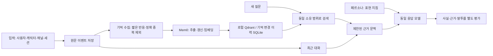

# 대량 대화·장기 기억·페르소나 실험 계획

기준: 2026-11-02, 로컬 `648f8bf` / `feat/persona-memory-foundation`.
이 문서에서 **조사**, **실험 구현**, **앱 적용**을 구분한다. 방송 서비스 연결은 구현하지 않고 많은 채팅이 쌓인 조건을 합성 데이터로 재현한다.

## 1. 기존 코드 조사

| 대상 | 관찰한 현재 동작 | 영향 |
|---|---|---|
| `chat_history_manager.store_message` | `chat_history/{conf_uid}/{history_uid}.json` 전체를 읽고 메시지를 추가한 뒤 전체를 다시 기록 | 데이터가 커질수록 쓰기 비용 증가. DB 트랜잭션·검색 인덱스 없음 |
| `BasicMemoryAgent._memory`, `_to_messages` | 이전 대화를 리스트에 계속 추가하고 매 요청마다 복사하여 전달 | 명시적 문맥 예산·요약·검색·퇴출 정책 없음 |
| `set_memory_from_history` | 선택한 JSON 기록 전체를 작업 기억으로 복원 | 기록을 열면 장기 기억이 검색되는 구조가 아님 |
| `ServiceContext.construct_system_prompt` | `persona_prompt`에 도구/표정 지침을 결합 | 페르소나 비교의 기존 연결점 |
| `ServiceContext.load_cache` | `agent_engine`을 참조로 재사용 | 기존 Agent의 사용자별 격리가 보장된다고 간주할 수 없음 |
| `AgentFactory`의 Mem0 분기 | `mem0_llm.LLM`을 import하지만 해당 파일은 0 byte. 설정 모델과 분기의 요구 필드도 불일치 | `mem0_agent`를 선택하는 것만으로 동작하지 않음 |
| `LettaAgent` | 외부 서버의 agent ID에 메시지 전달. 로컬 기록 복원/중단 처리는 비어 있음 | 장기 기억은 서버 측 구성·검증 필요 |
| `ProxyMessageQueue` | 대기열에 추가하고 순차 전달 | 유입량 제한·중복 제거·우선순위 선택은 별도 설계 필요 |

원본 [Open-LLM-VTuber README](https://github.com/Open-LLM-VTuber/Open-LLM-VTuber)는 v2 재작성 계획도 안내한다. 이번 실험은 팀의 v1 기준 코드를 대상으로 한다. 최신 원본으로 자동 업그레이드하지 않는다.

## 2. 공개 엔진 선택

| 후보 | 역할과 저장 | 이번 판단 |
|---|---|---|
| [Mem0 OSS](https://docs.mem0.ai/open-source/overview) | 대화에서 기억 추출·관리·검색. LLM·임베더·벡터 저장소를 설정 | **우선 검증**. 기억 로직을 새로 작성하지 않고 SDK를 얇게 감싼다 |
| [Letta](https://docs.letta.com/v1-sdk/memory/memory-blocks), [archival memory](https://docs.letta.com/v1-sdk/memory/archival-memory) | 상시 문맥의 memory blocks와 검색 가능한 archival memory | Agent 실행 환경까지 맡길 때 후보. 현재 앱과 책임 중첩 확인 필요 |
| [Qdrant](https://qdrant.tech/documentation/search/hybrid-queries/) | 벡터 검색·필터·검색 결합 | 이번에는 Mem0의 로컬 저장소. 그 자체가 기억 추출 엔진은 아님 |
| [PostgreSQL](https://www.postgresql.org/docs/current/textsearch.html) + [pgvector](https://github.com/pgvector/pgvector) | 원문·메타데이터·전문 검색·벡터를 서버 DB에서 관리 | 동시 쓰기/배포가 필요해질 때 재검토 |
| [SQLite FTS5](https://sqlite.org/fts5.html) | 로컬 트랜잭션과 어휘 검색 | API 없는 재현 기준선. 한국어 단어+2음절 토큰으로 검색. 의미 검색 아님 |

Mem0 OSS를 사용해도 설정한 LLM/임베딩 API의 사용량은 발생한다. 이번 예시는 Gemini 호환 API를 사용하며, Qdrant·기억 변경 이력·대화 원문은 로컬에 저장한다. 따라서 완전한 오프라인 구성으로 설명하지 않는다.

SDK는 **`mem0ai==2.2.1`**로 고정한다. 이 버전의 `search`는 `filters={"user_id": ...}`, `top_k`를 사용한다. 오래된 예제의 호출법을 섞지 않는다. [Mem0 quickstart](https://docs.mem0.ai/open-source/python-quickstart)와 실제 설치 버전의 시그니처를 확인했다. 본 앱의 `uv.lock`은 바꾸지 않고 실험 전용 환경을 둔다.

후속 공개 평가의 데이터 버전·정보 누출 방지·채점 규약은 [벤치마크 프로토콜](memory-benchmark-protocol.md)에 정리했다. LongMemEval-S 전체 검색과 표본 응답 평가를 구분하며, [별도 결과 기록](memory-benchmark-results-2026-11-02.md)에 실제 완료 범위를 남긴다.

## 3. 목표 데이터 흐름

- 원문과 파생 기억을 분리한다. Mem0의 변경 이력 DB는 전체 대화 원문 저장소를 대신하지 않는다.
- `MemoryScope(user_id, character_id, channel_id)`의 조합을 해시한 하나의 Mem0 `user_id`를 사용한다. 세션은 metadata에 기록해 같은 범위의 다른 세션을 검색할 수 있게 한다.
- 공개 채널의 공유 기억은 향후 명시적 별도 소유 범위로 설계한다. 개인 기억을 공개 범위로 자동 복사하지 않는다.
- Persona는 기억 소유권과 분리한다. 실험에서는 세 페르소나가 **동일한 검색 결과**를 받아 표현만 비교한다.
- 생성된 캐릭터 답변을 사용자 사실로 다시 수집하지 않는다. 검색 결과는 시스템 명령으로 승격하지 않고 JSON 데이터로 전달한다. 이 방식만으로 프롬프트 주입 방어가 보장되지는 않는다.
- 문맥 예산은 실험에서 4,000 **문자**다. 모델 토큰 예산과 다르며 실제 앱 연결 시 tokenizer 기반 예산으로 교체한다.

## 4. 구현과 완료 조건

| 단계 | 산출물 / 완료 조건 | 현재 범위 |
|---|---|---|
| A. 기준선·기존 수정 정리 | 기준 커밋, 복구 백업, 기존 저장/Agent 분석 | 이번 작업 |
| B. 독립 재현 실험 | SQLite 원문/어휘 검색, 실제 Mem0 어댑터, 5,000 반응 채팅 | 이번 작업 |
| C. 페르소나 비교 | 최근 8개 / 어휘 RAG / Mem0 × 3 페르소나 × 5 질문. 원문 응답·사용량·오류·검토 CSV | 이번 작업, 1회는 파일럿 |
| D. 현실적인 평가 확장 | 동의받은 비공개 한국어 대화, 잡음/패러프레이즈/정정/삭제/주입. 조건별 3회 이상. 두 명 이상 블라인드 평가 | 후속 |
| E. 앱 연결 | 연결별 Agent/소유권 계약, 비동기 수집·제한 대기열, BasicMemoryAgent에 opt-in 문맥 공급. 기본 기능 회귀 검증 | 최소 연결 구현·오프라인 검증 완료. 영속 수집 대기열·계정 식별·실제 앱 실행은 후속. [현재 상태](rag-runtime.md) |
| F. 검색 개선 | 임베딩/어휘 결합·rerank·시간 가중치·요약 비교. 정확도·지연·토큰 비용을 함께 평가 | D 결과를 보고 선택 |

## 5. 평가 설계와 해석

- 질문: 오래된 선호 회상, 정정된 일정, 두 세션의 정보 결합, 의미가 비슷한 다른 표현, 모르는 개인정보에 대한 응답 보류.
- 잡음: 5,000개의 반복 반응. 다른 사용자·캐릭터·채널의 같은 질문 관련 정보와 assistant의 허구 발화도 포함한다.
- 비교: 최근 문맥 기준선 / SQLite 어휘 검색 / Mem0. **기존 앱의 전체 기록 전달과 최근 8개 기준선은 다르다.** 전체 문맥·요약 방식과의 비교는 추가 실험이다.
- 모델·질문·근거·온도·출력 한도를 통제하고 순서를 고정 seed로 섞는다. 같은 모델의 seed 고정까지 보장하지는 않는다.
- 검색: 근거가 실제 top-k에 포함됐는지 따로 본다. 정답이 원문에 있어도 검색이 실패하면 생성 모델의 사실 정확도와 구분한다.
- 생성: 정답 키워드 그룹 포함률, 금지 개인정보 출현, 지연, API 토큰 사용량을 저장한다. 키워드 포함률은 정확도 판정이 아니며 부정·설명 문장도 오판할 수 있다.
- Persona: 존댓말/반말, 공감, 장난기, 길이를 본다. 원문과 `blind-review.csv`로 사실 정확성(0–2), 근거 충실성(0–2), 온기·장난기·격식(1–5)을 별도로 검토한다. 키워드 수만으로 성격 일치율을 주장하지 않는다.
- 이번 합성 데이터는 일반 성능을 증명하지 않는다. [LongMemEval](https://github.com/xiaowu0162/LongMemEval)의 정보 추출·세션 간 추론·정정·시간·응답 보류 축을 참고했으며 공식 벤치마크 점수는 아니다.

수집 필터의 한계도 기록한다. 길이+정확 중복 필터는 단순 반응을 줄일 뿐, 짧은 중요 사실·변형 스팸·누구에 대한 사실인지·인과 관계·악성 명령을 판별하지 못한다. Mem0가 기억을 바르게 갱신하는지도 출력과 원문으로 검토해야 한다.

## 6. 브랜치와 복원

시작할 때 브랜치 HEAD는 `main` 및 로컬 `origin/main`과 동일한 `648f8bf`였다. 새 커밋이 꼬인 상태가 아니라, 음성/WebSocket 관련 미커밋 변경 11개와 미추적 파일 5개가 있었다.

변경 내용·SHA-256 목록·binary patch를 `tmp/before-memory-study-2026-11-02/`에 저장하고 내용 일치를 확인한 뒤 해당 수정만 기준 커밋으로 복원했다. 로컬 설정·키·모델·기존 대화 파일은 복원 대상이 아니었다. 첫 작업은 실험 모듈과 문서로 제한했고, 이후 사용자가 승인한 [앱 RAG 최소 연결](rag-runtime.md)을 별도로 구현했다.

이 백업은 Git 제외 로컬 파일이므로 다른 PC로 전달되지 않는다. 복원 시 `manifest.json`을 먼저 확인하고 `tracked.patch`를 `git apply --check`로 검사한 뒤 별도 작업에서 적용한다. 미추적 파일 원본은 `files/`와 `archived-untracked/`에 있다. 이전 음성 수정이 제거됐으므로 이번 실험 결과로 앱 음성/마이크 성공을 주장하지 않는다.
