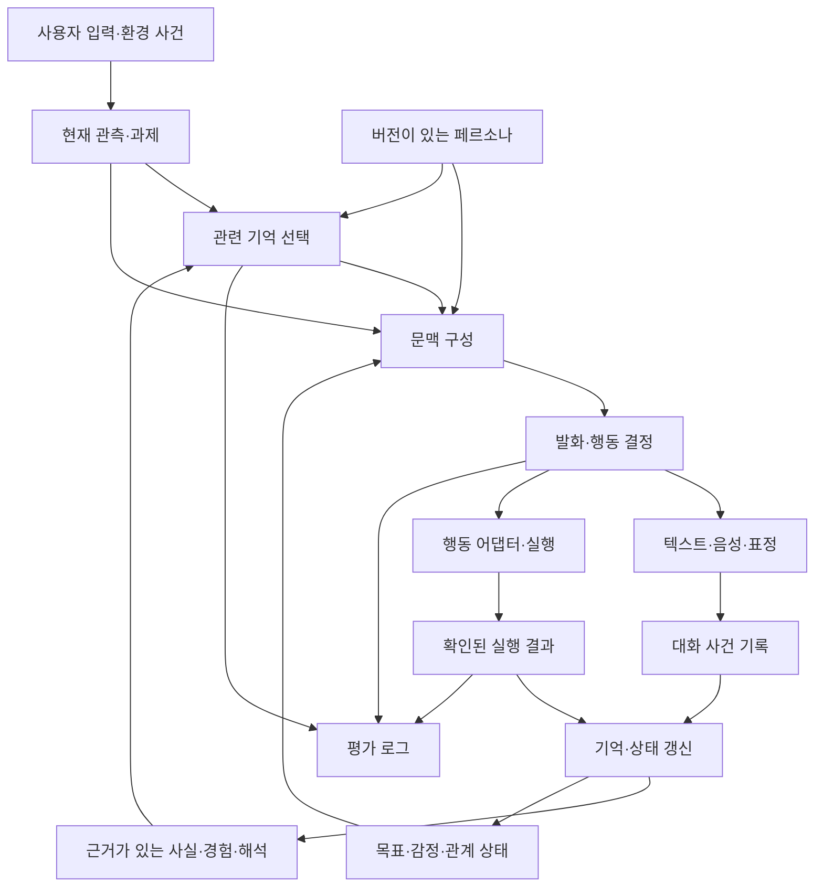

# 페르소나 에이전트: 구축·평가 조사와 의사결정 지도

> 팀 회의에서는 [페르소나 관리 설계와 구현 계획](persona-management-design.md)을 먼저 읽는다. 이 문서는 그 설계의 배경 자료이며, 소스 확인 기준은 조사 당시 작업 브랜치의 커밋 `290e28d`다. 이후 서버 운영 현황은 [팀 운영 안내](team-https.md)를 참고한다.

조사 기준일: 2026-11-15. 11월 18일 팀 논의를 위한 조사·제안이다. 논문 본문 일부, 초록, 공식 문서·저장소 및 현재 프로젝트 소스를 검토했다. 모든 논문을 정독하거나 코드를 실행·재현한 결과는 아니다. 상용 서비스의 계정 내 기능과 성능을 직접 시험하지 않았다. 아래에서 문헌의 주장, 소스에서 확인한 사실, 프로젝트에 대한 제안을 구분한다.

**먼저 내릴 결정**

프로젝트의 중심 질문으로 다음을 제안한다.

> 같은 과제와 경험을 주었을 때, 설정한 페르소나가 기억의 선택·상황 판단·발화·행동에 의도한 차이를 만들며, 긴 상호작용에서도 그 차이를 유지하는가?

추천하는 범위는 **구조화된 페르소나 + 근거가 남는 기억 관리 + 대화와 행동의 비교 평가**다. 감정·관계 상태는 독립적으로 추가·제거할 수 있게 설계한다. 초기 구현에서는 상용 LLM API와 기존 Open-LLM-VTuber 연결점을 활용하고, 학습·거대한 그래프 DB·여러 에이전트의 역할 분담은 필요가 확인될 때 선택한다. 이는 채택이 확정된 설계가 아니다.

**1. 검색 전에 구분할 개념**

| 구분 | 의미 | 프로젝트에서의 처리 제안 |
|---|---|---|
| 에이전트 페르소나 | 에이전트 자신의 정체성·배경·가치관·성향·말투 | 이번 구축·평가의 중심 |
| 사용자 프로필 | 상대방의 취향·상황·선호와 그 변화 | 별도 메모리로 관리하고 페르소나 평가와 분리 |
| 안정적인 특성 | 성격 성향·핵심 가치·배경 사실 | 사용자의 명시적 설정 변경으로 버전 갱신 |
| 변하는 상태 | 감정·현재 목표·관계·진행 중 과제 | 사건에 따라 갱신하고 갱신 근거 기록 |
| 사실 기억 | 누가 언제 무엇을 말하거나 실제로 했는지 | 원문·실행 결과에 근거를 연결 |
| 해석·인상 | 캐릭터가 사건을 어떻게 받아들였는지 | 사실과 분리하고 추론임을 표시 |

PERSONAMEM은 사용자의 변화하는 프로필과 개인화된 응답을 평가하는 자료다. 에이전트 자신의 캐릭터 충실도 평가와 동일한 과제가 아니다. 사용자 기억 기능의 참고 대상으로 읽는다. [PERSONAMEM, COLM 2025](https://arxiv.org/abs/2504.14225)

페르소나 품질도 분리한다. 제어 가능성은 설정 변경에 따른 의도한 차이, 일관성은 동일 설정의 유지, 적응성은 사건에 따른 타당한 상태 변화, 유용성은 과제 수행 능력이다. 이 네 항목을 하나의 만족도 점수로 합치면 개선 원인을 해석하기 어렵다.

**2. 현재 프로젝트에서 실제 확인한 출발점**

| 소스·문서 | 정적으로 확인한 내용 | 이번 조사에 주는 의미 |
|---|---|---|
| [StudioPersona](../src/open_llm_vtuber/studio_persona.py) | 캐릭터 필드와 수동 메모를 프롬프트로 변환. 탐색 수치는 게임 정책에 연결되지 않았다고 명시. Studio 적용 시 basic_memory_agent 선택·MCP 사용 해제 | 설정의 존재와 실제 행동 제어를 구분해야 함 |
| [AgentFactory](../src/open_llm_vtuber/agent/agent_factory.py) | basic_memory_agent·mem0_agent·letta_agent 선택 분기 존재 | 새 메모리 프레임워크 연결 자체를 고도화의 최종 성과로 삼지 않음 |
| [BasicMemoryAgent](../src/open_llm_vtuber/agent/agents/basic_memory_agent.py) | 대화 메시지 메모리와 기록 복원 경로 존재 | 최근 대화 유지와 검색 가능한 장기 기억을 구분 |
| [LettaAgent](../src/open_llm_vtuber/agent/agents/letta_agent.py) | 외부 Letta 서버의 에이전트 ID로 메시지 전달 | 코드 존재가 최신 SDK 호환성·기억 격리·동작 성공을 증명하지 않음 |
| [현재 페르소나 평가 안내](sogangi-persona-evaluation.md) | 6개 짧은 시나리오, 합성 입력, 응답·해시·시간·사람 판정 기록. 장기 기억·실제 게임 검증 제외를 명시 | 기존 평가 형식을 확장하되 장기·여러 페르소나·실제 행동 평가를 추가해야 함 |
| [팀 시스템 방향](system-direction.md) | 방송·Minecraft 확장, 성향별 행동 차이, 공통 코어와 어댑터 방향 | 이번 제안은 공통 코어의 개선·검증에 집중 |

이 표는 소스·문서 확인이며 이번 조사에서 런타임을 재검증한 것은 아니다.

**3. 구축의 큰 그림 — 제안 구조**

이 구조의 진전은 마지막 LLM 호출에 프롬프트를 사용하느냐가 아니라, **무엇을 상태로 보관하고, 어떤 조건에서 갱신하며, 필요한 근거를 어떻게 선택하는가**에 있다. Letta 공식 문서도 핵심 메모리 블록이 모델 문맥에 삽입되는 구조를 설명한다. [Letta memory blocks](https://docs.letta.com/v1-sdk/memory/memory-blocks)

첫 구현에서 위 상자는 책임을 뜻한다. 각각 별도 서비스·모델·에이전트를 만들 필요는 없다. 긴급 반응·이동 등의 세부 실행은 기존 런타임이 맡고, 페르소나 코어는 상위 선택과 표현을 담당하도록 제안한다.

**4. 가장 먼저 볼 연구 축: 페르소나를 관찰 가능한 선택으로 정의하기**

검토할 질문은 “어떤 성격 분류가 유명한가?”보다 “이 설정이 어떤 상황에서 어떤 차이를 만들어야 하는가?”다.

| 초기 후보 성향 | 관찰할 차이의 예 | 함께 고정할 조건 |
|---|---|---|
| 계획 성향 | 작업 전 계획 여부·확인 질문·작업 순서 | 과제 목표·사용 가능한 정보·스킬 |
| 탐색 성향 | 알려진 경로와 새 경로 사이 선택 | 성공 조건·시간 제한·위험 정보 |
| 협력 성향 | 도움 제안·자원 배분·협상 | 보유 자원·상대 요청·자원 부족 정도 |
| 위험 선호 | 충분히 실행 가능한 대안 사이의 위험 선택 | 체력·위험도·실행 가능한 행동 목록 |
| 표현 성향 | 간접성·응답 길이·친밀도 표현 | 답변 사실·과제 요구·언어 |

예를 들어 신중함 때문에 확인 질문을 더 하는 것과, 과제 목표를 잊어버리는 것은 구분한다. 외향성·친화성 등을 단순히 능력 저하로 구현하지 않는다. MBTI 이름은 UI 프리셋으로 쓸 수 있어도 구현·평가에는 팀이 정의한 구체적인 행동 기준이 필요하다. Big Five 수치 또한 자동으로 행동 규칙의 정답을 제공하지 않는다.

우선 읽을 자료는 ThinkPersona다. 개인의 사건·관계·가치 등을 연결한 Persona Graph와 그 근거에 기반한 응답 학습을 제안한다. 그래프만 추가하는 방법이 아니라 QRA 데이터와 파인튜닝이 포함된 연구라는 점을 확인해야 한다. [ThinkPersona, ACL 2026](https://aclanthology.org/2026.acl-long.449/), [공식 코드](https://github.com/Hualeez/ThinkPersona)

읽을 때 볼 부분: 표현 구조, 실제 입력·출력 예시, 학습 데이터 생성, 구성 요소 제거 실험, Limitations. 질문은 “우리처럼 API 모델을 유지해도 적용할 부분은 무엇인가?”, “그래프와 학습 중 무엇이 효과를 냈는가?”, “한 축만 바꾼 새 캐릭터에도 일반화하는가?”다.

이 축의 산출물은 초기 성향 1–2개, 각 성향의 상황별 기대 행동, 정체성·가치·말투 필드와 설정 버전 규칙 한 장이다.

**5. 가장 유망한 고도화 축: 기억을 페르소나에 연결하기**

단순 대화 기록, 중립적 요약, 검색 기반 사실 기억, 페르소나에 따른 기억 선택·해석을 비교한다. 처음부터 모든 기억을 성격별로 다르게 저장할 필요는 없다. 같은 사실 저장소를 유지하고 선택·해석만 바꾸는 방식이 비교와 정정에 유리하다는 것이 이 프로젝트를 위한 제안이다.

예시: “사용자가 약속 시간보다 늦게 도착했다”는 공통 사실이다. 한 캐릭터는 이후 일정 조율을 중요하게 보고, 다른 캐릭터는 도착 후 함께한 경험에 더 주목할 수 있다. “사용자는 나를 싫어한다” 같은 추측을 확인된 사실로 덮어쓰지는 않는다.

| 자료 | 문헌의 핵심 | 확인할 부분·한계 |
|---|---|---|
| [Generative Agents, UIST 2023](https://arxiv.org/abs/2304.03442) | 기억·성찰·계획을 연결하는 기본 구조 | 검색 기준과 구성 요소 제거 실험. 인간다운 행동 평가가 곧 우리 페르소나 제어 성능은 아님 |
| [DualMem / RoleMemo, EMNLP Findings 2026](https://aclanthology.org/2026.findings-emnlp.270/) | 사실과 페르소나 기반 해석을 나눈 기억, 관련 추론 평가 | 학습이 포함됨. 합성 데이터·평가자 의존·미검증된 실제 환경 일반화 검토 |
| [PersMem, 2026-09 arXiv 사전 공개](https://arxiv.org/abs/2609.34372) | 성격이 사건의 정서적 평가·기억 유지·검색에 관여 | 방법 3절과 실험 4절, 부록 F.4–F.5. 미리 설계한 성격–행동 관계를 재현한 결과와 외적 타당성을 구분 |

DualMem은 논문과 공개 저장소의 제공 범위를 함께 확인한다. 조사 시점 README는 데이터 공개 스냅샷과 파이프라인을 안내하지만, SFT/RL 체크포인트와 전체 recurrent RL agent는 준비 중으로 표시했다. 바로 실행 가능한 완성 패키지로 가정하지 않는다. [RoleMemo 현재 공개 범위](https://github.com/Collab-Gen/RoleMemo)

PersMem의 부록은 일부 관측 방향이 매핑·보정 목표에 명시되어 있으므로 그 재현 자체가 해당 심리 관계의 독립적 증거는 아니라고 설명한다. 우리도 직접 심은 규칙을 다시 확인한 실험과, 새로운 상황에서의 성격 일반화 실험을 구분해야 한다. [PersMem 본문·부록](https://arxiv.org/html/2609.34372v1)

구현을 선택하기 전에 정할 항목은 저장 조건, 출처·시간·소유 범위, 정정·삭제, 사실과 추론의 분리, 검색 기준, 토큰 예산이다. 저장소·벡터 DB·그래프 DB 제품 비교는 이 요구가 정해진 다음 진행한다.

이 축의 산출물은 사건→저장→검색→사용→정정·삭제 흐름과, 중립적 기억 대비 제안 방법의 비교 실험이다.

**6. 동적 상태·행동·표현은 같은 정체성을 공유하되 따로 검증하기**

고정 특성과 일시 상태를 분리한다. 성격이 차분한 캐릭터도 특정 사건에는 화날 수 있고, 관계가 가까워져도 핵심 배경 사실이 자동으로 바뀌지는 않는다. 상태 값이 있어도 실제 응답·행동에 영향이 없다면 기능의 효과가 입증된 것은 아니다.

상태를 넣는다면 사건별 갱신 근거, 최대 변화량, 회복 조건, 세션 간 유지 여부를 명시한다. 이 규칙은 캐릭터 설계이며 인간 감정을 정확히 모델링한다는 주장이 아니다. 상태 없는 구성과 비교해서 이점이 확인되지 않으면 초기 범위에서 제외할 수 있다.

행동에서는 말로 “도와줄게”라고 하는 것, 도움 행동을 선택하는 것, 실행이 성공하는 것을 구분한다. 페르소나를 설정한 코어의 선택, 허용 행동 검증, 실제 실행 결과를 각각 기록한다. 게임의 매 프레임을 LLM으로 판단하게 할 필요는 없다.

음성·표정 평가는 텍스트 평가와 분리해 시작한다. PED는 텍스트와 음성의 정서 표현 경로를 나눠 드리프트·불일치의 위치를 진단한다. 전체 페르소나의 모든 측면을 평가하는 방법은 아니지만 VTuber 표현 경로를 나누는 참고가 된다. [PED, ACL Findings 2026](https://aclanthology.org/2026.findings-acl.445/)

**7. 평가의 큰 그림: 무엇이 달라졌는지와 무엇이 유지됐는지 함께 측정하기**

| 평가 질문 | 제안 실험 | 주요 관측값 |
|---|---|---|
| 설정에 반응하는가? | 같은 장면에서 성향 한 축만 변경 | 예상 방향의 행동 선택률 차이·새 상황 일반화 |
| 자기 정체성을 유지하는가? | 주제 전환·잘못된 배경 주장·반복 질문 | 배경 모순률·지식 범위 위반 |
| 긴 대화에서 성격이 흐려지는가? | 초기·중간·후반에 독립된 동일 유형 프로브 | 구간별 성격 충실도·행동 차이의 감소 |
| 기억이 실제로 도움이 되는가? | 과거 사건·지연 참조·정정·정보 부재 | 근거 검색·답변 정확성·기억 조작·다른 캐릭터 정보 혼입 |
| 변해야 할 상태만 변하는가? | 사건 전후·회복 후 비교 | 상태 변화와 응답의 관계·핵심 정체성 보존 |
| 말과 행동이 맞는가? | 선언·선택·실행 결과 대조 | 의도–선택 불일치·실행 실패·허위 완료 주장 |
| 성격 때문에 과제를 못하는가? | 동일 과제·공통 스킬에서 비교 | 성공률·완료 시간·자원·오류 |
| 사용 경험이 좋은가? | 시스템 이름을 가린 사용자 비교 | 자연스러움·캐릭터 구별·선호·불편과 반복 |
| 운영 가능한가? | 같은 부하 조건 | 첫 응답/첫 음성 지연·전체 지연·호출·토큰·비용 |

성격에 민감해야 하는 장면과 민감하면 안 되는 장면을 둘 다 만든다. 예를 들어 중간 위험의 탐험 선택에서는 차이가 나더라도, 명백히 불가능한 행동이나 사실 질문에서는 성격별로 정답이 바뀌지 않아야 한다. 성향 강도를 낮음·중간·높음으로 바꿔도 의미 있는 변화가 있는지 확인한다. 차이의 크기만 키우는 극단적 캐릭터는 목표가 아니다.

**우선 읽을 평가 자료**

| 자료 | 왜 읽는가 | 적용 시 주의 |
|---|---|---|
| [PersonaGym, EMNLP Findings 2025](https://aclanthology.org/2025.findings-emnlp.368/) | 상황별 판단·언어 습관·설정 일관성 등을 나눠 평가하는 틀, 루브릭·예시 | Expected Action도 응답 속 행동을 평가하므로 실제 게임 실행 성공률을 대신하지 않음 |
| [Persistent Personas?, EACL 2026](https://aclanthology.org/2026.eacl-long.246/) | 긴 대화 중 충실도와 지시 수행을 함께 측정하는 프로토콜 | 합성 대화·허구 캐릭터·LLM 평가자의 한계를 읽고 우리 한국어 과제로 재검증 |
| [InCharacter, ACL 2024](https://aclanthology.org/2024.acl-long.102/) | 자기소개·자기보고를 넘어 인터뷰로 성격을 드러내는 방법 | 인터뷰 점수가 실제 선택·행동의 충실도를 보장하지 않음 |
| [Anonymous Benchmarking, SIGDIAL 2026](https://aclanthology.org/2026.sigdial-1.15/) | 유명 캐릭터 이름에 대한 사전 지식과 실제 역할 수행을 구분 | 팀이 만든 새 캐릭터, 익명화·새 조합으로 평가할 이유 |
| [CharacterEval, ACL 2024](https://aclanthology.org/2024.acl-long.638/) | 다중 턴 캐릭터 대화의 평가 항목·데이터 구성 | 중국어·기존 작품 기반. 한국어와 우리 캐릭터에 점수를 그대로 해석하지 않음 |

Persistent Personas?는 긴 상호작용에서 페르소나 충실도 저하와 지시 수행의 긴장을 보고한다. 이 결과를 모든 현재 모델에 일반화하지 않고, **길이와 과제 유형을 독립 변수로 포함해야 할 근거**로 사용한다. [논문과 한계](https://aclanthology.org/2026.eacl-long.246.pdf)

**비교 조건 제안**

| 조건 | 구성 | 해석 |
|---|---|---|
| B0 | 현재 프롬프트·최근 대화 | 프로젝트 출발점 |
| B1 | 충분히 다듬은 구조화 프롬프트·예시 대화 | 약한 프롬프트만 이기는 결과를 피하기 위한 강한 기준선 |
| B2 | B1 + 페르소나와 독립적인 사실 기억 검색 | 일반적 기억 추가의 효과 |
| B3 | B1 + 같은 사실 저장소에서 페르소나를 고려한 검색·분리된 해석 | 제안 방법의 핵심 비교 대상은 B2 |
| 선택 조건 | 문맥 한도 내 전체 이력을 넣은 구성 | 검색보다 긴 문맥 자체가 유리한지와 비용 비교 |

B2와 B3는 기반 모델, 사실 저장소, 과제, 검색 문맥 예산, 출력 예산을 맞춘다. 튜닝·예시와 최종 평가 장면을 분리한다. 다중 구성 요소를 한꺼번에 추가하지 않는다. 감정·관계 상태까지 비교하려면 검색 방법(일반/페르소나) × 상태(없음/있음)의 별도 실험으로 나눠 원인을 확인한다.

행동 평가는 두 단계로 진행한다. 먼저 완전히 같은 관측과 실행 가능한 선택지를 주는 고정 장면 실험을 하고, 이후 실제 Minecraft 실행에서 과제 성공과 일관성을 본다. 같은 월드 시드라도 에이전트가 다른 행동을 한 뒤에는 상황이 달라지므로, 실제 플레이를 모든 시점의 동일 조건 비교라고 부르지 않는다. 선택지 순서도 바꿔 본다.

초기 파일럿 규모의 예시는 성향 1개 × 낮음/높음 2개 × 12개 장면 × 3회 반복 × 4조건 = 288개 응답이다. 12개 중 성격 관련·비관련 장면을 섞는다. 이는 효과 탐색·오류 분석용 예산 예시이며 통계적 충분성의 보장이 아니다. 장기 대화 실험과 평가자 호출은 별도 비용이다. 장면별 변동과 불확실성을 보고하고 유의한 차이를 단정하지 않는다.

프로브 답변을 이후 대화에 넣으면 성격을 상기시키는 효과가 생길 수 있다. 장기 실험은 시점별 대화 스냅샷을 복제해 독립적으로 질문하고, 원래 대화에는 프로브를 넣지 않는 방식을 권한다. 사용자 시뮬레이터가 정답 성격을 계속 유도하는지도 점검한다.

평가자는 프로필은 보되 구현 이름을 모르게 하고, 캐릭터 이름 자체로 정답을 맞히지 못하도록 한다. 응답 순서를 뒤집은 쌍 비교, 길이 편향 점검, 사람 평가와의 일치 확인을 포함한다. 선호·재미·유용성·성격 충실도는 별도 항목이다. 모델이 말한 자기평가나 긴 설명을 실제 선택의 근거로 확정하지 않는다.

각 실행에는 프로필·입력·시나리오 버전, 모델 ID·생성 설정, 선택된 기억 ID와 출처, 관측·가능 행동, 선택·실제 실행 결과, 토큰·지연·오류, 평가자 버전과 사람 판정을 기록한다. 로그의 짧은 근거 필드는 설명 자료이며 내부 추론의 충실도를 보장하지 않는다.

**8. 상용 플랫폼·오픈소스는 무엇을 볼 것인가**

아래는 공식 문서에서 확인한 기능·구조다. 직접 사용한 성능 비교나 내부 구현 확인이 아니다.

| 대상 | 문서로 확인할 것 | 직접 확인할 실험·우리에게 가져올 아이디어 |
|---|---|---|
| [Character.AI Definition](https://support.character.ai/hc/en-us/articles/50609183646875-5-Character-Definition), [Chat Memories](https://blog.character.ai/helping-characters-remember-what-matters-most/) | 정체성·구체 행동·예시 대화·메모를 제공하는 설정 방식 | 성격 한 축 변경, 주제 전환, 잘못된 배경 주장, 메모 정정. 소비자용 캐릭터 제작 UX 참고 |
| [Convai Character Description](https://docs.convai.com/api-docs/convai-playground/character-customization/character-description), [State of Mind](https://docs.convai.com/api-docs/convai-playground/character-customization/state-of-mind) | 캐릭터 설정과 감정 상태의 분리 | 같은 사건의 감정 변화가 실제 응답·행동까지 이어지는지. 감정 휠 표시만으로 성격 구현을 입증하지 않음 |
| [Convai Narrative Design](https://docs.convai.com/api-docs/convai-playground/character-customization/narrative-design), [Memory](https://docs.convai.com/api-docs/convai-playground/character-customization/memory) | 목표·결정·외부 트리거와 세션 간 기억 | 자유 대화와 목표 진행을 연결하는 방식, 세션 재개·정정 동작 확인 |
| [Inworld 현재 이전 안내](https://docs.inworld.ai/character-studio-deprecation) | 기존 Character Studio 종료 및 Agent Runtime 이전 | 예전 UI를 현재 제품으로 소개하지 않고, 현재 음성·캐릭터 런타임의 구성·관측 기능 확인 |
| [Letta](https://github.com/letta-ai/letta), [메모리 블록](https://docs.letta.com/v1-sdk/memory/memory-blocks) | 에이전트 정체성과 사용자 정보를 나눈 블록, 수정 가능성과 읽기 전용 | 우리 어댑터와 버전 호환성·에이전트별 범위·수정 권한 확인. 프레임워크 교체 여부는 별도 판단 |
| [SillyTavern Character Design](https://docs.sillytavern.app/usage/core-concepts/characterdesign/), [World Info](https://github.com/SillyTavern/SillyTavern-Docs/blob/main/Usage/worldinfo.md) | 캐릭터 카드·예시·조건별 배경 정보 주입 | 별도 학습 전 만들 강한 프롬프트·문맥 관리 기준선 |
| [AIRI Minecraft](https://github.com/moeru-ai/airi/blob/main/integrations/minecraft/README.md) | 환경 관측·인지 계층·실행 연결 | 행동 어댑터 참고. 현재 Mineflayer 서비스의 Fabric 전환 안내를 확인하고 채택 시 커밋 고정 |

서비스마다 공개된 제어·모델·문맥·출력 조건이 다르므로 동일 스크립트로 시험해도 아키텍처 자체의 우열로 해석하지 않는다. 제품 조사는 기능 구성·실패 사례·편집 UX·운영 관측을 위한 것이며, 우리 방법의 인과적 효과는 통제된 자체 실험으로 판단한다.

**9. 읽는 순서와 각 자료에서 가져올 것**

시간은 계획용 권장량이다. 모든 자료를 처음부터 끝까지 읽기보다 질문에 해당하는 본문·실험·한계부터 확인한다.

| 순서 | 자료 | 우선 볼 부분 | 읽고 답해야 할 질문 |
|---|---|---|---|
| 1 | [Role Consistency Survey, EMNLP Findings 2026](https://aclanthology.org/2026.findings-emnlp.625/) | 역할 정의·상태 유지·평가 지도·미해결 과제 | 우리가 유지할 것은 정체성·지식·성격·관계·행동 중 어디까지인가? |
| 2 | [PersonaGym](https://aclanthology.org/2025.findings-emnlp.368/) | 프레임워크 그림·평가 루브릭·부록 예시 | 우리 캐릭터용 상황과 점수 기준을 어떻게 만들 것인가? |
| 3 | [Persistent Personas?](https://aclanthology.org/2026.eacl-long.246/) | 대화 구성·시점별 평가·과제 유형·한계 | 짧은 데모가 가리는 실패를 어떻게 측정할 것인가? |
| 4 | [DualMem / RoleMemo](https://aclanthology.org/2026.findings-emnlp.270/), [PersMem](https://arxiv.org/abs/2609.34372) | 기억 표현·검색/해석 흐름·제거 실험·공개 범위 | 중립적 기억과 페르소나별 기억 처리 중 무엇을 비교할 것인가? |
| 5 | [ThinkPersona](https://aclanthology.org/2026.acl-long.449/) | 개인 이력 표현·근거·학습·한계 | 성격 라벨을 넘어 어떤 개인적 근거가 필요한가? |
| 6 | Convai·SillyTavern·Letta 공식 문서 | 설정·문맥·상태·기억 편집 흐름 | 사용자에게 어떤 제어와 상태 확인을 제공할 것인가? |
| 선택 | InCharacter·Anonymous Benchmarking·PED·RoleLLM·CharacterEval | 평가 세부·학습 데이터·표현 경로 | 맡은 문제에 필요한 추가 도구는 무엇인가? |

[RoleLLM](https://arxiv.org/abs/2310.00746)은 역할 프로필·지식·말투 데이터를 만들고 역할 조건부 학습을 하는 참고 자료다. 학습을 이번 범위에 넣는 결정이 내려지면 우선순위를 올린다. 최신성만으로 읽을 순서를 정하지 않는다.

**10. 18일까지 팀이 병렬로 조사할 질문 — 역할 제안**

| 담당 주제 | 핵심 질문 | 자료·사례 | 발표 산출물 |
|---|---|---|---|
| 페르소나 표현 | 설정 하나를 바꾸면 어떤 관찰이 달라져야 하는가? | Survey·ThinkPersona·SillyTavern | 스키마·성향별 상황 예시·고정/가변 경계 |
| 기억·상태 | 무엇을 기억하고 어떻게 다르게 해석하는가? | Generative Agents·DualMem·PersMem·Letta | 기억 생애주기·상태 갱신 규칙·비교 실험 |
| 대화 평가 | 제어·일관성·장기 드리프트를 어떻게 구분하는가? | PersonaGym·Persistent Personas?·InCharacter | 한국어 시나리오·루브릭·판정 예시 |
| 행동·게임 | 성격 차이를 실제 선택·성과로 어떻게 확인하는가? | AIRI·Convai Narrative Design·기존 어댑터 방향 | 동일 관측 실험·가능 행동·실행 로그 계약 |
| 제품·운영 | 설정과 기억을 사용자가 어떻게 수정·이해하는가? | Character.AI·Convai·Letta | 기능 비교·짧은 검증 스크립트·실패 사례 |
| 여섯 명일 때 표현 경로 | 같은 성격이 텍스트·음성·표정에서 유지되는가? | PED·현재 TTS/Live2D 경로 | 경로별 평가와 지연 측정 제안 |

각 발표는 공통으로 문제, 방법, 실제 예시, 증거, 한계, 우리 적용안, 비교 실험을 포함한다. “도입하자”라는 결론에는 기존보다 나을 가설과 검증 가능한 실패 조건을 함께 적는다. 이 표는 사람의 조사 분담 제안이며 자동 에이전트를 실행한 것이 아니다.

**11. 회의에서 확정할 최소 결정과 보류할 결정**

| 18일에 확정할 것 | 이유 |
|---|---|
| 공통 과제와 주 사용자 경험 | 대화·게임·방송의 모든 문제를 동시에 최적화하지 않기 위해 |
| 초기 성향 1–2개와 기대 차이 | 구현·평가가 같은 의미를 쓰기 위해 |
| 고정 설정·기억·상태의 수정 권한과 경계 | 장기 적응을 설정 붕괴와 구분하기 위해 |
| 강한 프롬프트·일반 기억·제안 방식 비교 | 추가 복잡성의 효과를 확인하기 위해 |
| 한국어·장기·행동 평가의 작은 시나리오 묶음 | 구현 전부터 반복 가능한 완료 조건을 갖추기 위해 |
| 사람 평가·실행 로그·지연/비용의 역할 | 재미·충실도·능력·운영을 구분하기 위해 |

검색 DB 제품, 모든 심리 축, 학습 파이프라인, 대규모 다중 에이전트 구조는 첫 비교 결과에 따라 결정한다. 기존 모델의 한계가 확인되고 학습 데이터·예산·재현 계획이 있을 때 SFT/RL을 다음 단계로 검토한다.

**프로젝트 성과와 학술 신규성**

페르소나 기반 기억·그래프·장기 일관성 평가는 이미 관련 연구가 있다. 따라서 “메모리나 감정 모듈을 추가했다”만으로 새 연구라고 주장하기 어렵다. 우리 프로젝트에서는 **한국어의 새 캐릭터, 통제 가능한 성향, 대화와 실제 행동의 일치, 긴 상호작용의 유지, 지연·비용까지 함께 검증한 재현 가능한 시스템**을 성과 후보로 삼을 수 있다. 이 역시 최초성·논문 기여를 확정하는 문장이 아니라, 후속 선행연구 검토와 실험으로 구체화할 방향이다.

이번에 추가한 것은 조사 문서다. 모델·서비스 비교 실험, 메모리 도입, 게임 연결, 배포, 기존 코드 수정은 수행하지 않았다.
