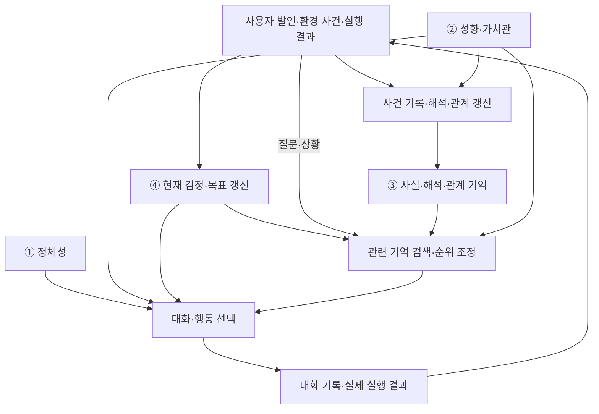

# 페르소나 시스템 설계

팀 논의용 초안 · 2026년 11월 16일

**정체성과 성향을 바탕으로 경험을 해석하고, 현재 목표에 맞는 기억을 찾아 대화와 행동에 반영한다.** 아래는 이 흐름을 구현하기 위한 설계안이다.

## 1. 관리할 정보와 역할

| 영역 | 관리할 정보 | 시스템에서 맡는 역할 |
|---|---|---|
| **① 정체성** | 이름, 역할, 배경, 세계관 | 캐릭터의 기본 설정과 지식 범위를 정한다. |
| **② 성향·가치관** | 판단 성향, 가치의 우선순위, 표현 방식 | 사건의 해석, 기억의 우선순위, 행동 선택에 영향을 준다. |
| **③ 경험·관계** | 사건, 사건에 대한 해석, 상대별 관계와 변화 이력 | 다음 판단에 쓸 근거를 저장하고 검색한다. |
| **④ 현재 상태·목표** | 감정, 진행 중 과제, 미완료 약속 | 지금 필요한 기억과 다음 행동을 정한다. |

네 영역은 아래의 저장·검색·갱신 과정을 함께 사용한다. **②는 ③의 기억을 해석하고 고르는 기준이며, ④는 지금 무엇을 찾아야 하는지 정하는 기준**이다.

## 2. 정보를 어떻게 연결해서 처리할까

### A. 기본 설정과 현재 상태를 읽는다

짧은 정체성·핵심 가치와 현재 목표는 매번 모델에 전달한다. 상세 배경은 외부에 저장하고 관련 상황에서 찾는다. [Letta의 문맥 계층](https://docs.letta.com/v1-sdk/memory/context-hierarchy)은 항상 제공하는 메모리 블록과 검색하는 외부 기억을 구분한다(V1 문서). [제타의 로어북](https://zeta-ai.io/ko/announcements/11884)은 특정 키워드가 나오면 등록된 설정을 참고한다.

**우리 선택:** 기본 설정은 버전별로 저장하고 제작자가 수정한다. 현재 감정·목표는 별도로 저장해 최신 값을 읽는다. 긴 배경은 키워드나 의미 검색으로 불러온다.

### B. 사건을 기록하고, 성향에 따라 해석한다

새 대화와 실행 결과에서 기억할 사건을 추출한다. 기존 기억과 비교해 중복·변경 여부를 확인한 뒤 반영한다. [Mem0의 2025년 논문](https://arxiv.org/html/2504.19413v1)은 기억 후보와 비슷한 기존 기록을 검색해 추가·수정·삭제·유지를 결정한다.

여기에 **② 성향·가치관을 사용해 ③의 해석 기억을 만드는 단계**를 둔다. 사건 기록은 보존하고, 캐릭터가 그 사건을 어떻게 받아들였는지 별도로 저장한다. [DualMem](https://aclanthology.org/2026.findings-emnlp.270/)은 사실과 페르소나에 따른 해석을 나누는 구조를 제안한다. 논문은 SFT·RL 학습을 포함한다.

**우리 선택:** 사실 기억과 해석 기억을 연결해 저장한다. 해석에는 근거 사건과 당시 성향 버전을 남긴다. 상대에 대한 판단은 해당 경험의 범위에서 관계 설명에 반영한다.

### C. 현재 목표로 기억을 찾고, 성향을 고려해 순서를 정한다

먼저 사용자·캐릭터·이야기 범위를 제한한다. 이어서 현재 질문과 **④의 목표·상황**으로 검색하고, **②의 성향**이 기억의 우선순위에 관여하게 한다. 관련 사실과 캐릭터의 해석을 함께 응답에 제공한다.

검색 구조는 다음처럼 조합할 수 있다.

| 설계 선택 | 참고 시스템의 방식 | 우리 설계에서의 용도 |
|---|---|---|
| **검색 후보 찾기** | [Zep 검색](https://help.getzep.com/v4/searching-the-graph)은 의미가 비슷한 내용을 찾는 벡터 검색과 키워드 검색을 결합한다. | 다른 표현으로 묻는 질문과 정확한 인물·장소 이름에 대응한다. |
| **기억 순위 조정** | [Generative Agents](https://arxiv.org/html/2304.03442v2)는 관련성·중요도·최근 접근 정도를 함께 반영한다. | 오래됐지만 중요한 사건도 다시 떠올리게 한다. |
| **성향·감정 반영** | [PersMem](https://arxiv.org/html/2609.34372v1)은 성격을 감정 평가·기억 유지·검색에 연결하고, 감정에 따른 회상과 목표에 따른 검색을 함께 사용한다. | 같은 경험에서도 캐릭터별로 참고하는 기억의 비중을 달리하는 연구 후보로 삼는다. |
| **관계·시간 조회** | [Zep/Graphiti](https://arxiv.org/html/2501.13956v1)는 사건에서 인물·관계와 유효 시점을 추출한다. | ‘A와 언제 동료가 됐고 지금도 동료인가’처럼 연결과 시점이 중요한 질문을 처리한다. |

**우리 선택:** 벡터·키워드를 결합한 검색으로 시작하고, 관련성·중요도·최근성을 반영해 후보의 순서를 정한다. 성향별 순위 조정은 같은 후보에서 중요하게 볼 경험을 달리하는 방식으로 붙인다. 현재 과제에 꼭 필요한 사실과 제약은 함께 제공한다.

성향이 검색에 미치는 정도와 규칙은 직접 정하고 검증해야 한다. PersMem은 이를 매개변수로 연결한 사전 공개 연구다. 관계 이력과 인물 간 연결을 자주 조회하게 되면 시간 정보를 가진 그래프를 추가한다. 그래프와 벡터·키워드 검색은 함께 사용할 수 있다.

### D. 응답하고, 결과에 따라 관계와 상태를 바꾼다

**①의 설정, ②의 판단 기준, ③에서 찾은 기억, ④의 현재 목표**를 모아 대화와 다음 행동을 결정한다. 실행 결과가 들어오면 목표 진행과 감정·관계를 갱신하고, 그 결과를 다음 사건으로 기록한다.

목표 진행은 사건에 따른 상태 전이와 LLM 계획을 조합할 수 있다. [Convai Narrative Design](https://docs.convai.com/api-docs/convai-playground/character-customization/narrative-design)은 목표를 가진 구간을 사용자 선택·위치·시간·사건으로 전환한다. Generative Agents는 기억을 참고해 계획을 만들고 상황에 따라 수정한다.

**우리 선택:** LLM이 다음 행동을 제안하고, 시스템은 실제 결과를 확인해 완료·중단 여부를 반영한다. 감정에는 원인과 회복 조건을 둔다. 기억을 정정하면 그 사건에서 나온 해석과 관계 설명도 함께 고친다.

## 3. 전체 구조와 동작 예

아래는 참고 시스템의 방식을 조합한 우리 설계안이다.

예를 들어 **약속을 중요하게 여기는 캐릭터**가 A에게 도움을 받았다면 다음처럼 이어진다.

1. **사건과 해석:** ‘A가 약속한 시간에 식량을 가져왔다’를 기록하고, ‘이번 약속을 지켰다’는 해석을 남긴다. A와의 관계 설명에 이 경험을 연결한다.
2. **검색:** 다음에 A와 공동 과제를 맡으면 현재 목표로 관련 기억을 찾고, 약속 이행 경험을 우선 참고한다.
3. **응답과 갱신:** A에게 역할을 맡길지 현재 조건과 함께 판단한다. 새 과제의 실제 결과를 기록해 다음 판단에 사용한다.

기본 조합은 **고정 설정 + 성향에 따른 해석 + 목표 중심 기억 RAG + 현재 상태 저장**이다. 성향별 검색 가중치와 관계 그래프는 이 흐름 안에서 선택할 수 있다.

자세한 배경은 [조사 노트](persona-agent-research-2026-11-15.md), 기존 코드 연결점은 [기술 초안](persona-runtime-design.md)을 참고한다.
