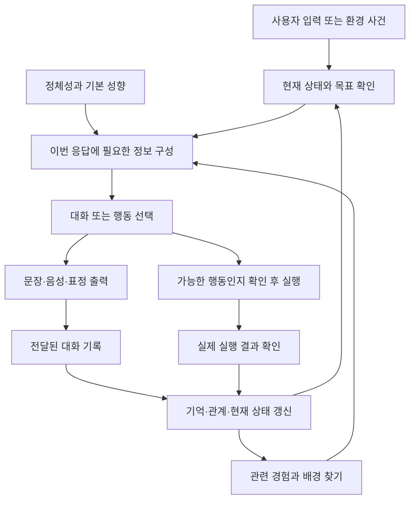

# 페르소나 관리 설계와 구현 계획

> **문서 상태:** 팀 검토용 초안
>
> **수정일:** 2026년 11월 16일
>
> **이번 검토의 목표:** 페르소나를 관리하는 방식과 첫 구현 범위를 정한다.

우리가 만들려는 것은 **기본 성격을 유지하면서도, 상대와 경험에 따라 반응이 달라지는 캐릭터**다. 이를 위해 캐릭터에 관한 정보를 네 영역으로 나누고, 각 영역에 서로 다른 변경 규칙을 적용하려고 한다.

이 문서는 먼저 목표와 예시를 설명한 뒤, 정보의 관리 방법과 구현 순서를 제안한다. 네 영역은 우리 프로젝트를 위한 분류다. 아래 기능은 앞으로 구현할 내용이며, 구현 현황은 1절에 따로 정리했다.

**읽는 순서:** 전체 방향은 1~3절, 운영 규칙은 4~5절, 구현과 평가는 6~7절을 읽으면 된다. 회의에서 결정할 사항은 8절에 모았다.

## 1. 무엇을 개선하려는가

현재는 이름, 성격 설명, 말투, 탐색 성향, 사용자가 적은 메모를 하나의 프롬프트로 묶어 모델에 전달한다. 이 방식으로도 캐릭터의 기본적인 말투와 설정을 표현할 수 있다.

다음 단계에서는 캐릭터가 대화 중에 겪은 일을 기억하고, 그 경험을 다음 대화와 행동에 반영하도록 만들고 싶다. 이때 중요한 것은 **바뀌어야 할 정보와 유지해야 할 정보를 구분하는 것**이다.

예를 들어 사용자가 도움을 주었다면, 그 사람과의 관계나 현재 감정은 달라질 수 있다. 그렇다고 캐릭터의 직업이나 기본 가치관까지 자동으로 바뀌어서는 안 된다.

이번 설계의 목표는 다음 세 가지다.

- **일관성:** 대화가 길어져도 정체성과 기본 성향을 유지한다.
- **적절한 변화:** 함께 겪은 사건과 현재 상황을 다음 반응에 반영한다.
- **검토 가능성:** 어떤 설정과 기억을 사용했고, 무엇 때문에 상태가 바뀌었는지 확인할 수 있다.

### 현재 구현과 제안의 경계

현재 소스에서 확인한 내용은 다음과 같다.

- 캐릭터 설정과 수동 메모를 자연어 지침으로 조합한다.
- 탐색 성향 수치는 아직 실제 게임 행동을 결정하는 정책에 연결되어 있지 않다.
- 메모는 사용자가 직접 등록한 내용이며, 자동으로 습득한 경험과 구분한다.
- 작업 공간과 캐릭터를 기준으로 대화 기록을 구분한다. 최신 팀 서버에는 공용 계정 로그인과 서버 세션 인증이 반영되어 있다. 개인별 계정과 사용자별 기억의 접근 권한 관리는 후속 구현이 필요하다.

페르소나 적용 방식은 [studio_persona.py](../src/open_llm_vtuber/studio_persona.py), 팀 서버의 인증 현황은 [운영 안내](team-https.md)를 참고한다. 공유 전 최신 main의 문서와 대조했으며, 이번 문서 수정에서 모델 실험이나 실행 코드 변경은 하지 않았다.

고도화 이후에도 LLM에는 자연어 지침과 참고 정보를 전달한다. 우리가 추가하려는 기능은 **정보를 따로 저장하고, 필요한 내용을 선택하며, 정해진 규칙에 따라 갱신하는 과정**이다.

## 2. 한 가지 사례로 보는 전체 구조

캐릭터를 “동료를 챙기고 탐험을 좋아하는 안내자”로 설정했다고 가정하자. 이 캐릭터가 사용자 A와 식량을 구하러 갔다면, 다음처럼 반응하기를 기대한다.

| 상황 | 새로 반영할 정보 | 기대하는 반응 |
|---|---|---|
| 처음 식량을 구하러 간다 | 현재 목표는 식량 확보다. | 필요한 준비와 이동 방법을 안내한다. |
| A가 식량을 나눠 준다 | 도움받은 경험과 감사한 감정이 생긴다. | 도움을 인정하고, 남은 식량 목표를 조정한다. |
| 이동 중 위험이 발생한다 | 긴장하고, 대피가 우선 목표가 된다. | 탐험을 잠시 미루고 안전한 곳으로 이동한다. |
| 위험이 해소된다 | 긴장이 가라앉고, 이전 목표를 다시 확인한다. | 평소 태도로 돌아와 미완료 과제를 이어간다. |

이 과정에서 “안내자다”, “탐험을 좋아한다”, “동료를 중요하게 여긴다”는 기본 설정은 유지된다. 반면 A와의 경험, 현재 감정, 진행 중 목표는 상황에 따라 바뀐다.

이 차이를 관리하기 위해 아래 네 영역을 둔다.

## 3. 어떤 정보를 관리할 것인가

| 영역 | 답하려는 질문 | 변경 원칙 |
|---|---|---|
| **핵심 정체성** | 이 캐릭터는 누구인가? | 제작자가 명시적으로 수정한다. |
| **성향·가치관** | 무엇을 중요하게 여기고, 어떻게 판단하는가? | 초기에는 기본값을 유지한다. |
| **경험·관계** | 누구와 무엇을 겪었고, 그 경험을 어떻게 받아들이는가? | 근거가 있는 사건에 따라 갱신한다. |
| **현재 상태·목표** | 지금 어떤 상태이고, 무엇을 하려는가? | 상황과 진행 결과에 따라 갱신한다. |

네 영역은 정보를 이해하고 관리하기 위한 구분이다. 실제 저장 구조에서는 경험과 관계, 감정과 목표를 각각 나눠도 된다.

### 3.1. 핵심 정체성: 캐릭터의 기본 설정

이름, 역할, 배경, 세계관 소속, 알고 있는 것과 모르는 것의 범위를 관리한다.

예를 들어 “산악 지역에서 활동해 온 안내자”라는 설정은 대화 중에 임의로 바뀌지 않아야 한다. 사용자가 “너는 원래 의사였어”라고 말해도, 그 발언만으로 직업을 바꾸지는 않는다. 설정 변경은 제작자나 편집 권한을 가진 사람이 편집 화면에서 수행한다.

수정할 때는 새 버전을 저장하고, 필요하면 이전 버전으로 되돌릴 수 있게 한다. 응답을 만들 때는 짧은 핵심 설정을 항상 제공하고, 긴 배경 설명은 관련된 상황에서만 제공한다.

### 3.2. 성향·가치관: 판단과 표현의 기준

계획성, 탐색 선호, 협력 성향처럼 선택에 영향을 주는 성향과, 캐릭터가 중요하게 여기는 가치를 관리한다. 말투와 표현 습관도 이 영역에 두되, 판단 성향과는 별도 항목으로 편집한다.

“탐색 성향이 높다”는 설명만으로는 기대 행동을 판단하기 어렵다. 따라서 각 성향에 **의미, 상황별 반응, 관찰할 차이**를 함께 적는다.

탐색 성향을 예로 들면 다음과 같다.

- **의미:** 익숙한 방법 외에 새로운 장소나 방법을 시도하려는 정도다.
- **낮을 때:** 검증된 방법을 먼저 사용하고, 필요할 때 대안을 찾는다.
- **높을 때:** 시간과 자원이 충분하면 새로운 방법을 제안하고 시험한다.
- **상황에 따른 조절:** 체력이 낮거나 마감이 가까우면 탐색보다 현재 과제를 우선한다.
- **확인할 차이:** 대안을 제안하는 빈도, 실제 탐색 선택, 소요 시간과 과제 성공 여부를 비교한다.

가치가 충돌하는 상황도 예시로 정한다. 새로운 곳을 좋아하더라도 동료가 긴급하게 도움을 요청하면 먼저 돕는 캐릭터를 만들 수 있다.

첫 구현에서는 계획·탐색·협력 중 1~2개 성향부터 다룬다. 수치를 사용한다면 각 값의 의미를 정의하고, 자연어 설명과 일치하는지 확인한다. 이 수치는 프로젝트의 조절 값이며 인간의 심리검사 점수나 행동 확률을 뜻하지 않는다.

초기에는 대화가 기본 성향을 자동으로 바꾸지 않도록 한다. 경험에 따른 성격의 장기적인 변화는 후속 연구로 검토한다.

### 3.3. 경험·관계: 함께 겪은 일과 상대에 대한 이해

경험을 저장할 때는 “실제로 확인한 일”과 “그 일에 대한 해석”을 구분한다.

예를 들어 A가 식량을 나눠 준 경우에는 다음처럼 기록한다.

- **사건:** 게임에서 A가 식량을 전달했다.
- **해석:** 이번 탐험에서 A에게 도움을 받았다.
- **관계:** A와 식량을 나눈 긍정적인 경험이 있다.

하나의 사건을 근거로 “A는 언제나 믿을 수 있다”라고 일반화하지 않는다. 관계는 상대와 상황에 맞게 기록하고, 판단의 근거가 된 사건을 함께 남긴다. 첫 구현에서는 복잡한 친밀도 점수보다 **짧은 관계 설명과 근거 사건**을 관리한다.

또한 다음 두 가지는 출처가 다르다.

- “어린 시절 친구와 모험했다”는 제작자가 정한 배경이다.
- “오늘 A와 모험했다”는 실제 상호작용에서 생긴 경험이다.

사용자의 발언도 출처를 표시한다. “A가 커피를 좋아한다고 말했다”는 사용자 진술로 저장할 수 있지만, 캐릭터가 추측한 내용을 같은 수준의 사실로 저장하지 않는다.

### 3.4. 현재 상태·목표: 지금의 반응과 다음 할 일

감정과 목표는 둘 다 변하는 정보지만, 유지되는 기간과 종료 조건이 다르다.

**감정**에는 현재 상태, 원인이 된 사건, 시작 시점, 회복 조건을 기록한다. 위험 때문에 놀랐다면 위험이 해소된 뒤 평소 상태로 돌아오게 한다. 감정은 표현과 접근 방식에 영향을 주되, 기본 가치관을 자동으로 바꾸지는 않는다.

**목표**에는 할 일, 완료 조건, 진행 상황, 중단·취소 조건을 기록한다. 식량을 구하기로 약속했다면 대화가 끝나도 미완료 목표를 유지한다. 새 과제가 들어오면 기존 목표를 유지할지, 잠시 중단할지, 교체할지 정하고 그 결과를 남긴다.

게임에서는 “음식을 구했어”라는 발언만으로 목표를 완료 처리하지 않는다. 실제 실행 결과를 확인한다. 재시작 후 작업을 이어갈 때도 현재 게임 상태와 저장된 진행 상황을 대조한다.

### 네 영역과 함께 사용할 보조 정보

사용자 프로필, 장소와 도구의 설명, 현재 체력과 소지품은 별도로 관리한다. 캐릭터의 성격과 외부 상황을 구분해야 같은 성향이 상황에 따라 어떻게 나타나는지 평가할 수 있다.

긴 세계관 설명은 필요할 때 찾아 쓰는 배경 자료로 둔다. 장기적인 포부는 성향·가치관에, 오늘 수행할 과제는 현재 목표에 기록한다.

## 4. 정보를 어떻게 유지하고 수정할 것인가

### 4.1. 공통 설정과 사용자별 경험을 분리한다

같은 캐릭터를 여러 사람이 사용하더라도 각자의 경험이 섞이지 않아야 한다. 이를 위해 공통으로 사용하는 정체성·기본 성향과, 사용자별로 쌓이는 경험·관계·목표를 분리한다.

예를 들어 A와 대화하는 서강이와 B와 대화하는 서강이는 같은 기본 설정을 사용할 수 있다. 그러나 A가 나눠 준 식량에 관한 기억은 B와의 대화에 자동으로 전달되지 않는다.

같은 사용자라도 독립된 이야기나 서로 다른 게임 월드에서는 경험을 나눈다. 방송에서 공개적으로 일어난 사건을 공유하려면 공개 범위를 따로 정한다. 개인 대화는 그 범위에 자동으로 포함하지 않는다.

정보를 누구에게 보여줄 수 있는지는 서버가 확인한다. 화면에서 전달한 사용자나 캐릭터 ID만으로 접근 권한을 판단하지 않는다.

### 4.2. 재접속과 새 시작의 의미를 정한다

사용자가 대화를 다시 열었을 때 무엇이 유지되는지 예측할 수 있어야 한다. 다음 동작을 기본안으로 제안한다.

- **재접속:** 기존 경험·관계와 미완료 목표를 복원한다.
- **새 대화:** 경험·관계·미완료 목표는 이어가고, 최근 장면의 대화 문맥을 새로 시작한다.
- **새 이야기:** 별도의 경험·관계·현재 상태로 시작한다.

이 차이는 화면에서도 설명한다. 독립된 이야기를 시작할 때는 이전 경험을 가져올지 선택할 수 있게 한다.

진행 중인 대화에는 어떤 설정 버전을 사용하는지 기록한다. 편집한 내용을 적용할 때 새 버전으로 전환하고, 역할이나 배경이 크게 달라졌다면 기존 경험을 계속 사용할지도 결정한다.

### 4.3. 기억은 후보를 만든 뒤 검사하여 저장한다

기억을 갱신하는 절차는 다음과 같다.

1. **사건을 기록한다.** 사용자 발언, 관측된 사건, 실제 실행 결과를 구분한다.
2. **남길 내용을 추린다.** 이후 대화에 필요한 사실, 약속, 경험을 후보로 만든다.
3. **후보를 검사한다.** 출처가 있는지, 같은 정보가 이미 있는지, 기존 설정과 충돌하는지, 누구의 기억인지 확인한다.
4. **기억을 반영한다.** 규칙을 만족하는 항목을 저장하고, 필요한 관계·상태 변화를 적용한다.
5. **변경 이유를 남긴다.** 나중에 수정하거나 평가할 수 있도록 근거 사건을 연결한다.

이 검사는 기본적으로 시스템이 수행한다. 모든 기억마다 사용자에게 승인을 요구하지 않는다. 근거가 부족한 해석은 보류하거나 저장하지 않고, 해결이 필요한 충돌은 관리 화면에서 확인할 수 있게 한다.

각 기록에는 내용과 함께 **출처, 관련 사용자·캐릭터·이야기, 발생·수정 시점, 정보의 종류, 현재 사용 여부**를 남긴다. 사용자 취향이 달라졌다면 이전 취향과 현재 취향의 시점을 구분한다.

### 4.4. 수정과 삭제는 관련 정보까지 반영한다

사용자는 자신의 기억을 확인하고, 잘못된 내용을 수정하거나 삭제하며, 중요한 내용을 고정할 수 있어야 한다.

예를 들어 “A가 식량을 줬다”는 기록이 잘못됐다면, 그 기록에서 나온 “A에게 도움을 받았다”는 해석과 관계 설명도 함께 수정해야 한다. 검색 결과, 요약, 임시 저장 내용에도 변경을 반영한다.

삭제한 정보가 이전 대화에서 다시 추출되어 되살아나지 않도록 재추출 대상에서도 제외한다. 삭제 범위는 원문, 기억, 파생된 해석 중 어디까지인지 구분해 관리한다.

캐릭터가 생성한 설명이나 감정 표현을 새로운 사건의 증거로 반복 사용하지 않는다. “도와줘서 고마워”라고 생성했다는 이유만으로 실제 도움 사건을 만들어내서는 안 된다.

## 5. 저장한 정보를 응답과 행동에 어떻게 사용할 것인가

한 번의 응답은 다음 흐름으로 만든다.

### 항상 제공할 정보와 필요할 때 찾을 정보

짧은 정체성, 핵심 가치, 현재 목표와 관측은 응답에 우선 반영한다. 상세한 배경, 오래된 경험, 상황별 예시는 현재 요청과 관련된 내용을 선택해서 제공한다.

오래된 대화를 요약할 때도 미완료 약속과 정정된 사실은 보존해야 한다. 저장할 수 있는 정보의 양과 한 번의 응답에 전달할 수 있는 정보의 양은 따로 관리한다.

경험을 찾을 때는 먼저 사용자·캐릭터·이야기와 정보의 사용 여부를 확인한다. 그 범위 안에서 관련성과 최신성을 비교한다. 첫 구현은 태그, 키워드, 상대방을 이용한 검색으로 시작하고, 필요한 정보를 놓치는 사례가 쌓이면 의미가 비슷한 내용을 찾는 검색을 추가한다.

성향에 따라 어떤 기억을 먼저 떠올리게 할지는 후속 실험으로 둔다. 이 기능을 추가하더라도 현재의 제약이나 반대되는 증거를 숨기지 않도록 한다.

### 행동은 실행 결과까지 확인한다

게임 행동을 실행하기 전에는 체력, 대상, 사용할 수 있는 능력 등 실행 조건을 확인한다. 성향은 그 조건을 만족하는 행동 중 무엇을 선호하는지에 영향을 준다.

평가할 때는 모델이 선택한 행동, 프로그램 규칙이 강제한 행동, 실제로 실행된 결과를 구분한다. 문장·음성·표정은 같은 대화 의도와 상태를 바탕으로 만들고, 서로 어긋나지 않는지도 확인한다.

## 6. 어떤 순서로 구현할 것인가

11월 18일에는 구조와 연구 질문을 합의하는 것을 목표로 한다. 아래는 이후의 권장 구현 순서다. 실제 일정과 담당자는 팀원의 가용 시간을 확인한 뒤 정한다.

| 단계 | 구현할 내용 | 완료를 판단할 기준 |
|---|---|---|
| **1. 프로필 관리와 기본 비교** | 설정 편집, 버전 저장·복구, 성향별 예시, 기존 대화 연결 | 같은 모델과 입력으로 프로필별 반응을 비교할 수 있다. |
| **2. 경험 저장과 관리** | 사건·기억 저장, 검색, 수정·삭제·고정, 사용자별 분리 | 재접속 후 기억을 사용하고, 정정·삭제가 반영되며, 다른 사용자의 경험이 섞이지 않는다. |
| **3. 관계·상태·목표 갱신** | 근거가 있는 관계 변화, 감정 회복, 목표 진행·취소·복원 | 변화 이유를 확인할 수 있고, 기본 정체성은 유지된다. |
| **4. 실제 행동 연결** | 고정된 상황에서 선택을 비교한 뒤 Minecraft 한 봇에 연결 | 실제 실행 기록으로 성향 차이와 과제 성공을 확인한다. |
| **5. 확장 여부 판단** | 성향에 따른 기억 선택·해석, 추가 성향과 장면 | 추가 기능의 효과를 비용과 함께 설명할 수 있다. |

### 사용자가 보고 관리할 화면

초기에는 다음 세 화면을 우선한다.

- **기본 설정:** 정체성, 성향, 말투, 상황별 예시를 편집하고 버전을 관리한다.
- **경험·관계:** 기억과 근거 사건을 확인하고, 수정·삭제·고정한다.
- **현재 상태·목표:** 현재 감정과 이유, 진행 중 과제, 중단하거나 완료한 목표를 확인한다.

개발용 화면에는 적용된 설정 버전, 선택된 기억, 상태 변경 근거, 실제 실행 결과를 보여준다. 이를 위해 모델의 긴 내부 사고 과정을 수집할 필요는 없다.

### 구현 책임을 나누는 기준

팀에서는 프로필 관리, 대화·세션 복원, 경험·관계 관리, 상태·목표 갱신, 응답 정보 구성, 외부 행동 연결, 평가 기록을 기준으로 작업을 나눌 수 있다. 이 구분이 각각 별도의 서버나 LLM 에이전트를 뜻하는 것은 아니다.

기존 백엔드와 일반 데이터베이스를 활용하는 안으로 시작한다. 검색 제품이나 Letta SDK의 채택은 필요한 기능과 작은 실행 검증을 거쳐 결정한다. 음성·Live2D·대화 연결은 기존 모듈을 우선 활용한다.

성격의 자율 성장, 파인튜닝, 정밀한 감정 수식, 대규모 관계 그래프는 첫 구현의 필수 범위에 넣지 않는다. 기본 기능의 평가 결과와 실패 원인을 확인한 뒤 검토한다.

## 7. 개선 효과를 어떻게 확인할 것인가

기능을 추가했다는 사실과 캐릭터가 더 잘 표현된다는 결과는 별도로 확인해야 한다. 다음 조건을 비교하여 어떤 기능이 효과를 냈는지 살펴본다.

| 비교 조건 | 구성 | 확인하려는 점 |
|---|---|---|
| A. 현재 방식 | 고정 프롬프트와 최근 대화 | 현재 성능은 어느 정도인가? |
| B. 프로필 개선 | 구조화된 설정과 잘 다듬은 상황 예시 | 설정과 예시를 개선하는 것만으로 얼마나 달라지는가? |
| C. 기억 추가 | B에 지속 기억과 검색을 추가 | 과거 경험을 다시 활용하는 것이 도움이 되는가? |
| D. 동적 관리 추가 | C에 관계·감정·목표 관리를 추가 | 명시적인 상태 관리가 추가로 도움이 되는가? |

B를 평가할 때는 같은 정보를 자유 서술로 제공하는 조건도 준비한다. 입력 형식만 달라진 효과와 정보·예시가 좋아진 효과를 구분하기 위해서다. D의 효과가 확인되면 관계, 감정, 목표 관리를 하나씩 제외하여 어떤 요소가 기여했는지도 살펴볼 수 있다.

### 함께 평가할 항목

- **정체성 유지:** 배경이나 역할에 모순이 생기는지 확인한다.
- **성향과 상황 반영:** 서로 다른 성향이 구별되면서도 현재 상황에 맞게 반응하는지 확인한다.
- **기억 관리:** 회상 정확성, 수정·삭제 반영, 사용자와 이야기 간 정보 분리를 확인한다.
- **관계 변화:** 변화가 근거 사건과 연결되는지 확인한다.
- **목표와 행동:** 미완료 과제를 유지하고 실제로 수행했는지 확인한다.
- **운영 비용:** 응답 시간, 호출 수, 사용 토큰과 비용을 함께 기록한다.

성향만 비교할 때는 모델, 입력 상황, 제공하는 기억을 같게 맞춘다. 기억 선택 방식의 효과는 별도 조건에서 평가한다. 기능 비교에서는 문맥 예산과 시나리오도 맞추고, 각 조건의 실제 사용량을 기록한다.

설정에 예시로 넣은 장면뿐 아니라 새로운 장면에서도 여러 번 반복한다. 평가자는 가능하면 시스템의 비교 조건과 캐릭터 이름을 가린 상태에서 응답을 판단하고, LLM 평가는 사람 평가를 보조하는 용도로 사용한다.

한 번의 시연만으로 효과를 판단하지 않는다. 예를 들어 도움을 받은 전후에 감정과 식량 보유량까지 달라졌다면, 반응의 차이가 관계 기억 때문인지는 알기 어렵다. 관계 기억의 효과를 보려면 현재 목표·감정·자원을 같게 하고 경험 유무만 달리한 비교가 필요하다.

본 평가 전에 합격 기준을 정한다. 페르소나 표현이 좋아졌더라도 과제 성공률이 떨어졌다면 두 결과를 함께 보고한다.

## 8. 회의에서 검토하고 결정할 사항

11월 18일 회의에서는 아래 항목을 결정하면 후속 구현 작업을 나누기 쉽다. 체크 표시는 해당 항목을 논의하고 결론을 기록했을 때 한다.

- [ ] **첫 성향을 선택한다.** 계획·탐색·협력 중 어떤 1~2개를 구현할 것인가? 각 성향이 어떤 반응 차이로 드러나야 하는가?
- [ ] **자동 변경 범위를 정한다.** 정체성과 기본 성향은 편집자가 관리하고, 경험·관계·현재 상태만 자동 갱신하는 안으로 시작할 것인가?
- [ ] **경험의 공유 범위를 정한다.** 사용자, 이야기, 게임 월드별로 무엇을 분리하고 무엇을 공유할 것인가?
- [ ] **대화 시작 방식을 정한다.** 재접속, 새 대화, 새 이야기에서 각각 어떤 정보를 이어갈 것인가?
- [ ] **평가 장면과 기준을 정한다.** 한 성향만 다른 프로필 두 개와 비교 장면을 만들고, 기대 차이와 공통 과제의 합격 기준을 정했는가?
- [ ] **첫 구현의 담당자를 정한다.** 6절의 1단계를 누가 맡고, 어떤 결과물을 함께 검토할 것인가?

회의가 끝나면 선택한 성향의 정의, 두 프로필의 예시, 정보 변경 규칙, 평가 시나리오를 이 문서에 반영한다. 아직 합의하지 않은 항목은 제안으로 남긴다.

## 참고 자료와 설계에 활용한 부분

아래 자료는 각각의 관리 원칙을 참고하기 위해 사용했다. 우리 네 영역 전체의 효과를 검증한 자료는 아니며, 제품의 기능 설명과 우리 시스템의 평가 결과는 구분한다.

- **[Letta — Memory blocks](https://docs.letta.com/v1-sdk/memory/memory-blocks)**

  정보를 목적별 블록으로 나누고, 읽기 전용 여부와 크기를 관리하는 방식을 참고했다. 블록은 최종적으로 모델의 프롬프트에 제공된다. 링크는 V1 legacy 문서이므로 실제 SDK를 선택할 때는 별도 검토가 필요하다.

- **[Character.AI — Memory](https://blog.character.ai/memory/)**

  중요한 기억을 직접 남기거나 고정하고, 자동 저장된 정보를 수정하며, 새 대화로 가져올지 선택하는 기능을 참고했다. 경험을 사용자가 관리하는 화면과 대화 시작 규칙에 연결된다.

- **[제타 — 설정집 안내](https://zeta-ai.io/ko/announcements/11884)**

  특정 키워드가 등장할 때 관련 설정을 참고하는 로어북 기능을 바탕으로, 상세 배경을 필요한 상황에 제공하는 방식을 검토했다. 이 자료에서 자동 경험 학습이나 관계 갱신 알고리즘까지 확인한 것은 아니다.

- **[Convai — State of Mind](https://docs.convai.com/api-docs/convai-playground/character-customization/state-of-mind)**

  대화 맥락에 따라 변하는 감정을 시각화하는 기능을 참고했다. 기본 성향과 현재 감정을 나누어 관리하는 데 도움이 된다. 구체적인 감정 갱신 수식은 이 문서로 확인되지 않는다.

- **[Generative Agents, 2023](https://arxiv.org/abs/2304.03442)**

  경험을 기록하고, 기억에서 해석을 만들고, 이를 계획에 사용하는 구조를 참고했다. 우리 설계에서는 근거 사건과 그에 대한 해석을 분리하는 데 활용한다.

- **[InCharacter, ACL 2024](https://aclanthology.org/2024.acl-long.102/)**

  심리 인터뷰를 통해 캐릭터의 성격이 얼마나 충실하게 표현되는지 평가하는 방식을 참고했다. 실제 게임 행동은 실행 기록으로 별도 검증한다.

- **[PersonaGym, EMNLP Findings 2025](https://aclanthology.org/2025.findings-emnlp.368/)**

  다양한 상황에서 페르소나 충실도를 확인하는 평가 체계를 참고했다. 자기소개 한 번보다 여러 장면의 반응을 비교하는 평가를 준비한다.

## 관련 프로젝트 문서

- [프로젝트 방향](system-direction.md): 전체 프로젝트 범위와 통합 방향.
- [배경 조사 노트](persona-agent-research-2026-11-15.md): 논문과 플랫폼을 검토한 내용.
- [구현 상세 후보](persona-runtime-design.md): 코드 연결점과 세부 구현을 논의할 때 참고할 이전 기술 초안.
