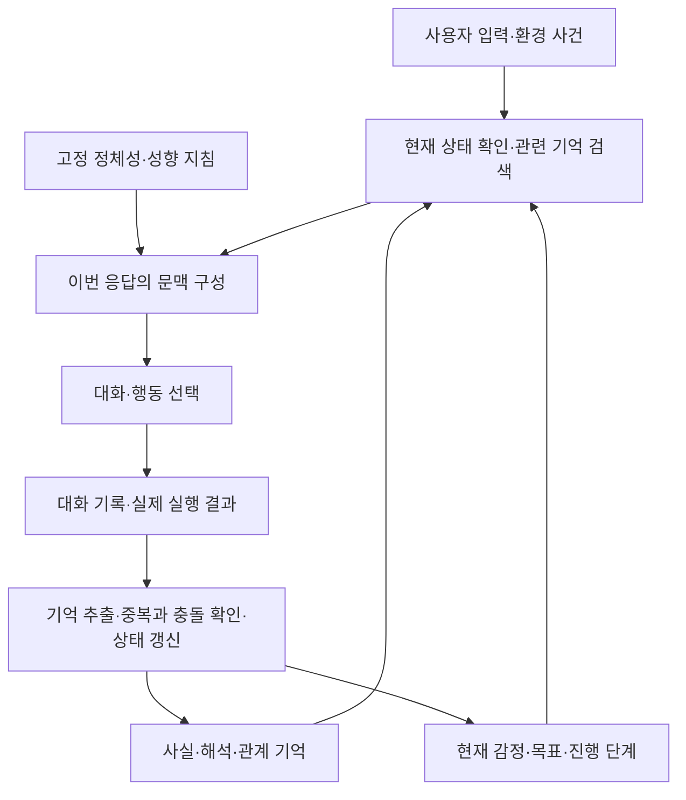

# 페르소나 시스템 설계

팀 논의용 초안 · 2026년 11월 16일

**페르소나를 저장·검색·갱신하는 구조를 정한다.** 네 영역에 사용할 수 있는 논문·상용 시스템의 방식을 비교하고, 우리 프로젝트에 적용할 조합을 제안한다.

## 1. 네 영역의 시스템 설계

### ① 정체성: 고정 메모리와 배경 지식 검색

**참고 구조 — Letta의 메모리 계층.** 짧고 중요한 정보는 매번 모델에 전달하는 메모리 블록에 두고, 큰 자료는 외부에 저장해 필요할 때 검색한다. 블록에는 읽기 전용 설정을 적용할 수 있다. [메모리 블록](https://docs.letta.com/v1-sdk/memory/memory-blocks), [문맥 계층](https://docs.letta.com/v1-sdk/memory/context-hierarchy) — V1 문서

- **설계안:** 이름·역할·핵심 배경은 고정 블록에, 상세 이력과 세계관은 검색 저장소에 둔다.
- **검색 선택:** [제타의 로어북](https://zeta-ai.io/ko/announcements/11884)처럼 키워드가 나오면 설정을 불러오거나, 질문과 의미가 가까운 내용을 벡터 검색으로 찾는다. 키워드는 호출 조건을 통제하기 좋고, 벡터 검색은 다른 표현으로 묻는 질문에 대응하기 좋다.
- **동작 예:** ‘고향’에 관한 질문이 들어오면 관련 배경만 검색하고, 고정된 정체성과 함께 응답에 넣는다.

**선택 기준:** 정체성의 핵심은 항상 제공하고, 분량이 커지는 배경에 RAG를 적용한다. 핵심 블록은 제작자가 편집하고 버전으로 관리한다.

### ② 성향·가치관: 성격이 기억 처리에 관여하는 위치

고정된 성향 지침에 더해, 성격을 **기억을 저장할 때** 반영할지, **기억을 검색할 때** 반영할지 선택할 수 있다.

- **저장할 때 반영 — DualMem.** 사실 기억과 페르소나에 따른 해석을 분리한다. 같은 사건에서도 캐릭터가 무엇을 중요하게 받아들였는지를 별도 기억으로 남기는 구조다. 논문은 SFT·RL 학습을 포함한다. [논문](https://aclanthology.org/2026.findings-emnlp.270/)
- **검색할 때 반영 — PersMem.** 성격을 감정 평가·기억 유지·검색의 매개변수에 연결한다. 의미와 감정이 비슷해 떠오르는 기억과, 현재 목표를 위해 찾는 기억을 함께 사용한다. 성격과 검색 매개변수의 연결을 실험하는 사전 공개 연구다. [논문](https://arxiv.org/html/2609.34372v1)

**우리 설계안:** 우선 ‘사실 저장소 + 캐릭터별 해석 저장소’를 두고, 현재 질문에 관련된 사실과 해석을 함께 찾는다. 해석에는 원래 사건과 페르소나 버전을 연결한다. 성향이 바뀌면 관련 해석도 다시 검토한다.

**선택 기준:** 별도 해석은 캐릭터가 사건을 받아들이는 관점을 드러내기 좋지만, 잘못된 해석이 쌓일 수 있다. 검색 순위에 성격을 반영하면 떠올리는 경험 자체를 바꿀 수 있지만, 어떤 성향이 어떤 기억을 우선할지 정하는 작업이 추가된다. 첫 안은 사실·해석 분리, 확장안은 성향별 검색이다.

### ③ 경험·관계: 기억 RAG와 시간 정보를 가진 그래프

먼저 저장 과정과 검색 과정을 나눈다. **저장 과정**은 무엇을 기억으로 남길지 정하고, **검색 과정**은 현재 질문에 어떤 기억을 사용할지 정한다.

[Mem0의 2025년 논문](https://arxiv.org/html/2504.19413v1)은 새 대화에서 기억 후보를 추출한 뒤, 비슷한 기존 기억을 검색해 추가·수정·삭제·유지 중 하나를 선택한다. 이 방식을 기억 갱신의 참고 구조로 삼을 수 있다.

검색은 아래 세 안을 비교한다.

| 방식 | 실제 구조·근거 | 선택 기준 |
|---|---|---|
| **벡터 RAG** | 기억을 임베딩하고 질문과 가까운 기록을 찾는다. Mem0의 기본 기억 저장소가 벡터 검색을 사용한다. | 간단한 출발점. 이름의 정확한 일치와 정보의 시점은 필터로 보완한다. |
| **중요도·최근성을 반영한 검색** | [Generative Agents](https://arxiv.org/html/2304.03442v2)는 의미 유사도, 중요도, 최근 접근 정도를 합쳐 기억을 고른다. 사건에서 만든 상위 해석도 기억으로 저장한다. | 오래됐지만 중요한 경험을 다시 꺼내기 좋다. 중요도 부여와 순위 계산이 필요하다. |
| **시간 정보를 가진 그래프 검색** | [Zep/Graphiti](https://arxiv.org/html/2501.13956v1)는 사건에서 인물·관계와 유효 시점을 추출한다. [Zep 검색](https://help.getzep.com/v4/searching-the-graph)은 벡터·키워드 검색을 결합하고, 연결된 노드 탐색과 시간 필터를 지원한다. | ‘누구와 어떤 관계였고 언제 바뀌었나’를 찾기 좋다. 인물 통합과 관계 갱신 처리가 추가된다. |

**동작 예:** ‘A와 지금도 동료인가?’라는 질문에는 비슷한 과거 대화보다 현재 유효한 관계가 필요하다. 관계의 시작·종료 시점을 기록하면 과거의 동료 관계와 현재 상태를 구분해 답할 수 있다.

**우리 설계안:** 사건 단위 기억과 출처·시점을 저장하고, 벡터·키워드를 함께 쓰는 하이브리드 검색으로 후보를 찾는다. 사용자·캐릭터·이야기 범위를 먼저 제한한 뒤 관련성·중요도·최근성을 반영해 순서를 정한다. 관계 이력이나 여러 인물 사이의 연결을 자주 조회하게 되면 그래프 방식을 선택한다.

### ④ 현재 상태·목표: 현재 상태 저장과 사건에 따른 전환

**참고 구조 — Convai의 Narrative Design.** 목표를 가진 구간을 만들고, 사용자 선택이나 위치·시간·사건 트리거로 다음 구간으로 넘어간다. [공식 문서](https://docs.convai.com/api-docs/convai-playground/character-customization/narrative-design)

- **상태 전이 방식:** ‘대기 → 탐색 → 복귀’처럼 상태와 전환 조건을 정한다. 진행을 확인하기 쉽고, 예상 가능한 과제에 적합하다.
- **LLM 계획 방식:** [Generative Agents](https://arxiv.org/html/2304.03442v2)처럼 기억을 참고해 계획을 만들고 상황에 따라 수정한다. 자유로운 목표에 대응하기 좋고, 완료·중단 여부를 확인하는 장치가 필요하다.

**우리 설계안:** 현재 감정·목표·진행 단계는 별도 상태 저장소에 두고 매번 직접 읽는다. LLM은 다음 계획을 제안하고, 실행 결과가 들어오면 시스템이 진행 상태를 갱신한다. 감정에는 원인과 회복 조건을 함께 둔다.

**동작 예:** ‘식량 수집 중’에 재료를 확보했다는 실행 결과가 오면 목표를 완료로 바꾼다. 과거 기록은 RAG로 찾고, 현재 진행 상황은 최신 상태에서 읽는다.

## 2. 조합하면 어떤 구조가 되는가

아래는 위 사례를 조합한 우리 설계안이다.

첫 조합은 **고정 메모리 + 하이브리드 기억 RAG + 사실·해석 분리 + 현재 상태 저장소**다. 관계 그래프와 성향별 검색은 필요한 질문과 동작에 맞춰 선택한다.

자세한 배경은 [조사 노트](persona-agent-research-2026-11-15.md), 기존 코드 연결점은 [기술 초안](persona-runtime-design.md)을 참고한다.
