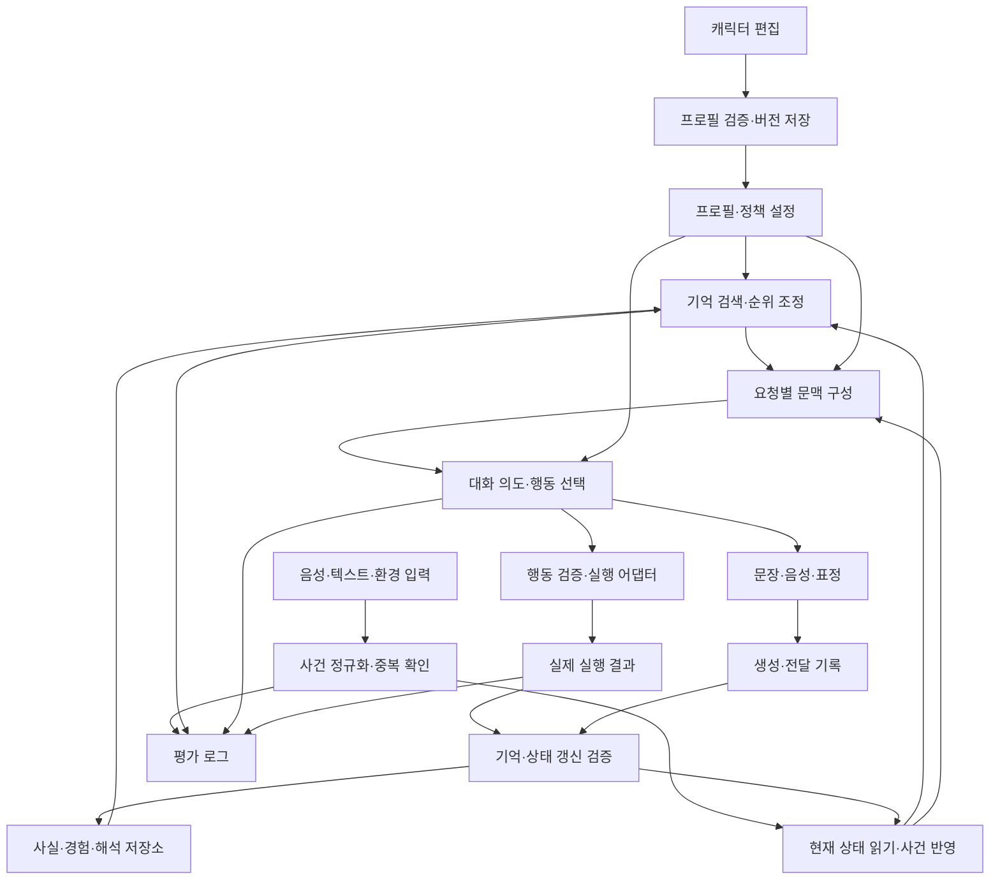

# 페르소나 고도화 설계와 구현 계획

> 이 문서는 11월 15일에 작성한 기술 검토용 초안이다. 팀 논의에서는 읽기 쉽게 정리한 [페르소나 관리 설계와 구현 계획](persona-management-design.md)을 먼저 읽고, 이 문서는 코드 연결점과 세부 구현을 검토할 때 참고한다. 소스 확인 기준은 당시 작업 브랜치의 커밋 `290e28d`이며, 이후 서버 운영 현황은 [팀 운영 안내](team-https.md)를 따른다.

작성: 2026-11-15. 상태: 검토 가능한 설계 제안. 사용자 요청은 깊이 있는 계획·구조화이며 이 문서가 아키텍처 채택이나 구현 완료를 의미하지 않는다. 현재 소스를 정적으로 확인했으며 이번 작업에서 모델 실험·런타임 변경·배포는 하지 않았다. 배경 자료는 [조사 노트](persona-agent-research-2026-11-15.md), 기존 범위는 [시스템 방향](system-direction.md)을 따른다.

**1. 제안하는 목표와 고도화의 의미**

목표: 캐릭터 설정이 발화뿐 아니라 경험의 선택·해석, 상태 변화, 행동 선택에 영향을 주고 그 효과를 반복 실험으로 검증할 수 있는 공통 에이전트 코어를 만든다.

고정 자연어를 JSON으로 바꾼 뒤 다시 프롬프트에 붙이는 단계는 설정 관리 개선이다. 다음 고도화에서는 프로그램이 지속 상태를 관리하고, 검색·갱신·행동 실행을 통제한다. LLM에 전달하는 문맥은 그 상태의 일부를 선택한 결과다. 기반 모델의 가중치는 초기 단계에서 고정한다.

| 수준 | 달라지는 것 | 주장할 수 있는 범위 |
|---|---|---|
| L0: 현재 | 고정 설명·최근 대화·수동 메모 | 조건부 응답 생성 |
| L1: 구조화 | 프로필 필드·버전·예시·상황 규칙 | 설정을 명시하고 재현 가능하게 관리 |
| L2: 상태·기억 | 영속 저장·정정·선별 검색·사건에 따른 상태 갱신 | 경험이 이후 응답에 영향을 주는 시스템 |
| L3: 행동 정책 | 성향이 실행 가능한 선택의 우선순위에 관여 | 대화와 실제 행동에 공통 페르소나 적용 |
| L4: 학습 | 데이터로 정책 또는 모델을 학습 | 별도 일반화 평가를 거친 학습 효과 |

이번 추천 범위는 L1–L3이며, 핵심 연구 질문은 L2/L3의 이득이 강한 프롬프트 기준선보다 크고 비용을 정당화하는가다. 지속 메모리 업데이트를 가중치 학습으로 부르지 않는다.

**2. 확인한 기존 코드와 연결 지점**

| 파일 | 확인한 역할 | 제안 변경 |
|---|---|---|
| `src/open_llm_vtuber/studio_persona.py` | `StudioPersona.prompt()`가 자연어·말투·탐색 수치·수동 메모를 합침. `apply_studio_persona()`가 basic agent를 선택하고 MCP 사용을 끔 | 프로필 검증·저장·버전 연결 추가. 기존 자유 서술은 유지하고 수동 메모의 출처를 보존 |
| `agent/agents/basic_memory_agent.py` | `_system`, `_memory`, 기록 복원, 일반/Claude/OpenAI 도구 경로, 스트리밍 후처리 | 요청별 문맥을 주입하는 작은 공통 연결점 후보. 모든 호출 경로를 함께 확인 |
| `agent/agents/agent_interface.py` | `chat`, `handle_interrupt`, `set_memory_from_history` 계약 | 새 agent도 동일 계약 준수 |
| `agent/agent_factory.py` | agent 선택 분기 | `persona_agent`를 별도 선택지로 추가하는 안 |
| `config_manager/agent.py` | agent 설정 모델 | 새 선택지·기능 플래그·호출 예산 설정 |
| `service_context.py` | 연결 컨텍스트·agent 초기화·시스템 지침 구성 | 연결마다 런타임 분리, 영속 상태는 명시적 ID로 읽기 |
| `agent/input_types.py` | `BatchInput`과 metadata | 입력을 내부 사건 모델로 변환. 브라우저가 보낸 ID를 소유권의 증거로 삼지 않음 |
| `agent/output_types.py` | `SentenceOutput`, 표정·그림·소리 `Actions` | 표현 출력 재사용. 게임 명령은 별도 실행 계약으로 둠 |
| `tools/evaluate_sogangi.py` | 합성 대화·응답/해시/시간·사람 판정 | 평가 runner를 확장해 조건·프로필·상태·기억·행동 결과 비교 |

`BasicMemoryAgent.set_system()`을 공유 객체에 매번 호출하는 구현은 피한다. 불변의 요청별 `TurnContext`를 전달하거나 연결 전용 인스턴스를 사용한다. 기존 basic agent는 비교 기준선으로 유지한다. 전체 도구 루프를 복사하기 전에 재사용 가능한 문맥/스트림 연결점을 추출할 수 있는지 작은 프로토타입으로 확인한다.

**3. 책임 구조**



각 상자는 함수·모듈의 책임이다. 첫 버전은 기존 Python 백엔드 안에서 실행한다. 게임 런타임만 어댑터 경계 밖에 둘 수 있다. 별도 다중 에이전트 구성을 전제하지 않는다.

**4. 데이터 모델과 상태 소유권**

| 모델 | 주요 필드 | 변경 주체·수명 |
|---|---|---|
| `PersonaDefinition` | character_id, version, identity, traits, values, biography, knowledge_limits, style, examples | 사용자 편집·명시적 발행. 세션을 넘어 유지 |
| `BehaviorPolicy` | policy_version, trait_mapping_version, applicability, constraints, weights, defaults | 개발자가 검증한 규칙 + 사용자 성향. 프로필 버전과 연결 |
| `AgentState` | state_version, active_goal, task_progress, affect, relation_refs, last_event_seq | 검증된 사건·결과. 감정은 일시적, 작업은 완료까지 |
| `RelationshipState` | character_id, counterpart_id, context_scope, familiarity, trust_hypothesis, evidence_ids | 특정 상대와 경험에 한정. 사용자의 전역 인격 판단으로 저장하지 않음 |
| `MemoryItem` | id, owner_scope, kind, content, source_event_ids, event_time, valid_from/to, status, confidence, persona_version | 사건 기반 추출·사용자 정정·관리 규칙 |
| `TurnContext` | turn_id, profile_version, state_version, selected_memory_ids, observation, allowed_actions, budget | 요청 중 불변 |
| `Decision` | intent, action_id/type/arguments, expression_hint, evidence_ids, concise_rationale | 선택기 생성, 코드 검증. 긴 내부 추론은 요구하지 않음 |
| `ActionResult` | action_id, status, actual_effects, observation_seq, error_kind | 실행 어댑터만 성공 확정 |

초기 영속 모델은 관계형 테이블과 JSON 필드로 시작하고 검색 인덱스를 선택적으로 추가한다. 로컬 단일 writer의 SQLite와 다중 워커 운영의 PostgreSQL 중 배포 조건에 맞춰 결정한다. 저장소 인터페이스를 먼저 정의한다. 그래프 형태의 관계 표현이 필요하더라도 즉시 별도 그래프 DB를 요구하지 않는다.

기억 소유 범위는 `workspace/user + character + context/world`로 명시한다. 세션은 대화의 단위이며 캐릭터 정체성과 동일한 ID가 아니다. 공유 경험은 공유 권한·참가자와 함께 기록한다. 모델이 소유 범위 필터를 결정하지 않는다.

현재 Studio의 클라이언트 workspace ID는 인증 수단이 아니다. 로컬 시연의 논리적 분리와 외부 다중 사용자 서비스의 접근 제어를 구분하고, 후자는 서버가 확인한 사용자 ID에 연결한 후 배포한다.

**5. 프로필은 자연어·구조·행동 예시를 함께 보관한다**

아래 수치는 UI/공학 제어값 예시다. 인간 성격검사 규준·백분위나 행동 확률을 의미하지 않는다. `exploration_preference`를 Big Five 개방성과 동일하다고 가정하지 않는다.

```yaml
character_id: companion_a
version: 1
identity:
  role: 함께 과제를 수행하는 탐험 동료
traits:
  planning_preference: 0.8
  exploration_preference: 0.3
values:
  - commitment_to_shared_goal
  - care_for_companion
biography:
  - id: authored_event_1
    content: 준비 없이 떠났다가 동료와 떨어진 경험이 있다
    source: creator_authored
style:
  register: friendly_informal_ko
  disagreement: explain_then_offer_alternative
behavior_examples:
  - situation: 새로운 길이 보이지만 귀환까지 시간이 부족함
    response_pattern: 현재 과제를 마친 뒤 탐색할 기회를 제안함
```

자유 서술에서 필드를 추출할 때는 LLM이 초안을 만들 수 있다. 근거 없는 개인사·수치를 자동 확정하지 않고 사용자에게 편집 가능한 결과를 보여준다. 빠진 필드는 unknown/default로 두고, 높은 계획성과 즉흥 행동을 동시에 요구하는 등 충돌은 표시한다. 생성한 프로필·정책·예시는 버전과 해시를 남긴다.

한 축을 비교하는 실험에서는 위 개인사·가치·말투도 동일하게 유지하고 성향 하나만 바꾼다. 전체 캐릭터가 다른 제품 데모와 인과적 비교용 프로필 쌍은 구분한다.

**6. 성격이 실제로 영향을 주는 세 지점**

첫째, 기억 검색. 소유권·삭제/정정 상태·현재 목표에 필요한 사실을 먼저 처리한다. 그 후 남은 문맥 예산에서 관련성·최근성·중요도·페르소나 관련성을 이용해 순위를 조정한다.

설명용 후보식:

`rank(m) = relevance(m, query, goal) + alpha * recency(m) + beta * importance(m) + gamma * persona_relevance(m, profile)`

각 항은 스케일을 맞추고 가중치는 개발용 시나리오에서 정한다. 사실 정확성에 필요한 기억은 별도 필수 영역으로 확보한다. 성격에 어울리는 기억만 검색해 반대 증거나 최근 정정을 누락하지 않는다. 동일 문맥 예산에서 `gamma=0`과 비교한다. 이 수식은 검증할 정책 후보이며 심리학 법칙이 아니다.

둘째, 사건의 해석과 상태 갱신. 사실 원문은 유지하고 해석은 별도 항목으로 저장한다. 예: 사용자가 식량을 나눠준 사건 → 도움을 받았다는 사실 → 상대가 협력적이었다는 제한된 해석. 해당 해석의 출처·적용 맥락·생성 당시 프로필 버전을 기록한다.

셋째, 의도·행동 선택. 먼저 현재 목표와 실행 가능 조건으로 후보를 만든다. 코드가 제공하는 수치 특징(거리·시간·체력·자원)과 모델이 추정하는 특징(사회적 적합성 등)을 구분한다. 초기 행동 정책 후보는 다음과 같다.

`score(a) = goal_progress(a) - time_cost(a) - risk_cost(a) + w_explore * novelty(a) + w_cooperate * shared_benefit(a)`

실행 불가·중지 요청·작업의 필수 조건은 점수로 상쇄할 수 없는 제약이다. 성향은 후보 사이의 우선순위에 관여한다. 점수식이 처리하기 어려운 열린 대화에서는 LLM이 프로필·상태·근거를 읽고 의도를 선택한다.

비교할 두 정책을 유지한다: `llm_choice`는 동일 후보에서 LLM 선택, `weighted_choice`는 코드의 가중 선택. 후자가 설정대로 움직이는지 확인하는 검사는 구현 검증이다. 사람이 새 장면에서 캐릭터답다고 느끼는지, 과제 수행이 유지되는지는 별도로 검증한다. 학습된 선택기는 이 비교 이후의 후보이며 Jev도 같은 입출력 계약 아래 별도 비교할 수 있다.

**7. 상태 전이는 사건의 근거를 남긴다**

| 사건 | 갱신 가능 | 자동 변경하지 않는 것 |
|---|---|---|
| 사용자가 과제를 변경함 | 현재 목표·기존 작업 취소/대체 | 핵심 가치·과거 실행 결과 |
| 도구가 도움 행동 성공을 반환함 | 과제 진행·해당 상대에 대한 경험 | 사용자의 전체 성격 |
| 사용자가 취향을 정정함 | 사용자 사실의 유효 상태 | 캐릭터 자신의 기본 성향 |
| 사용자가 캐릭터 편집 화면에서 수정함 | 새 프로필 버전 | 과거 사건의 실제 내용 |
| 대화 중 캐릭터 배경을 잘못 주장함 | 사용자 발언 사건 | 발행된 배경 사실 |
| 시간이 지남 | 일시적 감정의 회복 | 근거 없이 신뢰·배경 사실 변경 |

초기 감정 모델은 필요할 때 valence/arousal 등 소수 변수로 시작한다. 예시 갱신은 `next = clamp(decay(current, elapsed_time) + bounded_delta(event), limits)`다. 상수·감쇠·최대 변화량은 설계 파라미터이며 인간 감정의 검증된 수식으로 소개하지 않는다. 감정 없이도 가능한 목표·기억 기능을 먼저 완성한다.

LLM은 `StateDeltaProposal`을 만들 수 있지만 코드가 허용 필드, 범위, 출처, 상태 버전을 확인한 뒤 적용한다. 동일 사건은 한 번만 적용한다. 같은 입력이 반복됐다는 이유만으로 신뢰가 무한히 증가하지 않게 중복·출처를 점검한다. 내부 상태 수치는 실제 인간 심리를 추정한 진단값이 아니다.

프로필 변경 시 이전 해석은 old-version으로 남기고, 새 해석을 만들거나 현재 검색에서 제외한다. 사실 기억은 유지한다. 실험에서는 매 조건마다 동일 스냅샷으로 초기화한다. 사용자 삭제는 원문·요약·인덱스·파생 해석까지 전파하며 감사 로그에는 삭제한 내용 자체를 보존하지 않는다.

**8. 요청 한 번의 처리와 지연 예산**

1. 서버가 사건 ID·순서를 부여하고 캐릭터별 실행 순서를 정한다.
2. 프로필 버전·현재 상태 스냅샷을 읽는다. 입력 사건을 멱등적으로 기록한다.
3. 목표 변경·실행 결과처럼 확실한 사건을 반영한다. 입력은 기록됐지만 처리 실패한 경우 재개할 수 있게 상태를 남긴다.
4. 소유 범위·유효성을 필터링해 기억을 찾고, 필수 사실과 선택 기억으로 문맥을 구성한다.
5. 일반 대화는 1회 LLM 호출로 응답을 스트리밍한다. 행동이 필요한 장면은 검증 가능한 결정 단계 후 실행을 요청한다.
6. 행동 어댑터는 실행 직전 관측을 다시 확인한다. 이미 달라진 세계 상태에 대한 결정은 재판단한다.
7. 발화는 intent/planned와 result/confirmed를 구분한다. 결과 전에는 성공했다고 말하지 않는다.
8. 생성한 문장과 사용자에게 전달된 부분을 구분해 기록한다. 현재 중단 계약의 `heard_response`를 활용하되 이것이 실제 청취를 완벽히 보장하는지 별도 확인한다.
9. 결과 사건을 기준으로 과제·기억·상태를 갱신한다. 비동기 요약은 원본 사건 순서와 버전을 확인한 뒤 반영한다.

첫 음성 지연을 줄이기 위해 일반 대화마다 평가자·성찰자·계획자를 모두 호출하지 않는다. 평범한 턴은 모델 1회, 구조화 결정과 설명이 필요한 행동 턴은 최대 2회에서 시작한다. 성찰/요약은 중요 사건이나 문맥 예산 초과 시 실행하고 호출량을 별도 기록한다. 구체적인 초 단위 목표는 현재 경로의 p50/p95를 측정한 뒤 정한다.

구조화 Decision 전체를 일반 텍스트 스트리머에 보내면 JSON이 TTS로 읽힐 수 있다. 결정 결과는 서버에서 파싱·검증하고 발화 필드만 표현 경로로 보낸다. 도구 호출 지원이 다른 모델에서는 별도 파서와 제한된 1회 복구를 두고, 실패하면 실행 없이 질문/대화로 복귀한다.

초기 단계에서는 캐릭터별 요청 직렬화를 사용한다. 나중에 복수 워커가 쓰게 되면 state_version을 이용한 낙관적 잠금과 원자적 커밋을 추가한다. LLM 요청 동안 DB 트랜잭션을 오래 유지하지 않는다.

**9. 실패·취소·재시작 계약**

| 문제 | 처리 |
|---|---|
| 검색 실패 | 최근 대화+고정 프로필로 응답, 장기 기억 미사용을 로그에 기록 |
| 모델/API 실패 | 실행·상태 변경 여부를 명확히 기록하고 재시도는 호출 예산 안에서 제한 |
| 잘못된 행동 인자 | 실행 전 차단하고 제한된 재선택 또는 사용자에게 필요한 정보 질문 |
| 재접속·응답 재전송 | turn_id/action_id로 중복 실행 방지 |
| 음성 중단 | 생성 중단과 게임 작업 취소를 분리. 명시적 중지 의도는 어댑터 취소 요청으로 연결 |
| 행동 시간 초과 | failed로 단정하지 않고 unknown 상태로 조회. 결과 확인 전 재실행 금지 |
| 늦게 도착한 실행 결과 | 과거 action_id에 귀속하고 새 목표의 완료로 오인하지 않음 |
| 서버 재시작 | 미완료 작업·상태 버전을 복원하고 런타임의 실제 상태와 대조 |

생성된 회상이나 발언은 실제 환경의 성공 증거로 사용하지 않는다. 캐릭터가 말한 계획은 계획으로, 실행기가 반환한 결과는 결과로 저장한다.

**10. 대화와 게임을 연결하는 예시**

공통 과제: 제한 시간 안에 나무와 식량을 가져오기. 공통 기억: 이전 동굴 탐험이 지연됐으나 자원을 발견한 경험. 두 프로필은 탐색 성향만 다르고 목표·말투·가치·과거 사건은 같다.

| 단계 | 탐색 낮음 | 탐색 높음 | 공통 기준 |
|---|---|---|---|
| 기억 선택 | 동굴 우회에 든 시간을 상대적으로 강조 | 새 자원 발견을 상대적으로 강조 | 과제·시간·실패 정보도 둘 다 확인 가능 |
| 판단 | 알려진 경로로 과제 진행 | 여유가 있으면 짧은 탐색 포함 | 마감·체력·가능 경로 준수 |
| 발화 | 먼저 필요한 걸 모으고 돌아오자 | 잠깐 확인할 여유가 있으면 들러보자 | 선택과 발화가 일치 |
| 실행 | 알려진 수집 경로 | 조건부 우회 후 수집 | 실제 인벤토리로 과제 성공 판정 |
| 경험 반영 | 성공한 경로·소요 시간 기록 | 우회의 비용·보상 기록 | 결과 사실은 동일 규칙으로 기록 |

여유가 없는 상황에서는 두 캐릭터 모두 과제를 우선할 수 있다. 차이가 나타날 조건과 나타나면 안 되는 조건을 함께 평가한다. 설정을 떠올리게 하는 특정 단어가 없는 새 상황도 포함한다.

**11. 구현 파일의 제안 경계**

```text
src/open_llm_vtuber/
  persona/
    models.py          # 프로필·상태·기억·결정 계약
    profile.py         # 검증·버전·정책 매핑
    state.py           # 사건별 상태 갱신과 중복 처리
    memory.py          # 소유 범위·정정·검색·근거
    context.py         # 요청별 문맥·토큰 예산
    policy.py          # 후보 검증과 선택 정책
    repository.py      # 저장·트랜잭션 인터페이스
    runtime.py         # 턴 진행·실패·취소 조율
  agent/agents/persona_agent.py  # 기존 AgentInterface 어댑터
```

새 경로는 제안이며 아직 생성하지 않았다. 처음에는 `models`, `context`, `runtime`부터 만들고 실제 책임이 생길 때 분리한다. 표현은 기존 SentenceOutput·TTS·Live2D 경로를 재사용한다. 게임 실행 계약은 기존 표정 `Actions`에 혼합하지 않는다.

기존 프로필은 v1 고정 프로필로 읽는다. 수동 메모는 `creator_note`로 가져오고 자동 경험으로 재분류하지 않는다. 기능 플래그로 structured_profile, factual_memory, persona_retrieval, state_updates, action_policy를 개별 비교할 수 있게 한다. 프로필 전환은 저장 이력을 지우지 않되 진행 중 작업·문맥의 귀속을 명시한다.

**12. 평가 계획과 채택 기준**

| 조건 | 구성 | 분리하려는 효과 |
|---|---|---|
| A | 현재 방식 | 출발점 |
| B | 구조화 프로필+충분히 다듬은 예시·프롬프트 | 설정·프롬프트 개선 |
| C | B+일반 사실 기억 검색 | 장기 기억 추가 |
| D | C와 같은 사실 저장소+페르소나 검색/해석 | 페르소나에 따른 기억 처리 |
| E | D+명시적 행동 선택 정책 | 실행 제어 |

전체 누적 비교 외에 D에서 검색/해석 각각 제거, E에서 정책 제거, 감정 상태 on/off를 비교해 기여를 분리한다. 예산이 작으면 먼저 B/C/D만 비교한다. 긴 문맥 전체 이력을 넣을 수 있는 범위에서는 전체 이력 기준선도 추가한다.

기반 모델·온도·출력 예산·사실 정보·스킬·시나리오를 맞춘다. 학습/튜닝 장면과 최종 평가 장면을 분리하고, 설정 한 축 변경·낮음/중간/높음·무관 장면·선택지 순서 변경·새 캐릭터를 포함한다.

평가는 세 층으로 보고한다.

- 시스템 불변 조건: 격리·정정·삭제·상태 버전·중복 실행·허위 완료 방지. 자동 테스트에서 모두 통과해야 한다.
- 행동 효과: 성향 관련 선택률·일관성·기억 정확도·과제 성공·비용. 새 장면에서 효과 크기와 불확실성을 보고한다.
- 지각된 캐릭터 품질: 사람이 조건명을 가린 응답/행동을 보고 충실도·자연스러움·선호를 별도로 평가한다. LLM 평가자는 사람 평가와의 일치를 점검한다.

초기 검증 크기의 예시: 1개 성향×2개 프로필×12개 장면×3회×3조건(B/C/D)=216개 응답. 별도로 5개 장기 시나리오에서 시점별 스냅샷을 복제해 프로브한다. 표본 수는 파일럿 예시이며 통계적 충분성을 보장하지 않는다. 장기 평가 프로브는 본 대화에 되먹이지 않는다.

고정 관측에서 의사결정을 비교한 뒤 실제 게임으로 옮긴다. 실제 게임은 행동 이후 관측이 달라지므로 같은 시드만으로 모든 조건이 같다고 주장하지 않는다. 모델의 자기설명과 rule score는 실행 원인 전체를 증명하지 않으며 실행 로그·제거 실험과 함께 해석한다.

채택 기준은 파일럿 후 최종 실험 전에 수치로 고정한다. D는 C보다 성격 관련 지표가 개선되고 사실 정확성·과제 성능·지연/비용이 합의한 한도 안일 때 채택한다. E는 LLM 선택과 비교해 선택의 제어 가능성 및 실제 과제 성능이 유지될 때 채택한다. 개선이 없으면 더 단순한 조건을 제품 기본값으로 삼고 실패 원인을 보고한다.

**13. 단계별 일정·의존성 — 팀 검토용 초안**

팀 문서의 2027-01-08 마감과 5–6명 구성을 기준으로 한 제안이다. 가용 시간·API 예산에 따른 재조정이 필요하다.

| 기간 | 핵심 작업 | 완료 산출물·의존성 |
|---|---|---|
| 11/15–11/18 | 성향 1–2개·시나리오·구조 논의 | 행동 의미표, 프로필 스키마, B/C/D 비교 계획 |
| 11/19–11/25 | 기준선 기록·프로필 버전·요청별 문맥·저장 골격 | B의 텍스트 경로, 재시작/세션 분리 검사, 지연 측정 |
| 11/26–12/02 | 사실 기억·정정·검색·출처·로그 | C 구현, 지연 참조·정정·삭제·격리 통과 |
| 12/03–12/09 | 페르소나 검색·해석·B/C/D 파일럿 | 동일 예산 비교 보고서. 감정은 선택 실험 |
| 12/10–12/16 | 행동 정책·어댑터·한 봇 통합 | 고정 관측→선택→실행 결과. 어댑터 사전 조사는 앞 단계와 병행 가능 |
| 12/17–12/23 | 장기·새 장면·표현 일치 평가 | 사람 평가·구성 요소 제거 실험·실패 분석 |
| 12/24–01/01 | AWS/Docker·영속 저장·시연 안정화 | 원격 접속·재시작·지연/비용 보고. 운영 준비는 앞 단계부터 병행 |
| 01/02–01/08 | 재현·결과 정리·발표 | 고정 버전·실행 절차·데모·한계·후속 과제 |

담당 제안: A 프로필·정책, B 기억·저장, C agent/세션/실행 조율, D 시나리오·평가, E UI·관측·배포. 여섯 명이면 F가 게임 어댑터를 담당한다. 담당은 모듈 소유권이며 실제 배정은 팀이 정한다. 이 문서를 위해 자동 하위 에이전트를 실행한 것은 아니다.

첫 구현 작업 묶음:

1. `PersonaDefinition`과 `TurnContext` 스키마, 프로필 쌍과 고정 상황 12개 작성.
2. 현재 모델/설정으로 A/B 응답·토큰·지연 저장. 라이브 호출은 예산을 정한 실행에서 수행.
3. 기존 호출 경로별 요청 문맥 주입 지점 확인 후 `persona_agent` 최소 어댑터 구현.
4. 사건·상태 저장과 기록 복원 구현, 두 캐릭터 교차 대화·중단·재시작 검사.
5. 사실 기억 검색 C 구현 후에만 페르소나 검색 D 추가.

위험과 대응: 상태/기억 추출 오류는 근거·정정으로 추적하고, 추가 호출 지연은 일반 턴 1회 경로로 제한한다. 코드 정책의 뻣뻣함은 새 장면 사람 평가와 LLM 선택 비교로 확인한다. 성격별 검색의 확인 편향은 필수 사실과 반대 증거를 유지해 평가한다. 일정이 밀리면 감정 세분화·다중 봇·가중치 학습을 후속으로 두고 B/C/D와 한 가지 실제 행동 평가를 완성한다.

**14. 학습을 추가할 조건**

먼저 실패를 분류한다. 근거가 검색되지 않았으면 검색, 근거가 있어도 판단이 어긋나면 선택/모델, 선택은 맞지만 말투가 틀리면 표현, 실제 실행이 실패하면 어댑터 문제다.

같은 유형의 선택 실패가 충분한 근거와 예시에도 반복되고, 개발/검증/최종 평가를 분리할 데이터와 예산이 확보되면 가벼운 선택기 학습이나 SFT를 검토한다. RL은 보상의 타당성과 행동 환경의 재현성이 준비된 뒤 검토한다. 모델 변경·추가 토큰·추가 정보에 의한 개선과 학습 자체의 개선을 구분한다.

**15. 문헌이 뒷받침하는 부분과 우리의 제안**

- [McAdams](https://www.jstage.jst.go.jp/article/personality/18/3/18_3_173/_article/-char/en): 특성·동기/목표·서사 층위의 구분 참고. 프로필 필드와 갱신 규칙은 우리의 공학적 선택.
- [ThinkPersona](https://aclanthology.org/2026.acl-long.449/): 이력·가치·관계에 근거한 역할 수행과 학습 참고. 이 문서의 초기 API 기반 구현이 해당 학습 결과를 재현한다는 주장은 하지 않음.
- [DualMem / RoleMemo](https://aclanthology.org/2026.findings-emnlp.270/): 사실과 페르소나별 해석의 분리 참고. 여기의 저장 모델·정정 계약은 자체 제안.
- [PersMem](https://arxiv.org/html/2609.34372v1): 성격이 기억 처리에 영향을 주는 접근 참고. 사전 공개 연구이며 매핑 재현과 심리학적 외적 타당성을 구분.
- [Persistent Personas?](https://aclanthology.org/2026.eacl-long.246/): 장기 대화·과제 수행과 충실도를 함께 측정할 근거.
- [PersonaGym](https://aclanthology.org/2025.findings-emnlp.368/): 상황 기반 평가 항목 참고. 실제 게임 결과 평가를 별도로 설계.

핵심 검증 주장은 “새 인격을 학습했다”가 아니라 “같은 모델·정보·과제 조건에서 페르소나를 기억과 행동 선택에 연결한 구조가 제어 가능성과 장기 일관성을 얼마나 개선했는가”다. 실측 전에는 효과·신규성을 확정하지 않는다.
