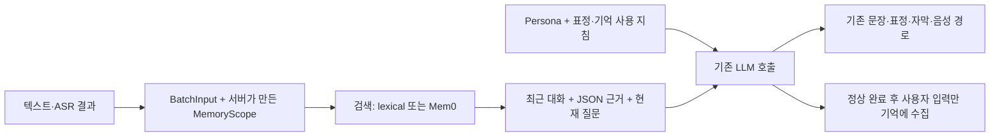

# 앱의 RAG 최소 연결

2026-11-02. `basic_memory_agent`에 선택형 검색을 구현했다. 외부 API를 추가로 호출하지 않고 가짜 LLM·가짜 Mem0 SDK·실제 임시 SQLite로 앱 연결 계약을 검사했다. 실제 모델의 답변 품질이나 음성·마이크·아바타 실행 성공을 뜻하지 않는다.

## 응답과 수집 흐름



- Persona는 기존 system 지침이다. 검색 근거는 현재 user 메시지의 별도 텍스트 블록이다. 검색 결과를 최근 대화나 사용자 사실로 재수집하지 않는다. 이 구분만으로 프롬프트 주입 내성이 보장되지는 않는다.
- 단순 응답 및 OpenAI/Claude 도구 호출이 공통으로 검색된 메시지를 받는다. 이번 검사는 단순 응답을 끝까지 실행했고, 실제 도구 호출은 실행하지 않았다.
- 기억 소유 범위는 `서버 연결 ID × character_config.conf_uid × history_uid`다. 표시 이름과 WebSocket metadata로 소유자를 정하지 않는다. 연결/선택된 기록이 없으면 RAG를 생략한다.
- `load_cache`는 기본 Agent의 최근 대화·중단 상태와 설정을 연결별로 분리한다. 캐시된 stateless LLM은 재사용하며 원래 소유자가 닫는다. 같은 연결에 새 단일 입력이 오거나 대화/캐릭터를 전환하기 전에 진행 중인 단일 응답을 취소하고 기다린다. 캐릭터 ID를 바꾸면 Agent를 새로 만들고 선택 기록을 비운다.
- `skip_memory`, `skip_history`, `proactive_speak` 중 하나가 켜져 있으면 이번 RAG의 검색과 수집을 생략한다. 클립보드·이미지·생성 답변은 장기 기억 수집 대상에서 제외한다. 기존 앱의 단기 대화 처리 의미는 유지한다.

## 켜는 방법

로컬 `conf.yaml` 또는 캐릭터 설정의 다음 위치에 넣는다. 실제 로컬 설정은 이번 작업에서 변경하지 않았다.

```yaml
character_config:
  agent_config:
    conversation_agent_choice: basic_memory_agent
    agent_settings:
      basic_memory_agent:
        # llm_provider 등 기존 설정 유지
        rag:
          enabled: true
          backend: lexical
          directory: chat_history/rag
          top_k: 5
          max_context_chars: 4000
          recent_messages: 20
          recent_chars: 12000
          timeout_seconds: 2
```

두 기본 YAML 템플릿에는 `enabled: false`로 추가했다. 생략해도 비활성화된다. `lexical`은 기존 `TranscriptStore`의 SQLite FTS 검색이며 외부 API/추가 패키지를 요구하지 않는다. 디렉터리는 기본적으로 Git 제외 `chat_history/` 아래다. 같은 디렉터리를 여러 연결이 공유하되 검색·수집에는 복합 범위가 적용된다. 같은 디렉터리에 서로 다른 RAG 설정을 적용하면 오류를 내므로 별도 디렉터리를 사용한다.

Mem0로 바꾸려면 앱 실행 Python 환경에 `mem0ai==2.2.1`을 설치하고, 다음 설정을 추가한다. 기존의 미구현 `mem0_agent` 선택지는 사용하지 않는다.

```yaml
        rag:
          enabled: true
          backend: mem0
          directory: chat_history/rag-mem0
          mem0_settings_file: experiments/memory/gemini.example.json
          api_key_env: GEMINI_API_KEY
```

JSON에는 호환 API 주소·추출 모델·임베딩 모델·임베딩 차원이 들어간다. 키는 지정된 환경변수에서 읽는다. 앱 의존성 환경에 Mem0를 함께 설치하는 호환성 검사는 아직 하지 않았으며, 별도 실험 환경에서 사용했던 SDK 어댑터를 연결했다. 앱의 패키지/lock 파일을 바꾸거나 패키지를 추가 설치하지 않았다. 실제 API 통합 확인 전에는 `lexical`로 연결을 확인한다.

## 대기·오류·삭제

- 저장소는 필요할 때 초기화한다. 디렉터리당 하나의 직렬 작업자가 SDK/SQLite를 다룬다. 검색·수집 중 작업 하나가 아직 실행 중이면 새 검색·수집을 쌓지 않고 생략한다. 요청은 기본 2초만 기다리고 정상 응답 경로로 돌아간다. 예외 로그에는 예외 종류만 넣는다.
- 제한 시간을 넘긴 동기 SDK 호출은 실행 중일 수 있다. Mem0의 개별 HTTP 호출에는 15초 제한과 자동 재시도 0을 설정한다. 추출 한 건은 여러 HTTP 호출로 구성될 수 있다. 이는 완전한 작업 취소나 전달 보장이 아니다.
- 응답 정상 완료 후 사용자 입력을 수집한다. 응답 중단/오류/작업자 사용 중일 때 일부 기억이 수집되지 않을 수 있다. 영속 수집 대기열과 재시도·수집 상태 UI는 후속 과제다. 기존 원문 기록은 별도로 남는다.
- 기록 삭제가 성공하면 현재 연결의 같은 기억 범위를 즉시 검색 불가로 만들고 기존 작업 뒤에서 실제 삭제한다. 삭제가 지연/실패하면 로그에 남긴다. 다른 연결에서 같은 원문 기록을 읽었던 범위까지 일괄 삭제하는 기능은 아직 없다. UI의 기존 삭제 성공은 원문 JSON 삭제 결과이며 모든 파생 기억의 삭제 완료 확인은 아니다.
- 서버 종료 시 공유 작업자를 정리한다. 아직 진행 중인 동기 작업의 종료를 기다리므로 SDK 호출 종료 시간에 영향을 받는다.

## 검증 범위와 남은 한계

실행 명령:

```powershell
.venv/Scripts/python.exe -m unittest discover -s tests
.venv/Scripts/ruff.exe check .
git diff --check
```

Windows의 비동기 테스트는 asyncio 내부 로컬 소켓 쌍을 만들 수 있어야 한다. 이번 제한된 샌드박스에서 해당 생성이 막혀, 허용된 외부 실행으로 로컬 검사만 수행했다. 테스트에는 실제 API 키나 외부 요청이 필요 없다.

새 검사는 실제 `process_single_conversation` → `BasicMemoryAgent.chat` → 가짜 LLM까지 통과한다. 오래된 사실이 최근 문맥에서 빠진 뒤 검색되는지, 다른 연결·캐릭터·기록의 근거가 제외되는지, 실패/시간 초과 시 응답이 유지되는지, 동일한 근거에서 Persona system만 바뀌는지 확인한다. Mem0 SDK 경계는 가짜 SDK로 검색 필터·사용자 발화 수집·클라이언트 재사용을 확인한다.

관측 결과: 새 통합 검사 15개와 기존 검사 21개, 총 36개 통과. Ruff 검사와 `git diff --check`도 통과했다. 이는 연결 계약·회귀 검사이며 LongMemEval 성능 점수가 아니다.

현재 범위는 **같은 연결·캐릭터·선택 기록 안에서의 오래된 발화 검색**이다. 재접속·다른 기록까지 이어지는 장기 기억은 인증된 사용자 ID와 채널 ID 계약을 만든 다음 확장해야 한다. 기존 JSON 기록 목록의 접근 제어를 추가한 것은 아니므로 이 변경을 계정 간 보안 격리 구현으로 해석하면 안 된다. 기존 기록 전체를 자동으로 색인하지 않으며 기능을 켠 후 정상 완료된 새 발화부터 수집한다. 기록 복원 시에는 최근 문맥만 제한해 불러온다.

최근 대화와 검색 근거 예산은 문자 기준이다. 현재 질문·이미지·도구 결과·Persona를 포함한 전체 토큰 예산은 별도 구현이 필요하다. 정정·삭제의 완전한 수명 관리, 범위별 추적 UI, 그룹/방송 대화, 검색 정확도·Persona 표현 효과 측정은 후속 단계다.
