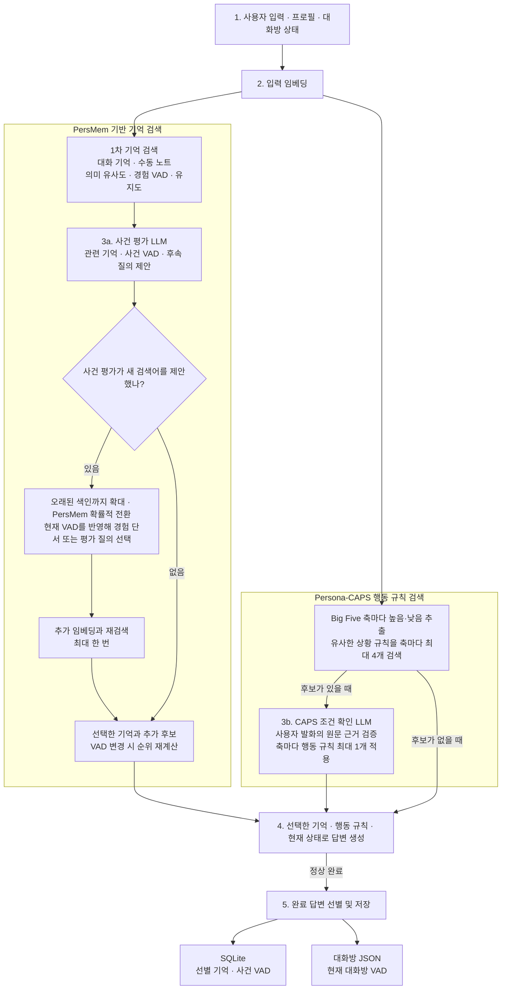

# Studio 에이전트 대화 파이프라인

Studio 대화 엔진은 캐릭터 프로필을 바탕으로 한 턴을 처리한다. **PersMem 기반 검색**은 어떤 경험을 떠올릴지 고르고, **Persona-CAPS**는 현재 상황에서 어떤 행동을 답변에 반영할지 고른다. 아래 도식은 에이전트를 등록해 사용하는 일대일 대화의 실행 경로다. 코드와 JSON 예시는 도식의 단계 순서로 배치했다.



두 경로에서 후보를 모은 뒤 사건 평가와 CAPS 조건 확인을 병렬로 실행한다. 추가 검색은 첫 벡터 검색에 성공하고 사건 평가가 새 검색어를 제안했을 때 수행한다. 대화 원문은 사용자 입력과 답변을 처리할 때 각각 대화방 JSON에 추가한다.

## 1. 프로필과 입력을 준비한다

대화에 연결할 때 서버는 현재 에이전트의 프로필 버전을 읽는다. 프리셋의 정체성·배경·말투에 Big Five 프로필과 수동 노트를 더한다. 프로필과 수동 노트는 `chat_history/studio.sqlite3`의 `agent_profiles`에서 `agent_id`와 버전으로 1건을 읽는다. 노트는 프로필당 최대 50개다. 프로필을 편집하면 같은 `agent_id`에 새 버전이 생긴다. 새 대화는 별도 기록과 초기 VAD로 시작하고 같은 에이전트의 장기 기억을 검색할 수 있다. 캐릭터를 복제하면 새 `agent_id`와 빈 자동 기억으로 시작한다. [시작 프리셋](../config_templates/studio-personas.yaml) · [프로필과 기억 저장소](../src/open_llm_vtuber/studio_registry.py)

텍스트와 음성 인식 결과는 같은 턴 처리기로 들어간다. ASR은 음성 입력에서 실행한다. 선택한 대화방이 있으면 검색과 LLM 호출 전에 현재 사용자 발화 원문 한 건을 `chat_history/<conf_uid>/<history_uid>.json`의 메시지 배열에 추가한다. 예시 기록의 형식은 아래와 같다.
```json
{
  "role": "human",
  "timestamp": "2026-11-25T14:00:00",
  "content": "편안한 모임에서 여러 사람과 함께 있으니 기뻐. 지난번에 말한 발표 시작 시간이 몇 시였지? 다음에 초안을 가져오면 같이 검토해 줄래?",
  "name": "사용자"
}
```


| 현재 턴에 읽는 값 | 출처 | 사용 개수와 방법 |
| --- | --- | --- |
| 현재 발화 | 텍스트 또는 ASR 결과 | 현재 입력 1건. 검색과 사건 평가에는 양 끝 공백을 제거한 뒤 최대 4,000자를 사용한다. 대화 JSON에는 원문을 저장한다. |
| 직전 대화 | 해당 JSON에서 복원한 에이전트의 메모리와 현재 연결에서 이어진 대화 | 가장 최근 메시지 최대 **4개**에서 시작한다. 사용자·에이전트 발화를 함께 세고, 맨 앞에 답변만 남아 있으면 그 답변을 빼며, 사건 평가에는 메시지당 최대 280자를 전달한다. 기록 파일에는 기존 메시지가 계속 누적된다. |
| 대화방 VAD | 같은 JSON의 첫 `metadata` 항목 | `studio_affect_v1`에서 에이전트별 VAD 1건을 읽는다. 저장된 VAD가 없으면 `(0, 0, 0.5)`로 시작한다. |
| 직전 대화를 붙인 검색어 | 위의 직전 대화에서 선택 | “그거 뭐였지?”처럼 앞말을 가리키는 입력이면 마지막 최대 2개 메시지의 텍스트를 붙여 별도 검색어를 만든다. 최신 메시지가 사용자 발화이면 그 한 건만 붙인다. | [입력 처리](../src/open_llm_vtuber/conversations/single_conversation.py) · [턴 준비](../src/open_llm_vtuber/studio_turn.py)

## 2. 기억과 행동 규칙의 후보를 찾는다

| 경로 | 후보를 만드는 방법 |
| --- | --- |
| 대화 기억과 수동 노트 | 노트 최대 50개와 같은 모델로 색인된 최근 대화 기억 최대 64개를 비교한다. 코사인 유사도 0.40 이상에서 최대 3개를 고른다. VAD가 기록된 경험에는 감정 정합도와 유지도를 더한다. |
| 추가 기억 검색 | 첫 후보에 필요한 근거가 빠졌다고 사건 평가가 판단해 새 검색어를 제안하면, 오래된 색인 기억까지 범위를 넓혀 한 번 더 검색한다. |
| CAPS 행동 규칙 | Big Five 다섯 축마다 점수를 확률로 사용해 높음·낮음 그룹 중 하나를 고른다. 입력과 유사한 상황 규칙을 축별 최대 4개 검색한다. 예를 들어 친화성 80점이면 높은 친화성 그룹을 80% 확률로 선택한다. |

기억의 출처와 기록 시각을 사건 평가에 전달한다. 정정된 사실에는 현재 값과 이전 값의 연결을 보존한다. [기억 검색 코드](../src/open_llm_vtuber/studio_turn.py) · [SQLite 조회](../src/open_llm_vtuber/studio_registry.py) · [한국어 CAPS 코퍼스](../config_templates/persona-caps-ko/README.md)

### 임베딩 요청과 로컬 비교

1. 현재 입력 1건과 문맥을 붙인 질의가 있으면 그 질의 1건을 요청에 넣는다. 같은 요청 목록에 아직 캐시되지 않은 활성 CAPS 상황 문장, 캐시를 처음 채울 때 수동 노트 최대 50개, 같은 에이전트의 색인 대기 기억 중 오래된 순서로 최대 8개를 추가한다.
2. 서버는 텍스트 최대 100개를 한 배치로 임베딩하고 벡터를 정규화한다. 규칙 상황 벡터는 캐시해 재사용한다. 대기 기억의 벡터가 도착하면 그 기억의 SQLite 행에 붙이고 이번 검색의 비교 대상으로 사용할 수 있다.
3. 원래 입력 벡터로 CAPS 상황을 비교한다. 기억 비교에는 직전 대화를 붙인 질의가 있으면 그 벡터를, 그 외에는 입력 벡터를 쓴다. CAPS의 166개 규칙은 한국어 JSONL을 읽는다. 임베딩에는 각 규칙의 상황 문장을 전달하고, 행동은 조건이 확인된 뒤 답변에 넣는다.
4. 대화 기억과 수동 노트에는 코사인 0.40을 먼저 적용한다. 이미 통과한 경험에만 성향, 기억별 VAD와 현재 VAD의 정합도, 기록이 오래될수록 감소하는 유지도를 가산한다. 기억의 각성이 높을수록, 또는 정서 민감도가 높은 캐릭터의 부정적 경험일수록 유지도가 느리게 감소한다. 수동 노트와 사실은 코사인으로 비교한다. 수정된 기억은 검색 가능한 범위에서 최신 진술에 연결하고 이전 진술을 최대 2건 붙인다.

아래는 이번 턴에 캐시와 대기 건을 함께 요청하는 예시다. 실제 요청 개수는 캐시와 색인 상태에 따라 달라진다. Gemini 구성의 기본 임베딩 모델은 `gemini-embedding-001`, OpenAI 구성의 기본 모델은 `text-embedding-3-small`이며 `STUDIO_EMBEDDING_MODEL`로 재지정할 수 있다.
```json
{
  "model": "text-embedding-3-small",
  "input": [
    "편안한 모임에서 여러 사람과 함께 있으니 기뻐. 지난번에 말한 발표 시작 시간이 몇 시였지? 다음에 초안을 가져오면 같이 검토해 줄래?",
    "사람들과 함께 기분 좋은 곳에 있을 때",
    "프로젝트 발표는 오전 10시에 시작한다.",
    "다음 회의에서 정리한 항목을 공유하겠다고 약속했다."
  ]
}
```

## 3. 사건 평가와 행동 조건 확인을 병렬로 실행한다

**사건 평가**는 현재 입력, 프로필, 이전 VAD, 기억 후보, 최근 대화를 읽고 JSON을 반환한다. 관련 기억, 사건의 감정, 무엇을 저장하거나 정정할지 제안한다. 서버는 발화에서 감정 근거를 확인한 뒤 VAD를 `이전 상태 × 0.6 + 사건 평가 × 0.4`로 갱신한다. VAD는 쾌·불쾌(−1~1), 각성(0~1), 통제감(0~1)을 뜻한다.

사건 평가 요청에는 수동 노트·대화 기억 후보 최대 3개가 담긴다. 응답은 관련 기억 ID 최대 3개와 정정 대상 기억 ID 최대 3개를 제안할 수 있다. 준비 단계에서는 후보와 VAD를 계산해 답변에 전달하고, 상태 저장은 5단계에서 수행한다. 아래는 LLM에 보내는 구조화 입력과 가능한 응답 예시다. 실제 호출에서는 아래 입력 JSON을 `user` 메시지의 텍스트로 보내고 사건 평가 지침을 시스템 메시지로 별도 전달한다.

**사건 평가 요청 데이터**

```json
{
  "persona": {
    "version": 3,
    "role": "발표 준비를 돕는 동료",
    "background": "사용자와 발표를 준비한다.",
    "traits": {
      "openness": 0.6,
      "conscientiousness": 0.8,
      "extraversion": 0.55,
      "agreeableness": 0.8,
      "neuroticism": 0.25
    },
    "values": [
      "협업"
    ],
    "style": "차분한 존댓말"
  },
  "input_date_utc": "2026-11-25",
  "previous_affect": {
    "valence": 0,
    "arousal": 0,
    "dominance": 0.5
  },
  "memory_candidates": [
    {
      "id": "note-1",
      "text": "프로젝트 발표는 오전 10시에 시작한다.",
      "source": "manual_note",
      "occurred_at": null
    }
  ],
  "recent_dialogue": [
    {
      "role": "user",
      "text": "발표 리허설 일정도 잡아 두자."
    },
    {
      "role": "assistant",
      "text": "일정이 정해지면 준비 순서를 정리해요."
    }
  ],
  "input": "편안한 모임에서 여러 사람과 함께 있으니 기뻐. 지난번에 말한 발표 시작 시간이 몇 시였지? 다음에 초안을 가져오면 같이 검토해 줄래?"
}
```

**사건 평가 응답 예시**

```json
{
  "relevant_memory_ids": [
    "note-1"
  ],
  "affect": {
    "valence": 0.45,
    "arousal": 0.3,
    "dominance": 0.6
  },
  "affect_evidence": "편안한 모임에서 여러 사람과 함께 있으니 기뻐.",
  "expression_hint": "joy",
  "remember": false,
  "corrected_memory_ids": [],
  "use_recent_dialogue": false
}
```

**CAPS 조건 확인**은 후보마다 등장인물·활동·상황이 현재 입력에 들어 있는지 판단하고 발화에서 근거를 인용한다. 서버는 실제 인용을 확인해 축마다 최대 1개 규칙을 반영한다. 후보가 들어온 축은 최대 5개이며, 한 턴에 적합한 조건이 없으면 행동 규칙 없이 답변한다. 이 호출에는 후보의 상황 문장만 번호로 묶어 전달한다. 지시어 해석에 사용하는 직전 교환이 있으면 최대 2개 메시지를 `previous_exchange`로 전달한다. 예를 들어 아래 1번은 코퍼스의 `beck2022_high_agre__positivity__rude__114`다.

**CAPS 조건 확인 요청 데이터**

```json
{
  "input": "편안한 모임에서 여러 사람과 함께 있으니 기뻐. 지난번에 말한 발표 시작 시간이 몇 시였지? 다음에 초안을 가져오면 같이 검토해 줄래?",
  "condition_groups": [
    {
      "1": "사람들과 함께 기분 좋은 곳에 있을 때"
    },
    {
      "2": "다른 사람들과 함께 있고 그들과 대화해야 할 때"
    }
  ]
}
```

**CAPS 조건 확인 응답 예시**

```json
{
  "matches": [
    {
      "number": 1,
      "evidence": "편안한 모임에서 여러 사람과 함께 있으니 기뻐."
    }
  ]
}
```

회상에 필요한 정보가 후보에 빠졌다고 판단하면 사건 평가가 `next_recall_query`로 후속 검색어를 제안한다. PersMem의 확률적 전환을 적용해 아직 쓰지 않은 관련 경험을 감정·유지도로 평가해 상위 최대 6개 중 하나를 표본 추출하고, 전환이 선택되면 그 경험의 앞 60자를 질의로 사용한다. 두 경우 모두 추가 검색은 최대 한 번이다. VAD 갱신으로 새로 상위에 오른 기억과 후속 검색 결과는 추가 후보로 표시하며 답변 모델이 질문의 대상·시점에 맞는지 확인한다. 후속 검색은 같은 에이전트의 현재 모델 색인에서 오래된 기억까지 읽고, 이전에 선택한 기억을 제외한 후보를 새 질의로 비교한다. 추가 임베딩 제한은 4초이며 최대 3개 후보를 더 고른다. [사건 평가와 재검색 코드](../src/open_llm_vtuber/studio_turn.py) · [PersMem §3 및 부록 D](https://arxiv.org/html/2609.34372v1#S3) · [Persona-CAPS 논문](https://aclanthology.org/2026.emnlp-main.1495/)

## 4. 선택한 문맥으로 답변을 생성한다

답변 모델의 시스템 메시지에는 에이전트의 정체성·말투와 확인된 CAPS 행동을 넣는다. 대화 문맥에는 선택한 기억과 현재 VAD를 넣고 필요한 턴에서만 직전 대화를 전달한다. 기억의 정정 이력을 찾으면 특정 과거 시점에는 당시 진술을, 현재 사실을 물으면 최신 진술을 사용하도록 안내한다.

답변 생성 호출은 아래 형식이다. 직전 메시지 최대 4개는 지시어가 있거나 사건 평가가 필요하다고 판단한 턴에서 문맥에 배치한다. 현재 사용자 메시지에는 서버가 선택한 문맥과 현재 입력이 각각 들어간다. 아래 시스템 지침은 읽기 쉽게 줄였다.

**답변 생성 요청의 시스템 지침과 메시지 예시**

```json
{
  "system": "캐릭터 동료: 차분한 존댓말. 이번 턴의 행동 규칙: 사람들과 함께 기분 좋은 곳에 있을 때 다정하게 말하고 고마움을 표현한다.",
  "messages": [
    {
      "role": "user",
      "content": [
        {
          "type": "text",
          "text": "서버가 선택한 대화 문맥:\n{\"experience\":[{\"id\":\"note-1\",\"text\":\"프로젝트 발표는 오전 10시에 시작한다.\",\"source\":\"manual_note\",\"occurred_at\":null}],\"affect\":{\"valence\":0.18,\"arousal\":0.12,\"dominance\":0.54}}"
        },
        {
          "type": "text",
          "text": "편안한 모임에서 여러 사람과 함께 있으니 기뻐. 지난번에 말한 발표 시작 시간이 몇 시였지? 다음에 초안을 가져오면 같이 검토해 줄래?"
        }
      ]
    }
  ]
}
```

**답변 예시**

발표는 오전 10시에 시작해요. 다음에 초안을 가져오면 구성부터 같이 검토할게요.

서버는 답변을 스트리밍한다. 음성 출력 설정이 있으면 TTS 엔진에 발화 분절별 텍스트를 보내고, 화면은 사건 평가에 근거한 표정 선택 결과를 사용한다. 정상 완료 응답의 기록에는 프로필 버전, CAPS 근거, 초기 검색을 포함한 검색 단계 수와 전환 결과가 붙는다. [답변 문맥 조립](../src/open_llm_vtuber/agent/agents/basic_memory_agent.py) · [완료 응답 기록](../src/open_llm_vtuber/conversations/single_conversation.py)

## 5. 완료된 턴을 기록하고 장기 기억을 선별한다

| 저장 위치 | 저장 단위 |
| --- | --- |
| `chat_history/<conf_uid>/<history_uid>.json` | 사용자 발화와 에이전트 답변 원문, 완료 응답의 규칙·검색 근거. `metadata`에는 같은 대화방을 이어 갈 때 복원하는 누적 VAD가 들어간다. |
| `chat_history/studio.sqlite3`의 `agent_memories` | 여러 대화에서 검색할 사용자 사실·선호·경험과 답변에서 확인한 약속·공동 경험. 원문, 출처가 된 대화와 사건 ID, 프로필 버전을 저장한다. 감정 평가 근거가 있는 경험에는 기억 자체의 사건 VAD인 `event_affect`를 붙인다. |

대화방 VAD는 방금 일어난 사건을 반영한 에이전트의 현재 상태다. 기존 대화방 기록과 함께 JSON에서 복원하고, 다음 턴에서 기억 순위와 답변 문맥에 쓴다. 완료된 작업이나 마감처럼 이후에도 쓸 정보는 선별되면 SQLite에서도 기억으로 검색할 수 있다.

`event_affect`는 특정 경험에 대한 에이전트의 반응을 그 기억과 함께 보관한다. 나중에 같은 에이전트가 다른 방에서 그 기억을 찾을 때도 현재 대화방 VAD와 비교할 수 있다. 새 대화방을 만들면 대화방 VAD는 초기값으로 시작하고, 기존 경험에 붙은 사건 VAD는 그대로 검색에 사용한다. 예를 들어 이전 대화방 쾌·불쾌가 `0`이고 사건 평가가 `0.8`이면, 그 경험에는 `0.8`을 붙이고 대화방에는 `0.32`를 저장한다. 이 예에서는 답변에 별도의 감정 근거가 없다.

### 완료 답변 선별과 기록 순서

1. 생성 오류 없이 답변 원문이 있고 같은 대화방이 유지됐을 때 완료 처리를 실행한다. 음성이 생성됐다면 TTS 작업이 끝나고 브라우저의 재생 완료 신호를 받은 뒤 실행한다. 중단된 턴은 이미 기록한 사용자 발화를 보존하고 장기 기억과 VAD 저장을 확정하지 않는다. 음성 재생 완료 신호가 누락되면 생성된 답변 원문은 대화 JSON에 남을 수 있고, 완료 턴의 검토 근거는 작성되지 않는다.
2. 완료 답변 선별은 사용자 발화 최대 4,000자와 에이전트 답변 최대 4,000자를 한 쌍으로 모델에 보낸다. 명시적 약속이나 두 메시지에서 확인되는 공동 경험이라면 최대 400자의 답변 근거를 제안한다. 원문 인용 확인을 통과한 구절을 장기 기억에 붙인다. 답변의 감정도 양쪽에 원문 근거가 확인될 때 반영한다. 선별이 제한 시간 3초를 넘기거나 실패하면 앞서 사건 평가에서 확인한 사용자 정보는 저장한다.
3. SQLite의 장기 기억을 먼저 저장하고, 대화방 VAD는 해당 대화의 JSON 메타데이터에 반영한다. 마지막으로 대화 JSON에 에이전트 답변 원문과 완료 턴의 근거를 추가한다. JSON은 임시 파일에 쓴 뒤 교체한다. SQLite에서는 새 기억 삽입과 대체된 기억 링크를 한 트랜잭션에서 다룬다. [JSON 쓰기](../src/open_llm_vtuber/chat_history_manager.py) · [SQLite 쓰기](../src/open_llm_vtuber/studio_registry.py)

**완료 답변 선별 요청 데이터**

```json
{
  "user_input": "편안한 모임에서 여러 사람과 함께 있으니 기뻐. 지난번에 말한 발표 시작 시간이 몇 시였지? 다음에 초안을 가져오면 같이 검토해 줄래?",
  "assistant_reply": "발표는 오전 10시에 시작해요. 다음에 초안을 가져오면 구성부터 같이 검토할게요."
}
```

**완료 답변 선별 응답 예시**

```json
{
  "response_evidence": "다음에 초안을 가져오면 구성부터 같이 검토할게요.",
  "kind": "commitment",
  "response_affect": null,
  "response_affect_evidence": null
}
```

### 저장 레코드 예시

아래 SQLite 행은 사건 평가가 사용자 입력의 저장을 제안하지 않아도 완료 답변에 검증된 약속이 있어 저장되는 예시다. SQLite 컬럼 `embedding_model`은 색인 전까지 빈 문자열이고, JSON `payload`에는 사용 예정인 모델명과 `vector: null`이 들어간다. 실제 `payload`는 JSON 문자열로 저장한다. 벡터가 채워지면 정규화한 float32 벡터를 Base64로 기록한다.

```json
{
  "agent_id": "agent-example",
  "event_id": "event-example",
  "occurred_at": "2026-11-25T05:00:00+00:00",
  "embedding_model": "",
  "text": "편안한 모임에서 여러 사람과 함께 있으니 기뻐. 지난번에 말한 발표 시작 시간이 몇 시였지? 다음에 초안을 가져오면 같이 검토해 줄래?",
  "payload": {
    "id": "event-example",
    "text": "편안한 모임에서 여러 사람과 함께 있으니 기뻐. 지난번에 말한 발표 시작 시간이 몇 시였지? 다음에 초안을 가져오면 같이 검토해 줄래?",
    "source": "user_turn",
    "occurred_at": "2026-11-25T05:00:00+00:00",
    "embedding_model": "text-embedding-3-small",
    "vector": null,
    "profile_version": 3,
    "source_history_id": "history-example",
    "meaning": null,
    "assistant_excerpt": "다음에 초안을 가져오면 구성부터 같이 검토할게요.",
    "assistant_memory_kind": "commitment",
    "search_text": "편안한 모임에서 여러 사람과 함께 있으니 기뻐. 지난번에 말한 발표 시작 시간이 몇 시였지? 다음에 초안을 가져오면 같이 검토해 줄래?\n다음에 초안을 가져오면 구성부터 같이 검토할게요."
  },
  "superseded_by": null
}
```

같은 대화의 JSON에는 아래처럼 메타데이터와 답변이 별도 항목으로 남는다. `studio.rules` 항목은 규칙 ID·행동·원 논문 관찰 근거와 매칭한 사용자 발화 인용을 함께 저장한다. 아래 예시는 저장 형식을 보여 주기 위해 사용자 원문과 규칙의 일부 필드를 생략했다.

```json
[
  {
    "role": "metadata",
    "timestamp": "2026-11-25T14:00:00",
    "studio_affect_v1": {
      "agent-example": {
        "affect": {
          "valence": 0.18,
          "arousal": 0.12,
          "dominance": 0.54
        },
        "event_id": "event-example",
        "updated_at": "2026-11-25T05:00:00Z"
      }
    }
  },
  {
    "role": "ai",
    "timestamp": "2026-11-25T14:00:03",
    "content": "발표는 오전 10시에 시작해요. 다음에 초안을 가져오면 구성부터 같이 검토할게요.",
    "name": "발표 동료",
    "studio": {
      "event_id": "event-example",
      "profile_version": 3,
      "rule_candidate_ids": [
        "beck2022_high_agre__positivity__rude__114",
        "beck2022_high_cons__sociality__efficient__044"
      ],
      "rule_directions": {
        "openness": "high",
        "conscientiousness": "high",
        "extraversion": "low",
        "agreeableness": "high",
        "neuroticism": "low"
      },
      "rule_selection": "ok",
      "rules": [
        {
          "id": "beck2022_high_agre__positivity__rude__114",
          "evidence": "편안한 모임에서 여러 사람과 함께 있으니 기뻐."
        }
      ],
      "recall_steps": 1,
      "recall_redirection": null
    }
  }
]
```

경험을 저장할 때는 확인된 경험 주체, 경험의 중요도와 캐릭터 관점에서의 해석을 `meaning`에 기록할 수 있다. 경험의 입력 VAD와 답변 VAD가 모두 확인되면 두 사건 VAD의 평균을 `event_affect`로 붙인다. 대화방 VAD에는 답변의 감정도 추가로 반영한다. [완료 처리와 기억 선별](../src/open_llm_vtuber/studio_turn.py)

발화의 벡터를 재사용할 수 있는 기억은 즉시 색인한다. 답변 근거를 포함한 기억은 `사용자 발화 + 답변 인용`을 색인할 때까지 원문을 보관하며, 이후 턴의 검색 배치에서 대기 건을 최대 8개씩 처리한다. 대화 삭제는 JSON 기록에 적용되며 SQLite의 에이전트 장기 기억은 보존된다. 등록 정보가 없는 기존 대화 경로는 같은 대화 JSON의 `studio_rag_v1`에 벡터가 있는 선별 기억을 최대 64개 보관한다. 등록된 에이전트를 사용하는 이 문서의 기본 경로에서는 SQLite가 장기 기억 저장소다. [대기 기억 처리](../src/open_llm_vtuber/studio_registry.py)

## 모델 및 API 호출

다음 수는 등록된 에이전트의 턴에서 서버가 논리적으로 요청하는 횟수다. 제공자 SDK의 재시도와 음성 처리 요청은 각각 별도로 센다.

| 도식 단계 | 요청 | 호출 조건 |
| --- | --- | --- |
| 1 | ASR | 음성 입력에서만. 로컬 실행 또는 외부 API 여부는 설정에 따른다. |
| 2 | 기본 임베딩 | 모델 설정과 어댑터가 있으면 실행한다. 현재 입력, 필요시 직전 대화를 붙인 검색어, 캐시가 비어 있는 규칙·노트, 대기 기억을 요청당 최대 100건으로 묶는다. 일반적으로 1회다. 배치 처리 제한 시간은 6초다. |
| 3a | 사건 평가 LLM | 매 Studio 턴에 1회. 검색이 비어 있어도 현재 발화와 상태를 평가한다. 제한 시간은 10초다. |
| 3b | CAPS 조건 확인 LLM | 규칙 후보가 있을 때 1회. 사건 평가와 병렬이며 제한 시간은 10초다. |
| 3a 후속 | 추가 검색 임베딩 | 사건 평가가 새 검색어를 제안할 때 최대 1회. 오래된 색인도 후보에 포함한다. |
| 4 | 답변 생성 LLM | 기본 1회. 스트리밍 첫 출력 전에 실패하면 최대 1회 재시도한다. |
| 4 출력 | TTS | 음성 출력이 설정된 경우 발화 분절별로 호출한다. 로컬 실행 또는 외부 API 여부는 엔진에 따른다. |
| 5 | 완료 답변 선별 LLM | 등록된 에이전트에서 정상 완료한 답변이 있을 때 1회. 제한 시간은 3초다. |

임베딩이 한 배치에 들어가고 CAPS 후보가 있는 보통의 텍스트 턴은 **답변 생성까지 4회, 완료 후 선별 1회**다. 기본 임베딩 1회, 사건 평가와 CAPS 조건 확인 각 1회, 답변 생성 1회를 뜻한다. 현재 구성은 같은 대화 모델을 평가·조건 확인·생성·선별에 용도별로 호출한다.

## 한 턴에서 확인할 예

- 발표 시각을 기록한 지 오래돼도 캐릭터의 수동 노트에 있거나 후속 검색에서 색인된 장기 기억을 찾으면 답변에 넣을 수 있다. 이때 JSON 원문과 연결된 최근 메시지는 별도로 사용한다.
- 조건 확인 결과가 달라지면 답변에 적용된 규칙 ID와 실제 발화 인용을 완료 응답의 `studio` 필드에서 확인한다.

## 검증 범위

- 로컬 자동 테스트 96개가 통과했다. 경험별 VAD 순위, 오래된 기억의 후속 검색, 확률적 전환, 완료 답변에서 고른 약속과 CAPS 발화 근거를 확인한다.
- `gpt-4o-mini`와 `text-embedding-3-small`을 사용한 합성 텍스트 세 턴에서 수동 노트 회상, 모임 상황의 CAPS 규칙과 발화 근거, 취향의 SQLite 저장을 확인했다.
- PersMem과 Persona-CAPS의 논문 벤치마크는 같은 조건에서 별도의 재현 실험이 필요하다. [PersMem](https://arxiv.org/html/2609.34372v1#S3) · [Persona-CAPS](https://aclanthology.org/2026.emnlp-main.1495/)
