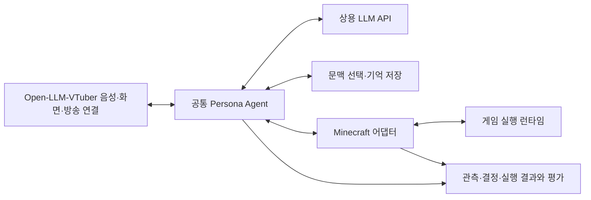

# 페르소나 에이전트·VTuber·Minecraft 통합 방향

작성일: 2026년 10월 29일. 사용자 회의 결과를 반영했다. **팀 확정 사항**, **확인한 구현 근거**, **제안**, **미정 사항**을 구분한다. 이 문서는 통합 구현·AWS 배포·평가 실험이 완료됐다는 보고가 아니다.

## 팀이 정한 큰 틀

1. 오픈소스 기반 개인 페르소나 에이전트를 공통 기반으로 만든다.
2. VTuber와 방송에 연결한다.
3. Minecraft에 연결한다.
4. 산책 동반은 확장 목표로 둔다.
5. 개발 후 로컬에서 에이전트 8개를 운영해 Minecraft 경기를 진행하는 것도 확장 목표다.

Open-LLM-VTuber를 기반으로 하고 AIRI의 게임 기능과 필요한 구현을 재사용한다. 여기서 AIRI는 우선 `moeru-ai/airi`로 해석했다. 다른 저장소를 뜻한 경우 재검토한다.

최우선 질문은 **페르소나별 대화와 행동이 팀이 미리 정한 방향으로 달라지고, 그 차이가 반복 실험에서도 확인되는가**다.

확정된 운영 방향은 개발용 AI 구독 활용, 상용 API 키 사용, AWS 서버와 Docker 사용이다. 구체적인 AWS 서비스·크기, 실제 과금 계정, API 예산·한도는 아직 정하지 않았다. 구독 사용량 배수와 런타임 API 한도는 같은 단위로 계산하지 않는다. 일부 플랜의 API 크레딧 혜택은 계정 연결·적용 범위·만료 조건을 따로 확인한다.

## 확인한 근거

- 현재 Open-LLM-VTuber의 Python 백엔드는 음성 입출력·Live2D·WebSocket·기록 저장을 제공하고, `AgentFactory`와 `BasicMemoryAgent`가 대화·모델 호출을 연결한다. 기존 Agent 연결점을 확장 후보로 삼는다.
- 현재 Agent 문맥은 `_memory`와 저장된 대화 복원에 의존한다. 기본 Agent 객체를 연결별 컨텍스트에 넘기는 경로가 있어, 다중 에이전트 확장 전에 객체·문맥 공유를 점검해야 한다. 실제 혼선은 아직 검증하지 않았다.
- AIRI 공식 소스 `e8dc7b84ca9846a3f26e469213fc618bb247d66f`의 `integrations/minecraft`는 TypeScript·Mineflayer 기반이고 자체 인지·계획·행동 계층이 있다. `mineflayer-pathfinder`, `mineflayer-collectblock`, `mineflayer-pvp` 등을 의존성으로 사용한다.
- 해당 Minecraft README는 **현재 Mineflayer 런타임을 Fabric 기반 런타임으로 교체할 예정**이라고 명시한다. 확인한 것은 소스와 문서이며 우리 환경에서 AIRI를 실행한 결과는 아니다. Fabric 전환의 완성도나 호환성을 확인했다고 주장하지 않는다.
- 두 프로젝트의 루트 코드는 MIT 라이선스다. 현재 저장소의 Live2D 예시는 별도 라이선스를 따른다. 실제 가져오는 코드·의존성·모델·리소스는 원본 커밋과 해당 라이선스를 함께 기록한다.

## 제안하는 통합 구조

공통 Agent가 캐릭터·목표·문맥과 상위 행동을 관리하고, 게임 런타임은 이동·채굴·먹기 같은 동작을 수행하도록 제안한다. Python과 TypeScript 경계는 명시적인 메시지 계약으로 연결한다. HTTP·WebSocket 등 전송 수단의 구체적인 선택은 아직 미정이다.

| 재사용·구현 영역 | 제안 |
|---|---|
| Open-LLM-VTuber | 현재 검증한 음성 대화·아바타·기록·WebSocket 경로를 유지한다. 공통 Agent 연결점을 확장한다. |
| AIRI | 게임 이벤트 정리, 스킬·실행 관리, 긴급 반응 구조를 우선 조사한다. 채택 여부는 작은 실행 검증 뒤 결정한다. |
| 공통 Agent | 페르소나 설정과 버전, 목표·문맥 선택, 기억의 소유 범위, 행동 요청과 결과 처리를 일관되게 관리한다. |
| Minecraft 어댑터 | 런타임 고유 객체를 공통 코어 밖에 두고, Mineflayer와 Fabric 중 채택한 방식의 관측·동작을 변환한다. |
| 평가 | 대화·행동·기억·과제 완수를 별도 지표로 기록한다. |

AIRI 자체 계획기와 우리 계획기가 동시에 같은 봇에 명령하는 구성은 피한다. 어떤 계층이 최종 행동을 결정하는지 하나로 정한다. 기존 TypeScript 코드를 Python으로 전부 옮기는 작업을 먼저 잡지 않는다.

게임의 매 프레임을 LLM에 질의하지 않고, 목표·사건 단위로 상위 판단을 요청한다. 세부 동작은 실행 런타임이 처리한다. 한 봇의 행동 큐·취소·우선순위를 관리해 대화 명령과 진행 중 작업의 충돌을 처리한다.

다음 메시지는 우리 시스템의 **제안 계약**이며 AIRI의 기존 공개 API 명세가 아니다.

- 관측: `agent_id`, `world_id`, 사건·시각, 위치·체력·배고픔·인벤토리·현재 작업.
- 결정 요청: `persona_version`, 현재 목표, 선택한 기억 ID, 토큰 예산 안의 문맥.
- 행동 요청: `action_id`, 작업 종류·대상·수량, 취소·시간 제한 정보.
- 실행 결과: 같은 `action_id`, 성공·실패·취소, 실제 상태 변화와 실패 이유.

Jev는 TypeSafe AI가 제공하는 실제 모델이며 의사결정 계층의 구체적인 후보로 검토한다. 앞서 특정 제품명이 없는 일반적인 의사결정 계층으로 해석했던 내용은 정정한다. 공식 문서에 따르면 상태와 정해진 질문을 받아 Choice(선택·확률·confidence), Score(점수·확률·confidence), Noul(0–1 판단값) 등의 구조화된 결과를 반환한다. 일부 실험 기능도 있지만 초기 검토는 텍스트 상태와 제한된 행동 선택으로 한정한다. 우리 환경에서 API를 호출하거나 성능을 측정한 결과는 아직 없다.

구성 제안은 LLM이 대화와 상위 목표·계획을 맡고, Jev가 코드가 제공한 실행 가능한 행동 후보에서 다음 행동을 선택하도록 하는 방식이다. 급박한 회복·후퇴 등 즉시 반응은 공통 규칙으로 처리할 수 있다. 실행 전에 허용된 행동·대상·실행 가능 조건을 검증하고, 실제 실행은 게임 런타임이 맡는다. 기존 LLM만으로 행동을 고르는 방식도 기준 조건으로 유지해 같은 관측·목표·페르소나·행동 후보로 성공률·지연·비용·성향 차이를 비교한다. 이 역할 배분은 제안이며 채택이 확정된 것은 아니다.

Jev의 형식이 맞는 응답과 판단의 정확성은 별도로 평가한다. 행동 후보의 순서·표현을 바꾼 실험, 확신도와 실제 성공률의 관계도 확인한다. `mrubens/jevcraft`에 Mineflayer와 Jev를 연결한 공개 사례가 있지만 그 프로젝트의 주장과 우리 시스템의 실측 결과를 구분한다.

## 페르소나 표현 제안

MBTI는 캐릭터 프리셋 이름으로 시작하고, 서술형 지침과 팀이 정의한 수치형 성향을 함께 저장한다. 수치가 실제 인간의 MBTI를 과학적으로 환산한 값이라는 주장은 하지 않는다.

| 설정 | 반영할 후보 | 관찰할 차이 |
|---|---|---|
| 계획 성향 | 사전 단계 구성, 진행 중 목표 확인 | 계획 단계 수·목표 확인 시점·작업 전환 빈도 |
| 탐색 성향 | 새로운 장소·대안 행동 선호 | 우회·탐색 선택과 과제 완료 시간 |
| 협력 성향 | 다른 캐릭터의 도움 요청과 자원 분배 | 도움 행동·자원 전달·협상 선택 |
| 위험 선호 | 공통 제한 안에서의 경로·상황 선택 | 위험 노출·후퇴·회복 행동 |
| 표현 방식 | 말투·응답 길이·감정 표현 | 대화 평가표와 실제 출력 |

같은 설정에서 시스템 지침과 행동 정책의 매개변수를 생성해 서로 어긋나지 않게 한다. 초기에는 한 축만 다른 두 프리셋을 비교한다. 예를 들어 INFP·INFJ라는 이름을 쓸 수 있지만, 기대 차이는 팀이 정의한 계획 성향으로 명시한다.

사용자 예시인 '나무와 음식을 구하러 가서 나무만 가져옴'은 원인을 구분한다. 목표가 문맥에서 사라졌다면 기억·문맥 구성 실패이고, 목표를 유지한 채 다른 일을 선택했다면 행동 정책의 결과다. 먼저 공통 과제 수행 능력을 확보하고, 성격 차이는 접근 순서·경로·도움 행동에서 확인하는 것을 제안한다. 의도적 산만함을 넣는다면 별도 행동 설정과 과제 실패 지표로 기록한다.

## 문맥·메모리 제안

RAG와 LLM은 역할이 달라 함께 사용할 수 있다. LLM은 사건에서 사실·요약을 추출하고, 검색은 현재 요청에 필요한 기억을 선택하는 데 사용한다.

문맥은 **고정 성격 지침 + 현재 목표·게임 상태 + 최근 대화 + 세션 요약 + 관련 기억**으로 구성하고 각 부분의 토큰 예산을 둔다. 전체 원문은 보존하되 매번 모두 보내는 것을 기본으로 삼지 않는다.

| 데이터 | 저장·사용 원칙 |
|---|---|
| 원문·게임 사건 | 재현·오류 분석의 근거로 보존한다. 게임 상태는 실제 관측값을 우선한다. |
| 세션 문맥 | 최근 대화·현재 작업·미완료 목표를 유지한다. |
| 장기 사실 | 출처·시각·소유 범위·정정 상태를 가진 구조화된 기록으로 저장한다. |
| 에피소드 요약 | 과거 경험을 압축하되 원문·사건의 출처 ID를 연결한다. |
| 검색 결과 | 사용자·캐릭터·월드·공유 범위로 먼저 필터링하고 관련 기억만 선택한다. |

처음에는 일반 DB와 명시적 필터·검색으로 필요한 기능을 검증하고, 의미 검색의 필요성이 확인되면 임베딩 검색을 추가하는 것을 제안한다. 최신 인벤토리·체력 같은 현재 상태를 과거 요약이나 검색 결과로 덮어쓰지 않는다.

페르소나가 기억의 중요도·검색 우선순위에 영향을 주는 실험은 가능하다. 초기에는 모두에게 같은 기억과 검색 결과를 제공해 성격 효과를 확인하고, 이후 검색 정책을 바꾸는 실험을 분리한다. 개인·캐릭터 간 데이터 격리와 현재 목표 보존은 먼저 검증한다.

## 가장 먼저 만들 평가 체계

실행 전에 성향별 예상 차이를 정의하고, 실행 후 설명이 아니라 실제 출력과 행동 결과로 평가한다. '나는 INFP다'라는 자기소개만으로 구현 성공을 판정하지 않는다.

| 시나리오 | 페르소나 차이의 후보 | 별도로 측정할 공통 성능 |
|---|---|---|
| 나무·음식 수집 | 수집 순서, 사전 계획, 중간 목표 확인 | 두 자원 확보율·누락률·완료 시간 |
| 도움 요청과 자원 부족 | 도움 제공·보류·교환 선택 | 자원 전달 성공·원래 목표 유지 |
| 탐색 중 위험 발생 | 후퇴·우회·계속 진행의 선택 | 피해·생존·명시된 제한 준수 |
| 장시간 대화·재접속 | 말투·태도·우선순위의 유지 | 사실 회상·정정 반영·기억 혼선 |

평가 절차 제안:

1. 모델·파라미터·관측·초기 기억·게임 버전·월드 조건·스킬을 고정한다. 프리셋과 지침 버전을 기록한다.
2. 중립 기준, 지침만 적용, 지침과 수치형 정책을 적용한 조건을 구분한다. 정책 코드로 강제한 차이와 LLM 판단에서 나타난 차이를 섞어 보고하지 않는다.
3. 같은 시나리오를 두 프로필로 반복한다. 여러 월드 조건에서도 확인하고 결과 분포를 비교한다. 한 번의 영상은 시연 자료로만 쓴다.
4. 대화는 프로필 이름을 가린 사람의 평가를 우선 준비하고, LLM 평가자는 사람 평가와 맞는지 확인한 뒤 보조로 사용한다.
5. 행동은 실제 인벤토리·위치·목표 상태·행동 기록으로 계산한다. 모델이 '완료했다'고 말한 것만으로 성공 처리하지 않는다.
6. 과제 성공, 성격 일관성·구별 가능성, 기억 정확성·격리, 지연·API 사용량을 따로 보고한다. 합격 기준은 실험 전에 팀이 정한다.

먼저 고정된 관측 JSON을 넣는 판단 실험을 만들고, 이후 같은 시나리오를 Minecraft 실제 실행에 연결한다. 초기 예산 예시로 10개 시나리오 × 2개 프로필 × 3회 반복을 검토할 수 있지만, 이는 통계적 충분성을 보장하는 수량이나 확정 일정이 아니다.

## AWS·Docker 및 8개 에이전트

배포와 평가의 기본 구조는 동일하게 유지한다. 초기에는 공통 코어·게임 워커·DB·웹 진입점을 구분하고 한 서버에서 컨테이너로 검증하는 방안을 제안한다. 구체적인 AWS 서비스·요금·서버 크기는 실측 후 정한다.

- 서버 안의 캐릭터별 상태·기억과 Minecraft 월드·DB를 영속 저장한다. 컨테이너를 다시 만들 때 기록이 사라지지 않는지 시험한다.
- API 키는 서버에서 주입한다. 원격 브라우저 마이크를 쓰려면 HTTPS와 그에 맞는 WebSocket 연결을 준비한다.
- 봇별 행동·문맥을 분리하고, 공통 API 호출 한도·동시 요청·토큰 예산을 관리한다.
- 현재 상용 API 방침에서 로컬 8개는 우선 봇·캐릭터 8개와 외부 모델 호출로 검증한다. LLM 가중치를 8벌 띄우는 완전 로컬 추론은 별도 성능 과제다. 현재 PC에서의 가능 수량은 측정 전 확정하지 않는다.
- Minecraft 봇 검증에는 모든 캐릭터의 아바타·ASR·TTS를 동시에 실행할 필요가 없다. 방송할 캐릭터와 게임 실행을 분리해 측정한다.

## 진행 순서 제안

| 단계 | 종료 기준 |
|---|---|
| 1. 공통 Agent와 평가 | 현재 실행 수정 공유, 연결별 상태 조사, 페르소나 2개와 평가 시나리오·로그 계약 |
| 2. 기억·문맥 | 최근 문맥·요약·필요 사실 선택, 정정·삭제·소유 범위 검사 |
| 3. Minecraft 한 봇 | AIRI 재사용 범위와 런타임 선택을 기록하고 관측→행동→실행 결과 경로 확인 |
| 4. 행동 차이 검증 | 공통 스킬로 같은 과제를 반복해 성격 차이와 과제 성능을 분리 보고 |
| 5. 방송·AWS 시연 | 대화·게임 사건·음성·화면을 연결하고 원격 접속·재시작·영속 저장 확인 |
| 6. 확장 | 2개→8개 봇의 상태 격리·API 한도·서버 부하 검증. 산책 동반과 완전 로컬 모델은 별도 실험 |

첫 통합 목표는 **페르소나 두 설정을 비교할 수 있는 한 봇 + 선별 기억 + 대화·행동 평가 리포트**로 제안한다. 8개 경기와 산책을 첫 완료 기준에 넣지 않는다.

## 아직 결정할 것

- AIRI 저장소 해석이 맞는지, 고정할 커밋과 재사용할 모듈, Mineflayer/Fabric 선택.
- MBTI 프리셋에서 실제로 달라질 축과 행동, 합격 기준, 평가 담당자.
- 목표·세션·사용자·캐릭터·월드의 소유 범위와 공유 기억 규칙.
- 저장소·검색 구현과 문맥 토큰 예산, 유료 API·AWS 예산.
- 의사결정 계층에서 LLM·규칙·Jev에 맡길 범위와 비교 평가 방식. 실제 Jev API의 계정·모델 버전·한도와 이 프로젝트에서의 성능은 별도 확인한다.

## 확인한 자료

- 2026-10-29 로컬 AIRI 참조 체크아웃은 `6399a0f158255254343f0e44cb9c51b3627e9be6`으로 고정했다. 아래 초기 조사 SHA와 구분하며, 실제 모듈 경계·레포 점검·라이선스 구분·공개 후보는 [AIRI 포팅 검토](airi-porting-review.md)를 따른다. AIRI 설치와 게임 실행은 아직 하지 않았다.
- [AIRI Minecraft 공식 README](https://github.com/moeru-ai/airi/blob/e8dc7b84ca9846a3f26e469213fc618bb247d66f/integrations/minecraft/README.md): 구조와 Fabric 전환 안내.
- [AIRI Minecraft 의존성](https://github.com/moeru-ai/airi/blob/e8dc7b84ca9846a3f26e469213fc618bb247d66f/integrations/minecraft/package.json), [AIRI 라이선스](https://github.com/moeru-ai/airi/blob/e8dc7b84ca9846a3f26e469213fc618bb247d66f/LICENSE).
- [InCharacter](https://aclanthology.org/2024.acl-long.102/): 인터뷰를 통한 역할 에이전트 성격 평가 참고. 이 프로젝트의 Minecraft 행동 검증을 대신하는 자료는 아니다.
- [Generative Agents](https://arxiv.org/abs/2304.03442): 경험 저장·요약·검색을 결합하는 설계 참고.
- [OpenAI 구독 API 크레딧](https://developers.openai.com/api/docs/guides/chatgpt-api-credits), [Claude 구독과 API](https://support.claude.com/en/articles/9876003-i-have-a-paid-claude-subscription-pro-max-team-or-enterprise-plans-why-is-claude-api-usage-billed-separately-from-my-paid-claude-plan): 적용 계정과 조건은 별도 확인.
- [브라우저 마이크의 보안 컨텍스트 조건](https://developer.mozilla.org/en-US/docs/Web/API/MediaDevices/getUserMedia).
- [TypeSafe Jev 공식 소개·질문 유형](https://docs.typesafe.ai/introduction), [공식 출시 설명](https://typesafe.ai/blog/introducing-system-one-models-and-jev), [1.14 업데이트와 실험 기능](https://typesafe.ai/blog/jev-1-14).
- [jevcraft 공개 구현](https://github.com/mrubens/jevcraft): Jev가 실행 가능한 행동 후보에서 선택하도록 한 Minecraft 사례.
- [Are AI Decision Models Biased? A Case Study of Jev](https://arxiv.org/abs/2610.19619): 응답 순서·표현 변화와 반환 확률의 민감도를 다룬 사전 공개 연구. 우리 게임 환경에 대한 직접적인 검증 결과는 아니다.
