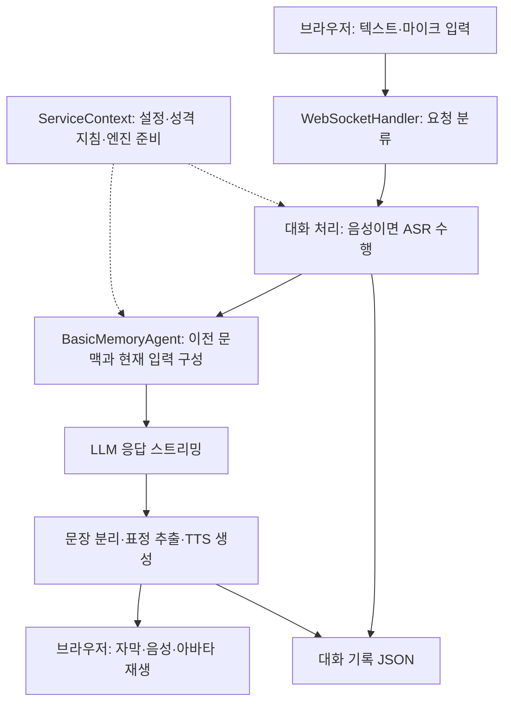

# 원본 시스템 구조와 코드 흐름

기준: 원본 커밋 `992309c0aa19845960228f880013d4685fde93b5`, `basic_memory_agent`의 1:1 대화. 이 문서는 소스 분석이며 실행 성공 보고가 아니다.

아래 상대 경로는 원본 저장소 루트 기준이다. 현재 브랜치의 같은 경로에는 수정된 코드가 있으므로 각 절의 고정 원본 링크나 별도 원본 폴더를 사용한다.

## 1. 전체 흐름



서버 기동은 `run_server.py` → `server.py`의 `WebSocketServer` → `ServiceContext.load_from_config()` 순서로 따라간다. FastAPI가 원본 프론트 파일을 `/`에 제공하며, `routes.py`에서 `/client-ws`를 등록한다. 브라우저 연결마다 `client_uid`를 발급하고 `WebSocketHandler`로 넘긴다.

## 2. websocket_handler.py: 요청을 담당 기능으로 연결

[고정 원본](https://github.com/Open-LLM-VTuber/Open-LLM-VTuber/blob/992309c0aa19845960228f880013d4685fde93b5/src/open_llm_vtuber/websocket_handler.py)

`src/open_llm_vtuber/websocket_handler.py`의 `WebSocketHandler`는 연결, 음성 버퍼, 현재 대화 작업과 메시지 분류를 관리한다.

| 메시지 type | 의미 | 주 처리 경로 |
|---|---|---|
| `text-input` | 텍스트 질문 | `_handle_conversation_trigger()` |
| `mic-audio-data` | 음성 조각 | `_handle_audio_data()`에서 연결별 버퍼에 누적 |
| `mic-audio-end` | 발화 종료 | 음성 버퍼를 꺼내 대화 시작 |
| `raw-audio-data` | 원시 음성 | 설정된 VAD를 사용하는 별도 처리 경로 |
| `interrupt-signal` | 끼어들기·중단 | `_handle_interrupt()` |
| `fetch-and-set-history` | 이전 기록 선택 | `_handle_fetch_history()` |
| `create-new-history` | 새 대화 | `_handle_create_history()` |
| `switch-config` | 캐릭터 전환 | `_handle_config_switch()` |

읽는 순서:

1. `_init_message_handlers()`: 어떤 요청을 지원하는지 확인한다.
2. `handle_websocket_communication()`: JSON 메시지 수신을 확인한다.
3. `_route_message()`: `type`에 따라 함수를 선택하는 부분을 확인한다.
4. `_handle_conversation_trigger()`: 대화 처리 모듈에 전달하는 인수를 확인한다.

예를 들어 `{"type":"text-input","text":"안녕"}`을 받으면 대화 시작 경로로 들어간다. 음성은 버퍼를 거쳐 전달되고, 이후 ASR 단계에서 텍스트가 된다.

**확인할 질문:** 화면의 한 동작이 어떤 메시지를 보내는가? 연결별로 보관하는 상태는 무엇인가? 방송 입력을 붙일 때 브라우저 전용 상태에 어디까지 의존하는가?

## 3. single_conversation.py: 질문 한 번의 처리 순서

[고정 원본](https://github.com/Open-LLM-VTuber/Open-LLM-VTuber/blob/992309c0aa19845960228f880013d4685fde93b5/src/open_llm_vtuber/conversations/single_conversation.py)

앞 단계인 `conversations/conversation_handler.py`의 `handle_conversation_trigger()`가 입력을 꺼내고, 1:1 대화에서는 `asyncio.create_task()`로 `process_single_conversation()`을 실행한다. 그룹 대화는 별도 경로다.

`process_single_conversation()`의 처리 순서:

1. 브라우저에 대화 시작과 대기 상태를 알린다.
2. `process_user_input()`을 호출한다. 음성 배열이면 ASR의 `async_transcribe_np()`로 전사하고, 텍스트이면 그대로 사용한다.
3. `create_batch_input()`으로 텍스트·이미지·메타데이터를 `BatchInput`에 담는다.
4. 활성 기록이 있으면 사용자 메시지를 `store_message()`로 저장한다.
5. `context.agent_engine.chat(batch_input)`을 호출하고 응답을 순차적으로 받는다.
6. `SentenceOutput` 또는 `AudioOutput`을 `process_agent_output()`에 전달한다. 도구 상태 메시지는 별도 전송한다.
7. 음성 작업과 프론트 재생 완료를 처리하고 대화를 마무리한다.
8. 활성 기록이 있으면 최종 AI 응답을 저장한다. 중단·예외 시 정리 경로도 있다.

출력은 다음 두 파일까지 연결해서 읽는다.

| 파일 | 역할 |
|---|---|
| `conversations/conversation_utils.py` | 입력 변환, Agent 출력 처리, 시작·종료 신호와 재생 완료 처리 |
| `conversations/tts_manager.py` | 문장별 TTS 작업을 만들고 결과를 순서대로 전송 |

`TTSTaskManager`는 음성 생성을 비동기 작업으로 진행하고, 순번을 사용해 전송 순서를 맞추도록 구성되어 있다. 음성 생성 완료와 브라우저의 실제 재생 완료는 다른 사건이다. 원본 `finalize_conversation_turn()`은 `frontend-playback-complete` 응답을 기다린다. 실제 오류·중단에서 순서가 지켜지는지는 실행으로 확인한다.

**확인할 질문:** 첫 텍스트·첫 음성은 각각 언제 나오는가? 중단 시 어느 작업이 취소되는가? 실제 들은 응답과 저장된 기록이 일치하는가?

## 4. service_context.py: 설정·엔진·성격 지침 준비

[고정 원본](https://github.com/Open-LLM-VTuber/Open-LLM-VTuber/blob/992309c0aa19845960228f880013d4685fde93b5/src/open_llm_vtuber/service_context.py)

`ServiceContext`는 캐릭터 설정, ASR·TTS·VAD·Agent·번역 엔진, Live2D 정보, 현재 기록 ID 등을 모아 둔다.

| 함수 | 확인할 내용 |
|---|---|
| `load_from_config()` | 설정을 읽어 필요한 엔진을 초기화·갱신하는 순서 |
| `construct_system_prompt()` | `persona_prompt`에 표정 표현 등 보조 지침을 합치는 방식 |
| `init_agent()` | `AgentFactory.create_agent()`에 설정·시스템 지침·도구 등을 전달하는 방식 |
| `handle_config_switch()` | 캐릭터 설정을 바꾸고 프론트에 알리는 경로 |
| `load_cache()` | 이미 준비한 객체를 연결별 컨텍스트에서 참조하는 방식 |

원본의 시스템 지침 구성은 캐릭터의 `persona_prompt`에서 출발한다. `system_config.tool_prompts`에 등록된 지침을 읽어 덧붙이며, Live2D 지침에는 모델이 지원하는 표정 이름을 넣는다. 그룹 대화·자발 발화 지침 등 일부 항목은 여기서 제외되어 별도 경로에서 사용된다.

```text
캐릭터 persona_prompt
  + 설정된 보조 지침·표정 사용 지침
  → 시스템 프롬프트
  → AgentFactory
  → BasicMemoryAgent가 LLM 호출에 사용
```

이 경로의 성격 설정은 모델에 전달하는 지침이다. 성격 지침 변경이 지속적으로 원하는 행동을 만드는지는 별도 비교 실험이 필요하다.

**원본에서 추가로 조사할 상태 공유:** 새 `ServiceContext`를 만드는 것과 내부 Agent가 분리되는 것은 다르다. 원본 `_init_service_context()`는 기본 `agent_engine`을 전달하고, `load_cache()`는 이를 참조로 대입한다. 따라서 같은 Agent의 `_memory`가 연결 간 공유될 가능성을 점검해야 한다. 이 자료에서는 실제 혼선이 발생했다고 판정하지 않았다. 현재 서강이 작업본은 이 경로를 연결별 Agent 생성으로 수정했다.

## 5. basic_memory_agent.py: 모델 문맥과 응답 가공

[고정 원본](https://github.com/Open-LLM-VTuber/Open-LLM-VTuber/blob/992309c0aa19845960228f880013d4685fde93b5/src/open_llm_vtuber/agent/agents/basic_memory_agent.py)

`BasicMemoryAgent`는 이전 대화를 `_memory` 리스트에 담고, 새 입력과 함께 LLM에 전달한다. 시스템 지침은 `_system`으로 별도 보관한다.

| 함수·속성 | 역할 |
|---|---|
| `_memory` | 현재 대화 문맥 |
| `_to_messages()` | 이전 문맥을 복사하고 현재 텍스트·이미지 입력을 모델 요청 형식으로 구성 |
| `_add_message()` | 사용자·AI 발화를 문맥에 추가 |
| `_chat_function_factory()` | 일반 LLM 호출 또는 설정된 도구 호출 경로와 출력 가공을 구성 |
| `chat()` | 외부 대화 처리에서 사용하는 진입점 |
| `set_memory_from_history()` | JSON 기록을 읽어 기존 문맥을 비우고 재구성 |
| `handle_interrupt()` | 실제 들은 응답과 중단 표시를 문맥에 반영 |

도구 사용을 끈 일반 대화에서는 `_llm.chat_completion(messages, self._system)`을 호출한다. 응답 조각을 스트리밍으로 받고, 완성된 응답을 문맥에 추가한다.

출력 가공은 함수에 붙은 데코레이터를 통해 문장 분리, 표정·동작 추출, 표시 텍스트 처리, 발화 텍스트 전처리로 이어진다. 이렇게 나온 `SentenceOutput`을 대화 계층이 받아 실제 TTS 생성으로 연결한다. MCP를 켜면 지원 LLM 종류에 따라 도구 호출 반복 경로가 추가되므로 첫 분석은 `use_mcpp: false`로 단순화한다.

## 6. 문맥·기록·RAG 구분

| 구분 | 위치·식별자 | 의미 |
|---|---|---|
| 연결 | `client_uid` | 브라우저 WebSocket 연결 식별 |
| 캐릭터 설정 | `conf_uid` | 캐릭터 구성과 기록 폴더 식별 |
| 대화 기록 | `history_uid` | 선택한 대화 기록 식별 |
| 현재 문맥 | Agent의 `_memory` | 다음 모델 요청에 사용할 메시지 |
| 디스크 기록 | `chat_history/<conf_uid>/<history_uid>.json` | 다시 열기 위한 발화 저장 |

`chat_history_manager.py`가 JSON 파일의 생성·조회·저장·삭제를 처리한다. 이전 대화를 고르면 WebSocket 처리기가 `set_memory_from_history()`를 호출하고, 파일 내용을 Agent 문맥으로 복원한다. 새 대화는 새 기록을 만들고 그 기록으로 문맥을 초기화한다.

이 기본 경로는 대화 이력 복원이다. 임베딩 생성·벡터 검색·검색 결과 선택을 수행하는 RAG 단계는 포함하지 않는다. 저장소의 다른 Agent 선택지까지 장기 기억이 전혀 없다고 일반화하지 않는다. 원본 AgentFactory에는 다른 Agent 경로도 있다.

실험은 같은 대화 / 기존 기록 복원 / 서버 재시작 후 기존 기록 / 완전히 새 대화를 구분한다. 캐릭터 ID와 연결 ID는 로그인 사용자 계정이나 권한 분리 보장을 뜻하지 않는다.

## 7. 세 팀이 공통 설계에서 검토할 연결 후보

아래는 제안이며 원본의 완성된 공통 API 명세가 아니다.

| 팀 | 기존 코드에서 볼 곳 | 설계에서 결정할 것 |
|---|---|---|
| 페르소나·RAG | 시스템 지침 구성, Agent 입력·문맥, 기록 저장 | 기억 저장·검색 범위, 문맥에 넣을 정보, 성격 변경 적용 시점 |
| 방송 연동·프론트엔드 | WebSocket 메시지, 입력 처리, 음성·재생 완료 신호 | 방송 메시지를 공통 입력으로 바꾸는 규칙, 응답 대상, 출력·중단 계약 |
| 게임 연동 | Agent 입력·출력과 도구 실행 경로 | 게임 관측, 행동 요청, 실행 결과, 취소를 주고받는 형식 |

첫 회의에는 위 흐름에 실제 함수 이름을 붙인 구조도, 직접 확인한 기능 표, 추가 설계가 필요한 질문을 가져간다. 방송·게임이 이미 연결되었다고 보고하지 않는다.
